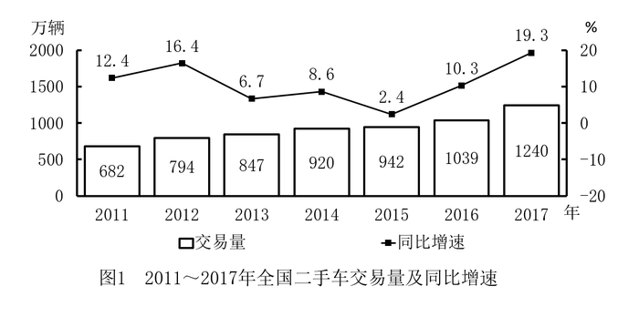

# 现期平均数（月均，'累计−当期'拆分+环比回推）

考点：[[20-考点/资料分析/平均数/现期平均数（月均，'累计−当期'拆分+环比回推）|平均数 / 现期平均数（月均，'累计−当期'拆分+环比回推）]]
材料：[[15-材料/资料分析/199340 2011～2017年全国二手车市场交|199340 2011～2017年全国二手车市场交]]

**问法模型**：题干问'2017年1～10月，平均每月……约为多少万辆'→现期月均=(全年累计1240−12月当月123−环比回推的11月量)÷10，只应扣除题目时段之外的11、12两个整月。

## 推理链
1. 第1步：题干限定2017年1～10月求'平均每月'交易量，材料时间为2017年（现期），判定为现期平均数问题，月份数n=10。
2. 第2步：文字段提取：2017年全年累计交易量1240万辆、12月当月123万辆（'环比上升'百分数在所给材料中空缺）、108万辆为2016年12月当月值（上年同期口径，本题不用）。
3. 第3步：1～10月不含11、12月，故1～10月总量=1240−123−11月量，其中11月=123÷(1+环比增速)须由环比关系回推；由官方答案A=100反推：100×10=1000万辆，11月=1240−123−1000=117万辆，对应12月环比上升约5.1%，数据链自洽。
4. 第4步：代入拆分：1～10月总量≈1240−123−117=1000万辆。
5. 第5步：月均=1000÷10=100万辆/月。
6. 第6步：与选项对照：A项100精确命中（若漏扣11月得(1240−123)÷10≈111.7会偏向B的105），故选A。

**最快解法**：⚡ '累计−当期'两刀拆分+估算：第一刀切12月（1240−123=1117），第二刀切11月（123÷1.051≈117，环比约5%，可由答案A反推验证：100×10=1000=1240−123−117），1117−117=1000，除以月数10恰得100，直选A；全程心算即可。

## 易错点
- ⚠ 累计/当期口径混淆：1240是全年累计、123是12月当月，求1～10月必须同时扣除11月和12月两个整月，只扣12月得(1240−123)÷10≈111.7→误选B。
- ⚠ 干扰数据108万辆：它是2016年12月（上年同期）当月值，属同比口径，与本题月均无关，混入算式即错。
- ⚠ 除数陷阱与数据缺口：除数应是月份数10而非12（1000÷12≈83.3会偏向C的90）；且所给材料'环比上升'百分数空缺，11月量不能直接照抄123，须按环比关系回推约117万辆。

## 母题抽象
> 🧩 当题干出现'某年1～n月平均每月……'且材料只给全年累计与末月当月值时，用'累计−末月−（末月÷(1+环比增速)回推的倒数第二月）'再除以n的拆分模型，只扣除题目时段之外的整月。

**同类特征**：'1～10月''平均每月'月均问法、现期平均数（时间与材料一致）、全年累计值与当月值混排、需剔除时段外的11、12两个整月、环比增速回推上月数据、结果单位为万辆/月

## 相关题
（暂无）

---

### 题干
2017年1～10月，平均每月全国二手车交易量约为多少万辆？

### 选项
- A. 100　✅
- B. 105
- C. 90
- D. 95

### 官方解析
根据题干“2017年1~10月，平均每月······万辆”，结合材料时间为2017年，可判定本题为现期平均数问题。定位文字材料“2017年全国二手车累计交易量为1240万辆······2017年12月，全国二手车交易量为123万辆，交易量环比上升”，可得2017年1~10月，平均每月全国二手车交易量约为，与A项最为接近。
故正确答案为A。

### 给定材料

        2017年全国二手车累计交易量为1240万辆，同比增长；二手车交易额为8092.7亿元，同比增长。2017年12月，全国二手车市场交易量为123万辆，交易量环比上升，上年同期交易量为108万辆。

> [!warning] 疑点（官方解析可能有误，待人工复核）
> 所给材料与官方解析中'12月环比上升'后的百分数均空缺（官方解析的代入公式亦缺失），11月交易量无法从给定文本直接算出；按官方答案A（100万辆）反推：1～10月总量=100×10=1000万辆，11月=1240−123−1000=117万辆，对应12月环比上升约5.1%，与答案完全自洽，官方答案本身无误，仅所给材料文本不完整。
