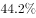
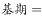
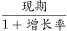
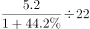

# 基期平均数计算

考点：[[20-考点/资料分析/平均数/基期平均数计算|平均数 / 基期平均数计算]]
材料：[[15-材料/资料分析/200302 2014年某区限额以上第三产业单位（|200302 2014年某区限额以上第三产业单位（]]

**问法模型**：题干问'2013年平均每家金融业单位实现收入'且限定2013年单位数与2014年相同→先用现期收入5.2亿元除以(1+44.2%)还原基期收入，再除以不变的22家

## 推理链
1. 第1步：定位表格'金融业'行，提取数据：2014年收入5.2亿元、2014年收入同比增速44.2%、单位数22家；题干设2013年单位数与2014年一样，即仍为22家
2. 第2步：基期平均数模型：2013年平均每家收入=2013年收入÷2013年单位数=[现期收入/(1+g)]÷单位数=5.2/(1+44.2%)÷22
3. 第3步：先还原基期收入：5.2/1.442≈3.6亿元（截位直除，商首位为3）
4. 第4步：再除以单位数：3.6/22≈0.164亿元（或一步计算5.2/(1.442×22)=5.2/31.7≈0.16）
5. 第5步：与选项对照：0.164与A项0.16最接近；若漏除(1+44.2%)则得5.2/22≈0.24落入B项陷阱，故选A

**最快解法**：⚡ 截位直除：直接一步5.2÷(1.442×22)=5.2÷31.7≈0.16，直除首两位即锁定A；注意分母先算1.442×22≈31.7再相除更快

## 易错点
- ⚠ 漏除(1+44.2%)，直接用现期5.2÷22≈0.24错选B——本题最大的现期/基期混淆陷阱，B项即为该错误定制
- ⚠ 两列增速口径混淆：误用2014年上半年增速30.7%代入1.307，题干问全年收入，应使用全年同比增速44.2%
- ⚠ 结果为0.1～0.2亿元量级小数，勿与文字段利润总额13.5亿元或表中交通运输收入13.5亿元等其他数据张冠李戴

## 母题抽象
> 🧩 当题干出现'基期年份+平均每家/每人…'且给定现期总量与同比增速时，用'现期值/(1+g)'还原基期总量再除以份数（份数不变则直接除现期份数），选项中'现期总量÷份数'往往是干扰项

**同类特征**：2013年（基期时间指向）、平均每家限额以上金融业单位实现收入、2013年单位数量与2014年一样（份数不变）、现期收入5.2亿元、同比增速44.2%、选项为0.1～0.7亿元量级小数、基期平均数模型

## 相关题
- [[10-真题/资料分析/平均数/1689212 基期平均数计算|1689212]]（重庆 2015，相关度2）
- [[10-真题/资料分析/平均数/13504661 基期平均数计算|13504661]]（辽宁 2025，相关度2）

---

### 题干
如2013年该区限额以上金融业单位数量与2014年一样，则该区2013年平均每家限额以上金融业单位实现收入约多少亿元？

### 选项
- A. 0.16　✅
- B. 0.24
- C. 0.39
- D. 0.65

### 官方解析

由题干“2013年平均每家限额以上金融业单位实现收入······”，结合材料所给时间为2014年，判定本题为基期平均数问题。定位表格材料，结合题干可知，2013年该区限额以上金融业单位数量也为22家，2014年实现收入5.2亿元，同比增速。根据，题目所求为：亿元，与A项最接近。

故正确答案为A。

### 给定材料

<b>根据下列统计资料回答问题</b>

        2014年某区限额以上第三产业单位共674家，实际收入1059.1亿元，同比增长；实现利润总额13.5亿元，同比增长；从业人员达到58631人，同比下降。

