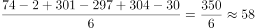
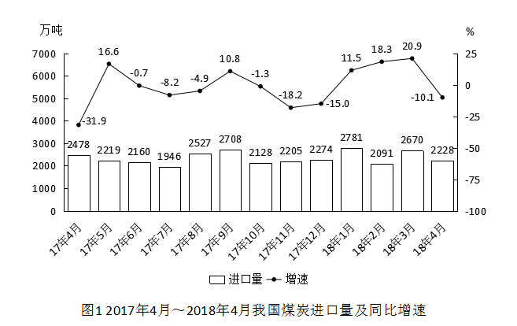

# 现期平均数（月均进口量=6个月当月值之和÷6）

考点：[[20-考点/资料分析/平均数/现期平均数（月均进口量=6个月当月值之和÷6）|平均数 / 现期平均数（月均进口量=6个月当月值之和÷6）]]
材料：[[15-材料/资料分析/210316 2017年4月～2018年4月我国煤|210316 2017年4月～2018年4月我国煤]]

**问法模型**：题干出现'2017年下半年……平均每月进口原油'→ 判定为现期平均数模型：下半年（7～12月）各月当月进口量求和后除以6，再与区间选项对照

## 推理链
1. 第1步：明确时间口径：2017年下半年=2017年7月～12月共6个月，只看图2（原油）柱状图当月进口量
2. 第2步：读图2柱状标注，7～12月原油进口量依次为3474、3398、3701、3103、3704、3370万吨
3. 第3步：套用平均数公式：平均每月进口量=（3474+3398+3701+3103+3704+3370）÷6
4. 第4步：求和得20750万吨，20750÷6≈3458.3万吨
5. 第5步：3458.3万吨落在3400～3500万吨区间内，对照选项只有C符合，故选C

**最快解法**：⚡ 削峰填谷（基准法）：以区间端点3400为基准，6个月差值为+74、-2、+301、-297、+304、-30，代数和=+350，350÷6≈+58，故平均数≈3400+58≈3458万吨，直接锁定C，避免加总6个四位数

## 易错点
- ⚠ 看串图：图1煤炭与图2原油同构、量级相近（均在2000～4000万吨），必须先确认看的是图2原油，误用煤炭数据（2128、2205、2274、2781、2091、2670）会得出约2350万吨错选A
- ⚠ 时间口径：下半年=7～12月共6个月，切勿把17年4～6月（3720、3611、3474）并入求平均，也不可漏掉12月
- ⚠ 月度值vs累计值：图中为当月进口量，直接求和÷6即可，若误当累计值再做差会得出荒谬结果；此外求平均后应与区间比较，不必精算到小数

## 母题抽象
> 🧩 当题干出现'平均每月/月均+某时期某指标'时，先锁定对应图表并数清该时期月份数（下半年=7～12月共6个月），用当月值求和÷月数；当选项为区间且数据彼此接近时，用削峰填谷：以区间端点为基准逐月作差求代数和再均摊，快速判断落在哪个区间

**同类特征**：平均每月、下半年（7～12月共6个月）、现期平均数、求和÷月份数、区间型选项（不到/在…之间/超过）、双轴图柱状读数

## 相关题
- [[10-真题/资料分析/增长/50805 现期量计算（同比增速不变预测+求月平均数）|50805]]（甘肃 2009，相关度1）
- [[10-真题/资料分析/平均数/13319360 现期平均数（总量÷份数）|13319360]]（江苏 2025，相关度1）
- [[10-真题/资料分析/平均数/13504650 现期平均数计算与多期排序比较|13504650]]（辽宁 2025，相关度1）
- [[10-真题/资料分析/平均数/18385424 现期平均数计算与比较（单价-均价=总额÷数量，跨双轴图取数）|18385424]]（浙江 2024，相关度1）
- [[10-真题/资料分析/平均数/18643712 现期平均数计算（累计值求月均）|18643712]]（天津 2026，相关度1）

---

### 题干
2017年下半年，我国平均每月进口原油：

### 选项
- A. 不到3300万吨
- B. 在3300～3400万吨之间
- C. 在3400～3500万吨之间　✅
- D. 超过3500万吨

### 官方解析

方法一：由题干“2017下半年，我国平均每月进口原油……”，可判定本题为现期平均数问题。定位图2，2017年下半年我国原油进口量即2017年7月～12月的原油进口量分别为3474、3398、3701、3103、3704、3370万吨，平均每月进口原油量=万吨，在3400～3500万吨之间。

方法二：削峰填谷，定位图2，2017年下半年我国原油进口量即2017年7月～12月的原油进口量分别为3474、3398、3701、3103、3704、3370万吨，以3400为基准，分别作差为74、-2、301、-297、304、-30，，平均数万吨，在3400～3500万吨之间。

故正确答案为C。

### 给定材料

 

