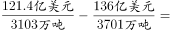
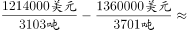

# 平均数（进口单价）两期差值比较

考点：[[20-考点/资料分析/平均数/平均数（进口单价）两期差值比较|平均数 / 平均数（进口单价）两期差值比较]]
材料：[[15-材料/资料分析/210316 2017年4月～2018年4月我国煤|210316 2017年4月～2018年4月我国煤]]

**问法模型**：题干给出两期进口金额（题干补充）+图中进口量，问'10月平均每吨进口价格较9月'变化→判定为平均数增长量问题，模型：单价=金额÷进口量，分别求9、10月单价后作差，按'上升/下降×不到/超过50美元'四象限对照选项

## 推理链
1. 第1步：定位图2（原油），提取2017年9月原油进口量3701万吨、10月3103万吨；从题干提取9月进口金额136亿美元、10月121.4亿美元（金额不在图中，属'图表+题干'拼合数据）
2. 第2步：公式：平均单价=进口金额÷进口量；单位换算：亿美元÷万吨=（金额/数量）×10^4美元/吨，即136亿美元÷3701万吨≈367美元/吨的量级
3. 第3步：9月单价=136÷3701×10^4≈367.5美元/吨
4. 第4步：10月单价=121.4÷3103×10^4≈391.2美元/吨
5. 第5步：作差：391.2-367.5≈+23.7美元/吨，方向为上升，幅度小于50美元
6. 第6步：与选项对照：'上升了不到50美元'对应A，故正确答案为A

**最快解法**：⚡ 换算+截位直除：先把口径统一为'亿美元÷万吨×10^4=美元/吨'；9月136/3701≈136/3700→约367美元/吨，10月121.4/3103≈121/3100→约391美元/吨；差约24美元，落入'上升+不到50'象限，秒选A；方向也可先粗判：金额降幅(14.6/136≈11%)<进口量降幅(598/3701≈16%)，量降得更快→单价必上升，排除C/D

## 易错点
- ⚠ 看串图：原油数据在图2，若误用图1煤炭9月2527万吨/10月2708万吨则整题报废；两图量级相近（2000~4000万吨），必须先确认图2
- ⚠ 量级换算：亿美元÷万吨结果为0.037、0.039，须×10^4才是美元/吨，若忘换算会误判差值为'不到1美元'或量级错一位
- ⚠ 方向误判：10月金额与进口量双双下降，易直觉选'下降'（C/D），实际须比较两个降幅——量降幅16%>金额降幅11%，单价反而上升；另注意本题求差值（增长量）而非增长率，勿套用g=(A/B-1)公式

## 母题抽象
> 🧩 当题干出现'平均每吨/每个…价格（单价）较上期上升/下降多少'且金额在题干、数量在图表时，用'单价=金额÷数量'分别算两期作差，先统一跨量级单位（亿美元/万吨×10^4=美元/吨），再按选项的'方向+阈值'四象限锁定答案

**同类特征**：平均每吨…进口价格、较9月（两期比较）、进口金额为题干补充数据（图中无）、亿美元与万吨跨量级换算、选项为'上升/下降×不到/…以上'四象限、需定位图2原油进口量

## 相关题
（暂无）

---

### 题干
2017年9月和10月，我国原油进口金额分别为136亿美元和121.4亿美元，10月平均每吨原油的进口价格较9月：

### 选项
- A. 上升了不到50美元　✅
- B. 上升了50美元以上
- C. 下降了不到50美元
- D. 下降了50美元以上

### 官方解析

由题干“10月平均每吨原油的进口价格较9月”，结合选项为上升/下降+单位，可判定本题为平均数的增长量问题。定位图2可知，2017年9月和10月，我国原油进口量分别为3701万吨和3103万吨；由题干可知，2017年9月和10月，我国原油进口金额分别为136亿美元和121.4亿美元。，则2017年10月平均每吨原油进口价格较9月上升了不到50美元。

故正确答案为A。

### 给定材料

 

