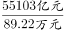
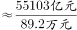
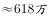

# 由人均创收额反推从业人数（收入÷人均创收桥接模型）

考点：[[20-考点/资料分析/平均数/由人均创收额反推从业人数（收入÷人均创收桥接模型）|平均数 / 由人均创收额反推从业人数（收入÷人均创收桥接模型）]]
材料：[[15-材料/资料分析/238900 2018年我国软件和信息技术服务业运|238900 2018年我国软件和信息技术服务业运]]

**问法模型**：题干问某年'从业人员人数'而材料未直接给出该数 → 用恒等式'业务收入=人均创收额×从业人数'变形为'人数=收入÷人均创收'，跨图取数计算

## 推理链
1. 第1步：定位图1，2017年完成业务收入为55103亿元；定位图2，2017年人均创收额为89.22万元；文字段仅给'从业人数比上年增加25万人'，无任何年份人数基数，必须跨图拼接
2. 第2步：由人均创收额定义可得恒等式 业务收入=人均创收额×从业人数，故 从业人数=业务收入÷人均创收额；单位换算：1亿元=10^4万元，亿元÷万元直接得到'万人'
3. 第3步：代入计算：55103亿元÷89.22万元＝55103÷89.22×10^4人≈617.6×10^4人≈618万人（截位直除：551÷89.2≈6.18）
4. 第4步：与选项对照：618与D项618完全吻合；交叉验证：用2018年数据63061亿÷98.07万元≈643万人，再减去'比上年增加25万人'得643-25=618万人，两条路径互验一致，故选D

**最快解法**：⚡ 截位直除：直接用2017年数据 55103÷89.22，截位为 551÷89.2≈6.18，还原量级即618万人；若担心量级，可先心算 89.22×600≈53532（亿元/万人口径），55103-53532=1571，1571÷89.2≈17.6，合计≈617.6≈618

## 易错点
- ⚠ 单位量级陷阱：收入是亿元、人均创收是万元，55103亿÷89.22万中1亿=10^4万，结果直接是'万人'（617.6万人），忘记换算会算出617.6或0.0618等错误量级
- ⚠ 时间口径陷阱：题干问2017年，若误用2018年的63061亿÷98.07万≈643万人作答则错；若走2018年路径必须再减'增加25万人'得618
- ⚠ 材料结构陷阱：文字段只给'从业人数比上年增加25万人'这一增量，任何年份人数都未直接给出，不能凭空设基数；图2为双轴图，柱读左轴（万元）、线读右轴（%），读89.22时勿误读成增速8.40%

## 母题抽象
> 🧩 当题干问'人数/份数'而材料只给'总量'与'人均量'时，用'总数=人均×份数'反解'份数=总数÷人均'，跨图取同一时期数据相除，并警惕亿元÷万元=万人的量级换算

**同类特征**：某年从业人员人数约为多少万人、材料未直接给出人数、人均创收额、完成业务收入、跨图拼接取数、单位：万人

## 相关题
- [[10-真题/资料分析/增长/2456363 基期量计算|2456363]]（浙江 2020，相关度1）
- [[10-真题/资料分析/增长/5408650 增长量计算（两险种合并口径：现期合计-基期合计）|5408650]]（四川 2022，相关度1）
- [[10-真题/资料分析/比重/5893794 现期比重逐年比较判断变化趋势（跨图取数）|5893794]]（国考 2024，相关度1）
- [[10-真题/资料分析/增长/2366022 增长率计算与两两比较（同比增速最接近的两期）|2366022]]（湖北 2019，相关度1）

---

### 题干
2017年，我国软件和信息技术服务业从业人员人数约为多少万人？

### 选项
- A. 701
- B. 652
- C. 633
- D. 618　✅

### 官方解析

根据问题“2017年，我国软件和信息技术服务业从业人员人数约为多少万人”，结合两个图形中的完成业务收入和人均创收额，可判断本题为现期平均数问题。定位图1，可知：2017年我国软件和信息技术服务业完成业务收入为55103亿元，定位图2，可知：2017年我国软件和信息技术服务业人均创收额89.22万元，那么2017年，我国软件和信息技术服务业从业人员人数。

故正确答案为D。

### 给定材料

        2018年，我国软件和信息技术服务业运行态势良好，收入和效益增长较快，吸纳就业人数稳定增长。2018年，全国软件和信息技术服务业规模以上企业3.78万家，累计完成软件业务收入63061亿元，软件和信息技术服务业实现利润总额8079亿元，同比增长，从业人数比上年增加25万人。

