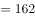

# 平均用时排序比较（缺项余量倒推）

考点：[[20-考点/资料分析/平均数/平均用时排序比较（缺项余量倒推）|平均数 / 平均用时排序比较（缺项余量倒推）]]
材料：[[15-材料/资料分析/238952 2018年国家统计局第二次全国时间利|238952 2018年国家统计局第二次全国时间利]]

**问法模型**：题干出现'每日平均用时依次减少的是'的排序问法 → 先统一单位为分钟，用'无酬劳动总平均−已知6项之和'倒推缺失的'购买商品或服务'用时，再对三项做降序排列对照选项

## 推理链
1. 第1步：定位材料第二段，无酬劳动平均用时2小时42分钟，换算为162分钟（全体48580名受访者的总体平均口径）
2. 第2步：无酬劳动7项细分中，材料直接给出6项均值：家务劳动1小时26分=86分、陪伴照料孩子生活36分、护送辅导孩子学习9分、陪伴照料成年家人8分、看病就医4分、公益活动3分；'购买商品或服务'未直接给出
3. 第3步：细分项为总体平均口径、口径一致可直接加和，6项之和=86+36+9+8+4+3=146分钟，故购买商品或服务=162−146=16分钟
4. 第4步：对选项涉及的三项降序排列：购买商品或服务16分＞护送辅导孩子学习9分＞看病就医4分
5. 第5步：对照选项，'购买商品或服务、护送辅导孩子学习、看病就医'为依次减少，与C项一致

**最快解法**：⚡ 余量倒推+直接读数：先换算162分钟，心算已知6项和146（86+36+9+8+4+3），差值162−146=16分钟即'购买商品或服务'；再读数比较16＞9＞4，秒选C，无需精确多位计算

## 易错点
- ⚠ 关键缺项陷阱：'购买商品或服务'均值材料未直接给出，须用162−146=16分钟间接推得，误以为材料缺数无从下手或凭空估数即错
- ⚠ 小时-分钟换算陷阱：'2小时42分''1小时26分'不可当小数（2.42、1.26）处理，必须先换算为162分、86分再加减
- ⚠ 排序方向与口径陷阱：'依次减少'是降序，把A/B等升序误选即错；且细分项是全体受访者总体平均，口径一致才能直接加和，若混淆参与者平均口径则162−146的倒推不成立

## 母题抽象
> 🧩 当排序题中某一分项数值材料未直接给出、但总量与其余分项均已知时，用'总量−已知分项之和'倒推缺失项，再统一单位后按要求方向（依次减少=降序）排列对照选项

**同类特征**：依次减少、排列/排序、购买商品或服务（材料未直接给值）、无酬劳动细分活动、平均用时、总量减分项倒推

## 相关题
（暂无）

---

### 题干
下列活动的排列中，受访居民每日平均用时依次减少的是

### 选项
- A. 护送辅导孩子学习、购买商品或服务、看病就医
- B. 护送辅导孩子学习、看病就医、购买商品或服务
- C. 购买商品或服务、护送辅导孩子学习、看病就医　✅
- D. 购买商品或服务、看病就医、护送辅导孩子学习

### 官方解析

由题干“······受访居民每日平均用时依次减少的是”，可判定本题为排序类问题。定位材料第一段可得：“受访居民无酬劳动平均用时2小时42分钟”，定位材料第二段可得：“无酬劳动包括家务劳动、陪伴照料孩子生活、护送辅导孩子学习、陪伴照料成年家人、购买商品或服务、看病就医和公益活动。受访居民家务劳动平均用时1小时26分钟······。受访居民陪伴照料孩子生活平均用时36分钟······；护送辅导孩子学习平均用时9分钟······；陪伴照料成年家人平均用时8分钟······；看病就医平均用时4分钟······；公益活动平均用时3分钟······”，统一时间单位为分钟，则购买商品或服务平均用时，购买商品或服务平均用时分钟，故受访居民每日平均用时依次减少的是购买商品或服务、护送辅导孩子学习、看病就医，C项符合。

故正确答案为C。

### 给定材料

        2018年国家统计局组织开展了第二次全国时间利用的随机抽样调查，共调查48580人。结果显示，受访居民在一天的活动中，有酬劳动平均用时4小时24分钟。其中，男性5小时15分钟，女性3小时35分钟；城镇居民3小时59分钟，农村居民5小时1分钟；工作日4小时50分钟，休息日3小时19分钟。受访居民有酬劳动的参与率为，其中城镇居民。受访居民无酬劳动平均用时2小时42分钟。其中，女性3小时48分钟；农村居民2小时39分钟；工作日2小时34分钟。受访居民无酬劳动的参与率为，其中男性。

        无酬劳动包括家务劳动、陪伴照料孩子生活、护送辅导孩子学习、陪伴照料成年家人、购买商品或服务、看病就医和公益活动。受访居民家务劳动平均用时1小时26分钟，参与率为。其中，女性2小时6分钟，参与率。受访居民陪伴照料孩子生活平均用时36分钟，参与率为；护送辅导孩子学习平均用时9分钟，参与率为；陪伴照料成年家人平均用时8分钟，参与率为；看病就医平均用时4分钟，参与率为；公益活动平均用时3分钟，参与率为。

> [!warning] 疑点（官方解析可能有误，待人工复核）
> 官方解析中'则购买商品或服务平均用时，购买商品或服务平均用时分钟'一句排版残缺，未印出具体算式（应为162−146=16分钟），但结论C与按材料数据推算结果一致，不影响答案
