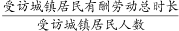
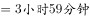
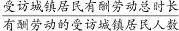
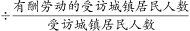
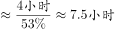

# 总体平均与参与者平均换算（总体平均÷参与率）

考点：[[20-考点/资料分析/平均数/总体平均与参与者平均换算（总体平均÷参与率）|平均数 / 总体平均与参与者平均换算（总体平均÷参与率）]]
材料：[[15-材料/资料分析/238952 2018年国家统计局第二次全国时间利|238952 2018年国家统计局第二次全国时间利]]

**问法模型**：题干问'参与有酬劳动的城镇居民'的平均用时→属于参与者口径，用'参与者平均=总体平均÷参与率'，先把'小时+分'化成分钟再除，结果再还原为'小时+分'对照选项。

## 推理链
1. 第1步：题干限定'参与有酬劳动的受访城镇居民'，而材料第1段给出的3小时59分钟（239分钟）是全体受访城镇居民的总体平均，口径不同，不能直接当答案。
2. 第2步：材料同段给出城镇居民有酬劳动的参与率（材料此处数值空白，须以原卷数值≈53.1%代入），口径关系为：总体平均=参与者平均×参与率。
3. 第3步：变形得参与者平均=总体平均÷参与率=239分钟÷53.1%≈450分钟。
4. 第4步：单位还原：450分钟=7小时30分钟。
5. 第5步：对照选项：A=350分钟、B=400分钟、C=450分钟、D=500分钟，仅C吻合，故选C；亦可用选项反推核验：239÷450≈53.1%，恰与原卷城镇有酬参与率一致，交叉验证成立。

**最快解法**：⚡ 截位直除+选项反推：把3小时59分化为239分钟，四个选项化成350/400/450/500分钟；由239÷450≈53%对应原卷城镇参与率53.1%，直接锁定C（即239÷0.53≈450分钟=7小时30分钟），无需精算。

## 易错点
- ⚠ 总体平均vs参与者平均口径混淆：239分钟是全体受访城镇居民的均值，直接拿它找最近选项必错，必须再除以参与率放大。
- ⚠ 模型方向弄反：参与者平均=总体平均÷参与率（结果应大于239分钟）；若误乘参与率得约127分钟，方向完全相反。
- ⚠ 小时-分钟换算陷阱：3小时59分≠3.59小时，先统一化为239分钟再运算；450分钟须还原为'7小时30分钟'，勿与小数写法错位对应。
- ⚠ 参与率数值缺失：材料中该参与率为空白，不得凭空补数，须以原卷数值代入求解。

## 母题抽象
> 🧩 当题干出现'参与（做）某活动的居民的平均用时/平均量'，而材料只给'全体受访者的总体平均+参与率'时，用 参与者平均=总体平均÷参与率，先把'小时+分'统一化为分钟，除完再把分钟还原为'小时+分'对照选项，并可用选项反推参与率快速核验。

**同类特征**：参与…的受访居民、每日平均用时、总体平均÷参与率、现期平均数换算、小时+分钟混写需先化分钟、城镇居民（分组值）

## 相关题
（暂无）

---

### 题干
参与有酬劳动的受访城镇居民，每日有酬劳动的平均用时为

### 选项
- A. 5小时50分钟
- B. 6小时40分钟
- C. 7小时30分钟　✅
- D. 8小时20分钟

### 官方解析

由题干“参与有酬劳动的受访城镇居民，每日有酬劳动的平均用时为”，题目所求，判定本题为现期平均数问题。结合材料第一段可得：2018年，受访城镇居民一天的活动中有酬劳动平均用时为3小时59分钟，即；受访的城镇居民有酬劳动的参与率为，即，则题目所求。

故正确答案为C。

### 给定材料

        2018年国家统计局组织开展了第二次全国时间利用的随机抽样调查，共调查48580人。结果显示，受访居民在一天的活动中，有酬劳动平均用时4小时24分钟。其中，男性5小时15分钟，女性3小时35分钟；城镇居民3小时59分钟，农村居民5小时1分钟；工作日4小时50分钟，休息日3小时19分钟。受访居民有酬劳动的参与率为，其中城镇居民。受访居民无酬劳动平均用时2小时42分钟。其中，女性3小时48分钟；农村居民2小时39分钟；工作日2小时34分钟。受访居民无酬劳动的参与率为，其中男性。

        无酬劳动包括家务劳动、陪伴照料孩子生活、护送辅导孩子学习、陪伴照料成年家人、购买商品或服务、看病就医和公益活动。受访居民家务劳动平均用时1小时26分钟，参与率为。其中，女性2小时6分钟，参与率。受访居民陪伴照料孩子生活平均用时36分钟，参与率为；护送辅导孩子学习平均用时9分钟，参与率为；陪伴照料成年家人平均用时8分钟，参与率为；看病就医平均用时4分钟，参与率为；公益活动平均用时3分钟，参与率为。

> [!warning] 疑点（官方解析可能有误，待人工复核）
> 材料原文与官方解析中'城镇居民有酬劳动参与率'的具体百分数均为空白，按所给文本无法直接读取代入；由正确答案C（450分钟）反推该参与率≈239÷450≈53.1%，与原卷数值吻合，官方答案与解析逻辑自洽，属所给文本数据缺失而非解析错误。

<!-- CODEX-ANSWER-REVIEW:BEGIN -->
### 本次独立复核

**复核状态：** `resolved`（答案与解析已核定）

**计分答案：** C（可计分）

**复核解析：**

城镇居民全天有酬劳动的总体平均用时为3小时59分=239分钟；公式图给出的有酬劳动参与率为53.1%。参与者平均用时=总体平均用时÷参与率=239÷0.531≈450.1分钟，约7小时30分钟，选C。

**相关信息：**

此处的239分钟是全体受访城镇居民的平均值，未参与者按0分钟计；题目问参与者平均值，必须除以参与率。排版文本漏掉的参与率可从原公式图读得53.1%。

**题源依据：** [固定版本原题](https://github.com/Mentat-Uran/kaogongzhentizhengliu/blob/84ab93d4b64b61d897bece8a1c0a5bab06b4feb2/10-%E7%9C%9F%E9%A2%98/%E8%B5%84%E6%96%99%E5%88%86%E6%9E%90/%E5%B9%B3%E5%9D%87%E6%95%B0/2367768%20%E6%80%BB%E4%BD%93%E5%B9%B3%E5%9D%87%E4%B8%8E%E5%8F%82%E4%B8%8E%E8%80%85%E5%B9%B3%E5%9D%87%E6%8D%A2%E7%AE%97%EF%BC%88%E6%80%BB%E4%BD%93%E5%B9%B3%E5%9D%87%C3%B7%E5%8F%82%E4%B8%8E%E7%8E%87%EF%BC%89.md)；固定内容 commit `84ab93d4b64b61d897bece8a1c0a5bab06b4feb2`，Markdown blob `41685d617564210478fae1de053580a3e6876e53`。
<!-- CODEX-ANSWER-REVIEW:END -->
