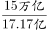
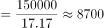

# 现期平均数（销售均价=销售额÷销售面积，跨口径单位换算）

考点：[[20-考点/资料分析/平均数/现期平均数（销售均价=销售额÷销售面积，跨口径单位换算）|平均数 / 现期平均数（销售均价=销售额÷销售面积，跨口径单位换算）]]
材料：[[15-材料/资料分析/239312 2018年我国宏观经济运行情况：GD|239312 2018年我国宏观经济运行情况：GD]]

**问法模型**：题干求'2018年商品房销售均价约为'→现期平均数模型：均价=现期销售总额÷现期销售总面积，核心在万亿元与亿平方米之间的量级换算

## 推理链
1. 第1步：由题干'2018年…销售均价'结合材料时间为2018年，判定为现期平均数，无需做基期转换
2. 第2步：定位文字材料第3段（房地产段），提取2018年全国商品房销售面积17.17亿平方米、销售额约15万亿元
3. 第3步：统一量级：15万亿元=15×10^8万元，17.17亿平方米=17.17×10^8平方米，两者10^8相消，均价=15/17.17万元/平方米
4. 第4步：截位直除15÷17.17≈0.87万元/平方米，换算为约8700元/平方米
5. 第5步：与选项对照：A项8700元/平方米吻合，B/C/D（9700/6700/5700）均差约1000元以上的量级，排除

**最快解法**：⚡ 量级换算+截位直除：将15万亿元写为15×10^8万元、17.17亿平方米写为17.17×10^8平方米，10^8约掉后只需算15÷17.17≈0.87（万元/平方米），0.87万元=8700元，直接锁定A；考场可先心算15/17≈0.88锁定8700~8800量级即可排除B/C/D

## 易错点
- ⚠ 万亿元与亿平方米相除的量级换算：错将15万亿当作15×10^8元或17.17亿当作17.17×10^4，导致结果差10^4/10^2倍，恰好误选B或C
- ⚠ 四个选项8700/9700/6700/5700数值接近、仅千位不同，比值15/17.17≈0.87算错一位即选错，须先固定'0.87万元/平方米'再换元
- ⚠ 误用第3段的房地产开发投资12.03万亿元作分子（投资额≠销售额），或以为文字段增速空缺（'增长'后数字缺失）无法做题而放弃——本题为现期平均数，只需现期总量与份数，与增速无关

## 母题抽象
> 🧩 当题干出现'均价/单价/每单位产值'且材料只给现期总量与总份数时，用现期平均数=总量÷份数，先做万亿元↔亿元↔万元的量级对齐（借10^8约分），再截位直除验证首位商并比对选项量级

**同类特征**：'2018年……销售均价约为'、现期平均数问法（无基期字样）、分子为销售额约15万亿元、分母为销售面积17.17亿平方米、单位元/平方米（万元→元换算）、选项千位差异、量级敏感

## 相关题
（暂无）

---

### 题干
2018年我国商品房销售均价约为：

### 选项
- A. 8700元/平方米　✅
- B. 9700元/平方米
- C. 6700元/平方米
- D. 5700元/平方米

### 官方解析

根据题干所求“2018年······销售均价约为”，结合材料时间为2018年，可判定此题为现期平均数问题。定位文字材料第4段可得，2018年全国商品房销售面积为17.17亿平方米，销售额约15万亿元，则销售均价约为元/平方米。

故正确答案为A。

### 给定材料

根据以下资料，回答下列问题。 

        初步核算，2018年我国国内生产总值90.03万亿元，按可比价格计算，比上年增长，实现了左右的预期发展目标。分产业看，第一产业增加值6.47万亿元，比上年增长；第二产业增加值36.60万亿元，增长；第三产业增加值46.96万亿元，增长。

        其中，全国建筑业总产值23.51万亿元，同比增长；全国建筑业房屋建筑施工面积140.9亿平方米，同比增长。

        2018年全国固定资产投资（不含农户）63.56万亿元，比上年增长，增速比前三季度加快0.5个百分点。其中，民间投资39.41万亿元，增长，比上年加快2.7个百分点。分产业看，第一产业投资增长，比上年加快1.1个百分点；第二产业投资增长，加快3.0个百分点，其中制造业投资增长，加快4.7个百分点；第三产业投资增长，其中基础设施投资增长。

        此外，2018年全国房地产开发投资12.03万亿元，比上年增长。全国商品房销售面积17.17亿平方米，增长，其中住宅销售面积增长。全国商品房销售额约15万亿元，增长，其中住宅销售额增长。

