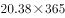
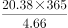
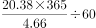
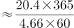

# 现期平均数计算（跨段落拼合：年总时长÷年人均册数）

考点：[[20-考点/资料分析/平均数/现期平均数计算（跨段落拼合：年总时长÷年人均册数）|平均数 / 现期平均数计算（跨段落拼合：年总时长÷年人均册数）]]
材料：[[15-材料/资料分析/239327 2017年我国成年国民阅读情况：传统|239327 2017年我国成年国民阅读情况：传统]]

**问法模型**：题干出现'平均阅读一本图书需要'的问法特征 → 采用平均数模型：阅读一本所需时间=全年总时长÷年人均阅读册数，并完成'分钟/天→分钟/年→小时'的单位换算

## 推理链
1. 第1步：题干要求2017年读一本纸质图书平均所需时间，属现期平均数：所需时间=总时间÷书的数量
2. 第2步：从文字段3提取2017年人均每天读纸质图书20.38分钟；从统计表提取2017年人均纸质图书阅读量4.66本
3. 第3步：全年阅读纸质图书总时长=20.38×365=7438.7分钟
4. 第4步：每本所需时间=7438.7÷4.66≈1596.3分钟
5. 第5步：单位换算1596.3÷60≈26.6小时
6. 第6步：与选项对照，26.6小时对应D，故选D

**最快解法**：⚡ 截位直除+量级估算：20.38×365≈20×365≈7300余，7300余÷4.66≈1590余分钟；1590÷60≈26.5小时偏大→实际约26.6小时，锁定D；若算出20余小时量级（如20.8/22.3）说明分子或年化步骤出错

## 易错点
- ⚠ 漏做年化换算：直接用20.38÷4.66≈4.4分钟/本，量级荒谬却可能被选项误导
- ⚠ 分钟→小时漏除60：把约1596分钟当成小时级别或忘记÷60，误选A或B量级
- ⚠ 单位口径：分母必须是2017年纸质图书4.66'本'，勿误用报纸33.62份、电子图书3.12册等表格其他行；本题与文字段阅读率/接触率无关，勿被空缺的阅读率数值干扰

## 母题抽象
> 🧩 当题干出现'平均每本/每件/每人所耗时间'特征时，用'每天量×365=年总量，再÷年对应总量'求每单位耗时，最后必须把分钟÷60换成小时，验证结果量级与选项单位一致

**同类特征**：平均一本图书、平均需要（时间）、选项以小时计、每天时长×365天、年人均阅读量作分母、现期平均数

## 相关题
- [[10-真题/资料分析/平均数/13319360 现期平均数（总量÷份数）|13319360]]（江苏 2025，相关度1）
- [[10-真题/资料分析/平均数/13504650 现期平均数计算与多期排序比较|13504650]]（辽宁 2025，相关度1）
- [[10-真题/资料分析/平均数/18385424 现期平均数计算与比较（单价-均价=总额÷数量，跨双轴图取数）|18385424]]（浙江 2024，相关度1）
- [[10-真题/资料分析/平均数/18643712 现期平均数计算（累计值求月均）|18643712]]（天津 2026，相关度1）
- [[10-真题/资料分析/平均数/18643737 现期平均数比较（平均每船次进口量与固定值8万吨比较计数）|18643737]]（天津 2026，相关度1）

---

### 题干
2017年我国成年国民阅读一本纸质图书平均需要：

### 选项
- A. 20.8小时
- B. 22.3小时
- C. 24.1小时
- D. 26.6小时　✅

### 官方解析

由题干“2017年我国成年国民阅读一本纸质图书平均需要”，可判定本题为现期平均数计算。阅读一本纸质图书平均需要的时间=总时间÷书的数量。定位文字材料第三段可知，2017年我国成年国民每天阅读纸质图书为20.38分钟，则全年阅读纸质图书的总时间为；定位表格，2017年成年国民纸质图书人均阅读量为4.66（本）。因此，阅读一本书平均需要分钟，即 小时。

故正确答案为D。

### 给定材料

        2017年我国成年国民图书阅读率为，比上年增加0.3个百分点；报纸阅读率为，比上年降低2.1个百分点；期刊阅读率为，比上年增加1个百分点。 

        2017年我国成年国民数字化阅读方式(网络在线阅读、手机阅读、电子阅读器阅读、平板电脑阅读等)的接触率为。其中，网络在线阅读接触率为，比上年增加4.4个百分点；手机阅读接触率为，比上年增加4.9个百分点；电子阅读器阅读接触率为，比上年增加6.5个百分点；平板电脑阅读接触率为，比上年增加2.2个百分点。

        传统纸质媒介中，2017年我国成年国民人均每天阅读纸质图书时长为20.38分钟，人均每天阅读报纸时长为12.00分钟，人均每天阅读期刊时长为6.88分钟。

