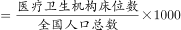
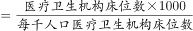
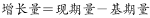
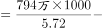
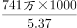
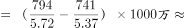
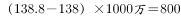

# 平均数反推总量（每千人口床位数→人口总数）再求增长量

考点：[[20-考点/资料分析/平均数/平均数反推总量（每千人口床位数→人口总数）再求增长量|平均数 / 平均数反推总量（每千人口床位数→人口总数）再求增长量]]
材料：[[15-材料/资料分析/239338 全国医疗卫生机构床位：2017年末总|239338 全国医疗卫生机构床位：2017年末总]]

**问法模型**：题干给出两年'每千人口床位数'且床位总量两年均可知，问人口总数增加量最接近多少 → 平均数反推总量模型：人口=床位数÷每千人口床位数×1000，两期分别反推后作差

## 推理链
1. 第1步：从文字提取：2017年末全国床位794.0万张，每千人口床位数2016年为5.37张、2017年为5.72张；从图形提取：2016年末床位741万张（可用794.0-53.0=741万张交叉验证）
2. 第2步：由'每千人口床位数=床位数÷人口×1000'反推：人口总数（万人）=床位（万张）×1000÷每千人口床位数
3. 第3步：2017年末人口=794.0×1000÷5.72≈138811万人≈13.88亿人
4. 第4步：2016年末人口=741×1000÷5.37≈137989万人≈13.80亿人
5. 第5步：人口增加量≈138811-137989=822万，与B项822万最接近，故选B

**最快解法**：⚡ 公式法+截位直除：人口（万人）=床位（万张）×1000÷每千人口床位数；794×1000÷5.72≈13.88亿，741×1000÷5.37≈13.80亿，两期差约0.82亿×1%量级即约822万人，直接锁定B

## 易错点
- ⚠ 量级陷阱：除以'每千人口'床位数后得到的是'千人'数，需×1000换回人数（或按'万张×1000÷每千人口=万人'处理），漏乘1000会差千倍
- ⚠ 跨源配对：2016年床位741万张只能从图（或794.0-53.0）取得，且5.37对应2016、5.72对应2017，两期'每千人口'数不能交叉配对
- ⚠ 不能用53.0万张床位增量直接折算人口增量：两期每千人口床位数不同（5.37→5.72），必须分别反推两期人口再作差，'增加'这里是2017比2016的当期口径

## 母题抽象
> 🧩 当题干出现'每千人口（人均）拥有量+总量已知，反求分母（人口）及其增加量'时，用'分母=总量÷每千人口拥有量×1000'分别反推两期，再相减，务必核对万/千量级换算与两期平均数的对应年份

**同类特征**：每千人口医疗卫生机构床位数、人口总数增加量最接近、2017年末比2016年末、平均数反推总量、跨文字与图拼接取数、选项带'万'量级单位

## 相关题
（暂无）

---

### 题干
从所给数据资料中可以推算，2017年末全国人口总数比2016年末增加量最接近：

### 选项
- A. 741万
- B. 822万　✅
- C. 895万
- D. 938万

### 官方解析

根据题干“······增加量最接近”，结合选项带单位，可判定本题为增长量计算问题。定位文字材料可得：2017年末，全国医疗卫生机构床位794.0万张，每千人口医疗卫生机构床位数由2016年5.37张增加到2017年5.72张。定位图形材料可得：2016年末，全国医疗卫生机构床位741万张。根据公式：每千人口医疗卫生机构床位数可得，全国人口总数。根据公式：，2017年末全国人口总数比2016年末增加量万，与B项最接近。

故正确答案为B。

### 给定材料

根据以下资料，回答下列问题。

        2017年末，全国医疗卫生机构床位794.0万张，其中：医院612.0万张（占），基层医疗卫生机构152.9万张（占）。医院中，公立医院床位占，民营医院床位占。与上年比较，床位增加53.0万张，其中：医院床位增加43.1万张，基层医疗卫生机构床位增加8.7万张。每千人口医疗卫生机构床位数由2016年5.37张增加到2017年5.72张。

