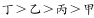
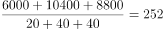
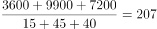

# 现期平均数比较（劳动生产率=人均产量排序）

考点：[[20-考点/资料分析/平均数/现期平均数比较（劳动生产率=人均产量排序）|平均数 / 现期平均数比较（劳动生产率=人均产量排序）]]
材料：[[15-材料/资料分析/239366 某机械加工企业甲、乙、丙、丁四个车间|239366 某机械加工企业甲、乙、丙、丁四个车间]]

**问法模型**：题干问'车间劳动生产率从高到低依次排列正确的是'→ 对四个车间分别计算人均产量（总产量÷总人数）后按大小排序，与选项排列对照。

## 推理链
1. 第1步：由文字材料'以人均产量评价劳动生产率'确认模型：劳动生产率=产量÷人数；表格给出各车间高级/中级/初级三级的人数与件数。
2. 第2步：先加总各车间人数：甲20+50+30=100人，乙20+40+40=100人，丙15+45+40=100人，丁25+25+50=100人，四车间总人数均为100人，故车间人均产量=总产量÷100。
3. 第3步：横行加总各车间总产量：甲5600+12500+6000=24100件，乙6000+10400+8800=25200件，丙3600+9900+7200=20700件，丁6000+5000+9500=20500件。
4. 第4步：代入计算劳动生产率：甲24100÷100=241件/人，乙25200÷100=252件/人，丙20700÷100=207件/人，丁20500÷100=205件/人。
5. 第5步：比较大小：252(乙)>241(甲)>207(丙)>205(丁)，注意丙与丁仅差2件/人（总产量差200件），须精确区分。
6. 第6步：排序为乙、甲、丙、丁，对照选项，B项即'乙甲丙丁'，与官方答案B一致。

**最快解法**：⚡ 利用'四车间总人数均为100人'的命题规律：车间劳动生产率=总产量÷100，即总产量直接去两个零（24100→241、25200→252、20700→207、20500→205），四个加法口算完成后直接比大小得乙甲丙丁，无需任何除法。

## 易错点
- ⚠ 表中产量是各等级工人的合计产量而非人均，直接拿产量数字（或拿单等级产量）当劳动生产率比较会全错，必须先加总再除以人数。
- ⚠ 斜线三重表头易串行串列：乙车间高级工（20人/6000件）与丁车间高级工（25人/6000件）产量相同、人数不同，跨列读取时易混淆串数据。
- ⚠ 丙与丁人均产量仅差2件/人（207与205），总产量差200件，加总时漏加某一等级或口算失误即会排错丙丁顺序。

## 母题抽象
> 🧩 当题干出现'劳动生产率/人均产量从高到低排序'特征时，先核查各比较对象总人数是否相同；若均为100人，则人均=总量÷100，只需横行加总总量、去两个零后直接比大小，再对照选项排列验证。

**同类特征**：从高到低依次排列、车间劳动生产率、人均产量、四个车间整体比较、现期平均数排序、加总后相除

## 相关题
- [[10-真题/资料分析/平均数/2377059 现期平均数比较（劳动生产率=产量÷人数，子群体人均产量最大值比较）|2377059]]（选调 2019，相关度1）

---

### 题干
车间劳动生产率从高到低依次排列正确的是：

### 选项
- A. 

- B. 

　✅
- C. 

- D. 

### 官方解析

根据题干“劳动生产率从高到低排序正确的是”，结合文字材料“以人均产量评价劳动生产率”可判定本题为现期平均数比较问题。，定位表格可得，

甲：；乙：；

丙：；丁：。

则车间劳动生产率从高到低排序为：乙甲丙丁。

故正确答案为B。

### 给定材料

根据以下资料，回答下列问题。

        某机械加工企业下设四个生产车间生产加工同种类型和型号的产品，并以人均产量评价劳动生产率。

