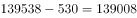
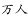
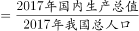
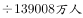
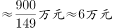

# 基期平均数计算（人均GDP=GDP÷人口，基期需倒推）

考点：[[20-考点/资料分析/平均数/基期平均数计算（人均GDP=GDP÷人口，基期需倒推）|平均数 / 基期平均数计算（人均GDP=GDP÷人口，基期需倒推）]]
材料：[[15-材料/资料分析/240291 2018年我国国民经济和社会发展主要|240291 2018年我国国民经济和社会发展主要]]

**问法模型**：题干出现'基期年份（2017年）+人均指标+约为'→基期平均数模型：2017年人均GDP=2018年GDP÷(1+增速)÷2017年人口（人口按'现期-增量'倒推），换算成万元后对照选项。

## 推理链
1. 第1步：题干问'2017年人均国内生产总值'，早于材料现期2018年，判定为基期平均数计算，须先还原2017年GDP与2017年人口。
2. 第2步：取数：2018年GDP=900309亿元（本版增速留白，硬算须以原卷增速代入，不得凭空编数）；2018年总人口139538万人、比上年增加530万人。
3. 第3步：倒推基期分母：2017年总人口=139538-530=139008万人=13.9008亿人。
4. 第4步：套公式：2017年人均GDP=900309÷(1+增速)÷13.9008，'亿元÷亿人=元/人'，再÷10^4换算为'万元'档。
5. 第5步：代入原卷增速后结果落在6万元档；即使增速留白也可用上界锁定：2017年GDP必小于900309亿元，故人均<900309÷13.9008≈6.48万元。
6. 第6步：对照选项：B(6.5万)、C(7万)、D(7.5万)均超过上界6.48万元被排除，唯一可行且最接近的是A（6万元）。

**最快解法**：⚡ 上界排除法+截位直除：先由'基期GDP<现期GDP'得上界900309÷13.9008亿人≈6.48万元，一步排除B/C/D锁定A；常规路径为基期公式900309÷(1+增速)÷13.9008，截位直除约6.1万元（增速以原卷数值代入）。

## 易错点
- ⚠ 分母年份用错：误用2018年人口139538万人，正确须倒推2017年人口139538-530=139008万人。
- ⚠ 指标混淆：'人均可支配收入28228元'≠'人均GDP'，两者数值口径完全不同，分子绝不能取错。
- ⚠ 单位量级：'亿元÷亿人=元/人'，而选项是'万元'档，忘÷10^4会差一万倍；且本版全部增速留白，依赖增速的硬算须以原卷完整数据为准。

## 母题抽象
> 🧩 当题干出现'基期年份+人均/平均…约为'特征时，用基期平均数模型：现期总量÷(1+增速)÷基期分母（分母按'现期±增量'倒推），先统一亿元/亿人/万元量级再截位直除；若增速缺失，可用'基期值≤现期值'构造量级上界直接排除选项。

**同类特征**：基期年份（2017年）+人均指标、选项为'万元'量级估算档、人口'比上年增加'需倒推基期人口、现期GDP总量已知、'约'字提示估算

## 相关题
- [[10-真题/资料分析/增长/5802085 增长量计算（现期与同比增速求增长量）|5802085]]（浙江 2023，相关度1）
- [[10-真题/资料分析/比重/5509772 基期比重比较（同一总量的两个基期占比作差）|5509772]]（四川 2023，相关度1）

---

### 题干
2017年我国人均国内生产总值约为（    ）。

### 选项
- A. 6万元　✅
- B. 6.5万元
- C. 7万元
- D. 7.5万元

### 官方解析

根据题干“2017年我国人均···约为”，结合材料时间为2018年，可判定本题为基期平均数计算问题。定位文字材料第一段，2018年我国国内生产总值900309亿元，比上年增长；2018年我国总人口139538万人，比上年增加530万人。可得，2017年我国总人口为。则2017年我国人均国内生产总值。

故正确答案为A。

### 给定材料

        2018年我国国内生产总值900309亿元，比上年增长，全国居民人均可支配收入28228元，比上年增长，全国居民恩格尔系数为。2018年我国总人口139538万人，比上年增加530万人，其中城镇常住人口83137万人，全年出生人口1523万人，死亡人口993万人。

        2018年我国货物进出口总额305050亿元，比上年增长。其中，出口164177亿元，增长；进口140873亿元，增长。货物进出口顺差23304亿元，比上年减少5217亿元。对“一带一路”沿线国家进出口总额83657亿元，比上年增长。其中，出口46478亿元，增长；进口37179亿元，增长。

        2018年社会消费品零售总额380987亿元，比上年增长。全年实物商品网上零售额70198亿元，比上年增长。按经营地统计，城镇消费品零售额325637亿元，增长；乡村消费品零售额55350亿元，增长。按消费类型统计，商品零售额338271亿元，增长；餐饮收入额42716亿元，增长。

注释：

> [!warning] 疑点（官方解析可能有误，待人工复核）
> 本版材料中2018年GDP增速及官方解析公式中的关键数值均留白，仅凭本版材料无法硬算出'约6万元'的完整过程，结论依赖原卷完整增速数据；但用上界法（900309÷13.9008≈6.48万元）仍可唯一锁定A，与官方答案一致，无实质冲突。

<!-- CODEX-ANSWER-REVIEW:BEGIN -->
### 本次独立复核

**复核状态：** `resolved`（答案与解析已核定）

**计分答案：** A（可计分）

**复核解析：**

2018 GDP 900309亿元、同比增6.6%；2018人口139538万人、比上年增加530万人，2017人口139008万人。2017人均GDP=(900309/1.066)/139008×10000≈6055元，即约6万元，选A。

**相关信息：**

GDP与人口分别还原到2017年；亿元/万人换算为元/人乘10000。

**题源依据：** [固定版本原题](https://github.com/Mentat-Uran/kaogongzhentizhengliu/blob/84ab93d4b64b61d897bece8a1c0a5bab06b4feb2/10-%E7%9C%9F%E9%A2%98/%E8%B5%84%E6%96%99%E5%88%86%E6%9E%90/%E5%B9%B3%E5%9D%87%E6%95%B0/2393997%20%E5%9F%BA%E6%9C%9F%E5%B9%B3%E5%9D%87%E6%95%B0%E8%AE%A1%E7%AE%97%EF%BC%88%E4%BA%BA%E5%9D%87GDP%3DGDP%C3%B7%E4%BA%BA%E5%8F%A3%EF%BC%8C%E5%9F%BA%E6%9C%9F%E9%9C%80%E5%80%92%E6%8E%A8%EF%BC%89.md)；固定内容 commit `84ab93d4b64b61d897bece8a1c0a5bab06b4feb2`，Markdown blob `11f3cf21503c73884fbfcc3f85314e4786345219`。
<!-- CODEX-ANSWER-REVIEW:END -->
