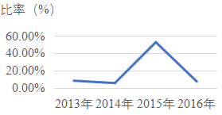
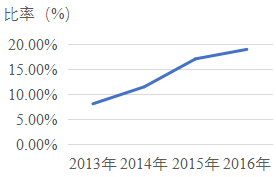
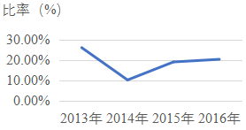
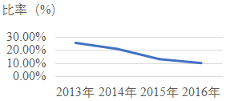

# 平均数增长率（人均第一产业总产值增长率变化趋势判断，跨表求比值）

考点：[[20-考点/资料分析/平均数/平均数增长率（人均第一产业总产值增长率变化趋势判断，跨表求比值）|平均数 / 平均数增长率（人均第一产业总产值增长率变化趋势判断，跨表求比值）]]
材料：[[15-材料/资料分析/241026 2012—2016年我国乡村人口与乡|241026 2012—2016年我国乡村人口与乡]]

**问法模型**：题干问'2013年至2016年人均第一产业总产值增长率的变化趋势'→ 先用表二总产值÷表一乡村从业人员数逐年求人均值（亿元÷万人=万元/人），再逐年求增长率，锁定峰值年份与趋势形状，与选项图形匹配。

## 推理链
1. 第1步：定位表一，乡村从业人员数2012—2016年为53858、54013、54026、37041、36175万人（注意2013年基期需取2012年数据）；定位表二，第一产业总产值同期为89453、96995、102226、107056、112091亿元
2. 第2步：人均第一产业总产值=第一产业总产值÷乡村从业人员数（亿元÷万人=万元/人）；增长率=（现期人均值-基期人均值）÷基期人均值
3. 第3步：逐年代入计算，人均值约为2012年1.66、2013年1.80、2014年1.89、2015年2.89、2016年3.10万元/人；对应增长率约为2013年+8.1%、2014年+5.4%、2015年+52.7%、2016年+7.2%
4. 第4步：增长率在2015年出现跳升达峰值约53%，其余年份均为个位数小幅波动（8%→5%→53%→7%），四个选项中只有A项图形峰值落在2015年，故选A

**最快解法**：⚡ 定性观察法（分子分母反向变动）：2015年从业人员由54026骤降至37041（约降31%），而总产值由102226升至107056（约升4.7%），分子升分母降，人均值及其增长率必为2013—2016年中最大；其余年份分子分母同向小幅变动、增长率温和，无需精算各年数值，直接选峰值在2015年的A项。

## 易错点
- ⚠ 基期取数：题干问2013年起的变化趋势，2013年增长率需用2012年人均值作基期，漏取2012年数据会导致少算一年
- ⚠ 统计断点误判：2015年从业人员54026→37041的断崖下降是口径调整所致，会自然推出2015年增长率异常高达约53%，切勿当成计算错误予以排除或平均化处理
- ⚠ 图形匹配陷阱：2016年人均值最高（3.10万元/人）易被误当作增长率最大年份，需区分'人均值最大'与'增长率最大'，本题峰值增长在2015年而非2016年

## 母题抽象
> 🧩 当题干出现'人均××（总量÷人数）增长率的变化趋势/最大年份'特征时，用'分子分母相对变动'定性法：分子升而分母骤降的年份即人均增长率峰值年份，先锁定该年份再匹配选项图形，可免除逐年精算。

**同类特征**：人均第一产业总产值、增长率的变化趋势、跨表（表一+表二）求比值、2013年至2016年、选项为折线/趋势图、平均数增长率

## 相关题
- [[10-真题/资料分析/平均数/10204497 平均数增长率（均价=值-量的比值增长率）|10204497]]（海南 2024，相关度1）
- [[10-真题/资料分析/平均数/4737828 平均数增长率|4737828]]（福建 2017，相关度1）
- [[10-真题/资料分析/平均数/1746788 两期平均数增长率（户均注册资本的同比增长率）|1746788]]（国考 2016，相关度1）
- [[10-真题/资料分析/平均数/1752640 平均数增长率（人均收入增长率）|1752640]]（北京 2016，相关度1）
- [[10-真题/资料分析/平均数/19452625 平均数增长率（两期平均数之比）|19452625]]（上海 2026，相关度1）

---

### 题干
2013年至2016年我国乡村从业人员人均第一产业总产值增长率的变化趋势为：

### 选项
- A. 

　✅
- B. 

- C. 

- D. 

### 官方解析
根据题干“2013年至2016年······人均第一产业总产值增长率的变化趋势为”，可判定本题为平均数的增长率。定位表一，2012年至2016年我国乡村从业人员数分别为：53858、54013、54026、37041、36175万人，定位表二，2012年至2016年的第一产业总产值分别为：89453、96995、102226、107056、112091亿元。
方法一：则2012年我国乡村从业人员人均第一产业总产值为万元/人；2013年为万元/人；2014年为万元/人；2015年为万元/人；2016年为万元/人。根据，则2013年我国乡村从业人员人均第一产业总产值增长率；2014年为；2015年为；2016年为。明显最大的为2015年，观察选项，增长率最大为2015年的只有A项。
方法二：观察表一和表二可知，我国乡村从业人员数从2014年的54026万人突然下降到2015年的37041万人，而我国第一产业总产值从2014年的102226亿元反而上升到2015年的107056亿元，而2016年无论是乡村从业人员数还是第一产业总产值相对于2015年都没有较大变化，2013年与2014年也是与此类似，故2015年我国乡村从业人员人均第一产业总产值增长率应该是2013年至2016年中最大的，满足其最大的只有A项。
故正确答案为A。

### 给定材料

