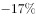
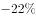

# 平均数增长率（由单价增速与面积增速合成土地成交额增速）

考点：[[20-考点/资料分析/平均数/平均数增长率（由单价增速与面积增速合成土地成交额增速）|平均数 / 平均数增长率（由单价增速与面积增速合成土地成交额增速）]]
材料：[[15-材料/资料分析/246300 2019年1-8月全国房地产开发投资|246300 2019年1-8月全国房地产开发投资]]

**问法模型**：题干问'土地成交额与去年同期相比增长约'且选项为百分数，而材料只给'购置面积同比下降（b）'与'每平方米土地价格同比上涨（r）'→用平均数增长率关系式反解总量增速：成交额增速=(1+r)×(1+b)-1。

## 推理链
1. 第1步：定位材料第三段，提取三个量：土地购置面积12236万平方米（同比下降，图中读得b=-25.6%）、每平方米土地价格同比上涨（图中读得r=+13.9%）、土地成交额现期6374亿元（增速未直接给出）。
2. 第2步：单价=成交额÷购置面积为平均数，由平均数增长率公式 r=(g额-g面积)/(1+g面积) 反解得 g额=(1+r)×(1+b)-1。
3. 第3步：代入计算：g额=(1+13.9%)×(1-25.6%)-1=1.139×0.744-1≈0.847-1≈-15.3%。
4. 第4步：校验易错路径：若将两增速简单相加得13.9%-25.6%=-11.7%，漏掉乘积修正项13.9%×25.6%≈3.6%，正确值应为-11.7%-3.6%≈-15.3%。
5. 第5步：与选项对照：-15.3%最接近约-15%，与官方答案B吻合，故选B。

**最快解法**：⚡ 公式法（合成增速）：直接背'总额增速=(1+单价增速)×(1+面积增速)-1'，1.139×0.744≈1.14×0.74≈0.84，即约-15%~-15.5%，锁定B；等价速算：先简单相加得-11.7%，再减去乘积修正项约3.6%，得约-15.3%。

## 易错点
- ⚠ 面积增速为负值，代入公式漏掉负号会得到(1+13.9%)×(1+25.6%)-1≈43%的荒谬结果；
- ⚠ 把两增速直接相加得约-11.7%，漏乘积修正项(约3.6个百分点)，易错选-12%附近选项；
- ⚠ '每平方米土地价格同比上涨'是平均数（单价）增速而非成交额增速，'土地成交额6374亿元'是现期值、材料未给其增速，不能将6374亿元误作基期或增速使用；'回落/加快X个百分点'是增速期际变化，本题不涉及但勿误代入。

## 母题抽象
> 🧩 当题目求'总量（成交额）增速'而材料只给'份数（面积）负增速b'与'平均数（单价）正增速r'时，用g总=(1+r)×(1+b)-1带符号合成，切勿两增速简单相加（差一个乘积修正项r×b≈3~4个百分点）。

**同类特征**：与去年同期相比增长约、土地成交额、每平方米土地价格同比上涨、土地购置面积同比下降、选项为百分数、平均数增长率反解总量增速

## 相关题
- [[10-真题/资料分析/增长/9629 一般增长率计算（现期需由增量倒推）|9629]]（安徽 2009，相关度1）
- [[10-真题/资料分析/比重/2604234 现期比重计算|2604234]]（广东 2020，相关度1）
- [[10-真题/资料分析/增长/27835 一般增长率计算（已知现期量与增长量求增长率）|27835]]（河北 2012，相关度1）
- [[10-真题/资料分析/平均数/10204497 平均数增长率（均价=值-量的比值增长率）|10204497]]（海南 2024，相关度1）
- [[10-真题/资料分析/增长/12536395 隔年（间隔）增长率|12536395]]（四川 2024，相关度1）

---

### 题干
2019年1-8月，房地产开发企业土地成交额与去年同期相比增长约：

### 选项
- A. 

- B. 

　✅
- C. 

- D. 

### 官方解析

根据题干“2019年1-8月，······与去年同期相比增长约”，结合选项是百分数，且每平方米土地价格，可判定本题为平均数的增长率问题。定位文字资料第三段可知，2019年1-8月，房地产开发企业土地购置面积同比下降（b），每平方米土地价格同比上涨（r）。根据平均数增长率公式：，房地产开发企业土地成交额增速为，代入公式得：，则。

故正确答案为B。

### 给定材料

        2019年1-8月，全国房地产开发投资84589亿元，同比增长，增速比1-7月回落0.1个百分点。其中，住宅投资65187亿元，增长，增速回落0.2个百分点。

        1-8月，东部地区房地产开发投资44857亿元，同比增长，增速比1-7月回落0.4个百分点；中部地区投资17809亿元，增长，增速加快0.3个百分点；西部地区投资18506亿元，增长，增速加快0.9个百分点；东北地区投资3418亿元，增长，增速回落1.3个百分点。

        1-8月，房地产开发企业土地购置面积12236万平方米，同比下降，每平方米土地价格同比上涨，土地成交额6374亿元。

        1-8月，东部地区商品房销售面积40303万平方米，同比下降，降幅比1-7月收窄0.6个百分点；销售额50739亿元，增长，增速加快0.3个百分点。中部地区商品房销售面积28791万平方米，增长，1-7月为下降；销售额20682亿元，增长，增速加快0.7个百分点。西部地区商品房销售面积28284万平方米，增长，增速加快1.0个百分点；销售额20363亿元，增长，增速加快0.6个百分点。东北地区商品房销售面积4471万平方米，下降，降幅收窄1.2个百分点；销售额3589亿元，增长，增速加快1.8个百分点。

