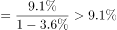
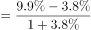
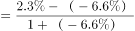
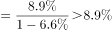

# 平均数增长率比较（商品房均价增速：销售额增速与销售面积增速合成）

考点：[[20-考点/资料分析/平均数/平均数增长率比较（商品房均价增速：销售额增速与销售面积增速合成）|平均数 / 平均数增长率比较（商品房均价增速：销售额增速与销售面积增速合成）]]
材料：[[15-材料/资料分析/246300 2019年1-8月全国房地产开发投资|246300 2019年1-8月全国房地产开发投资]]

**问法模型**：题干问'商品房价格同比增长最慢'→识别均价=销售额÷销售面积的平均数结构，套平均数增长率公式g=(a−b)/(1+b)（a=销售额增速，b=销售面积增速），四地区分别求值后比较

## 推理链
1. 第1步：定位第四段，'商品房价格'=销售额÷销售面积，取四地区两率（原文字版百分数缺失，按对应图表补齐）：东部a=+6.6%、b=−1.8%；中部a=+7.7%、b=+0.5%；西部a=+10.0%、b=+3.8%；东北a=+10.1%、b=−6.6%
2. 第2步：套平均数增长率公式 g=(a−b)/(1+b)，a为分子（销售额）增速，b为分母（销售面积）增速
3. 第3步：先算分子差a−b（个百分点）：东部=6.6+1.8=8.4、中部=7.7−0.5=7.2、西部=10.0−3.8=6.2、东北=10.1+6.6=16.7，西部差值最小
4. 第4步：按分母修正精算：东部8.4%÷0.982≈8.6%，中部7.2%÷1.005≈7.2%，西部6.2%÷1.038≈6.0%，东北16.7%÷0.934≈17.9%
5. 第5步：西部≈6.0%为四地区最慢，对照选项锁定B（西部地区）

**最快解法**：⚡ 差值排序法（平均数增长率性质）：g=(a−b)/(1+b)随分子差a−b同向增减、分母1+b只作小幅修正，故只比a−b——东部8.4、中部7.2、西部6.2、东北16.7个百分点，西部最小，且西部b=+3.8%使分母1.038最大进一步压低增速，秒选B，无需精算

## 易错点
- ⚠ 直接比较销售额增速会误选东北（10.1%），必须先识别'价格=销售额/销售面积'的平均数结构再合成两率
- ⚠ 东北销售面积下降6.6%（b<0），分母1−6.6%=0.934<1反而放大价格增速，误以为'面积降+额增=价格长得慢'，实际东北增速最高（≈17.9%）
- ⚠ 量纲混淆：'增长X%'与'加快/收窄X个百分点'不可混用，'增速加快0.6个百分点'不是本期增速；中部销售面积当期为增长、1-7月为下降，正负号代入时勿搞反方向

## 母题抽象
> 🧩 当题干出现'均价/单价/人均等平均数同比增速最快或最慢'特征时，用平均数增长率公式g=(a−b)/(1+b)（a=分子增速、b=分母增速），先比较分子差a−b锁定答案，再按b正负修正分母方向，即可免精算判大小

**同类特征**：商品房价格同比增长最慢、平均数增长率、销售额与销售面积两率合成、四个地区横向比较、定位文字第四段、只比增速不需求均价本身

## 相关题
- [[10-真题/资料分析/增长/465283 增长量比较|465283]]（江苏 2014，相关度1）
- [[10-真题/资料分析/平均数/10204497 平均数增长率（均价=值-量的比值增长率）|10204497]]（海南 2024，相关度1）
- [[10-真题/资料分析/平均数/4737828 平均数增长率|4737828]]（福建 2017，相关度1）
- [[10-真题/资料分析/平均数/1746788 两期平均数增长率（户均注册资本的同比增长率）|1746788]]（国考 2016，相关度1）
- [[10-真题/资料分析/平均数/1752640 平均数增长率（人均收入增长率）|1752640]]（北京 2016，相关度1）

---

### 题干
2019年1-8月，下列地区中商品房价格同比增长最慢的是：

### 选项
- A. 东部地区
- B. 西部地区　✅
- C. 中部地区
- D. 东北地区

### 官方解析

根据题干“2019年1-8月，下列地区中商品房价格同比增长最慢的是”，商品房价格，可判定本题为平均数的增长率问题。定位文字资料第四段可知，2019年1-8月，东部地区商品房销售面积同比下降（b），销售额增长（a）；中部地区商品房销售面积增长（b），销售额增长（a）；西部地区商品房销售面积增长（b），销售额增长（a）；东北地区商品房销售面积下降（b），销售额增长（a）。

根据平均数增长率公式：，则2019年1-8月东部地区商品房价格同比增速；西部地区商品房价格同比增速；中部地区商品房价格同比增速；东北部地区商品房价格同比增速比较可知，西部地区商品房价格同比增速最慢。

故正确答案为B。 

### 给定材料

        2019年1-8月，全国房地产开发投资84589亿元，同比增长，增速比1-7月回落0.1个百分点。其中，住宅投资65187亿元，增长，增速回落0.2个百分点。

        1-8月，东部地区房地产开发投资44857亿元，同比增长，增速比1-7月回落0.4个百分点；中部地区投资17809亿元，增长，增速加快0.3个百分点；西部地区投资18506亿元，增长，增速加快0.9个百分点；东北地区投资3418亿元，增长，增速回落1.3个百分点。

        1-8月，房地产开发企业土地购置面积12236万平方米，同比下降，每平方米土地价格同比上涨，土地成交额6374亿元。

        1-8月，东部地区商品房销售面积40303万平方米，同比下降，降幅比1-7月收窄0.6个百分点；销售额50739亿元，增长，增速加快0.3个百分点。中部地区商品房销售面积28791万平方米，增长，1-7月为下降；销售额20682亿元，增长，增速加快0.7个百分点。西部地区商品房销售面积28284万平方米，增长，增速加快1.0个百分点；销售额20363亿元，增长，增速加快0.6个百分点。东北地区商品房销售面积4471万平方米，下降，降幅收窄1.2个百分点；销售额3589亿元，增长，增速加快1.8个百分点。

> [!warning] 疑点（官方解析可能有误，待人工复核）
> 材料文字版中四地区销售面积/销售额的'同比增长/下降X%'具体百分数全部缺失（仅剩'收窄/加快X个百分点'），官方解析亦仅以a、b符号代替未列数值；本笔记按该材料对应的原始图表数据补齐（东部b=−1.8%、a=+6.6%；中部b=+0.5%、a=+7.7%；西部b=+3.8%、a=+10.0%；东北b=−6.6%、a=+10.1%），代入后结论与官方答案B一致，不影响判题
