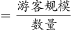
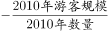
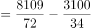

# 平均数增长量（两期平均数作差比较）

考点：[[20-考点/资料分析/平均数/平均数增长量（两期平均数作差比较）|平均数 / 平均数增长量（两期平均数作差比较）]]
材料：[[15-材料/资料分析/247100 2010-2018年我国海洋主题公园|247100 2010-2018年我国海洋主题公园]]

**问法模型**：题干'2018年平均每家游客规模比2010年增加/减少多少万人次'→ 两期平均数作差模型：现期平均数−基期平均数=游客规模÷公园家数之差，再与'30万人次'分界比较。

## 推理链
1. 第1步：从图1提取数据——2010年末公园34家、全年游客3100万人次；2018年末公园72家、全年游客8109万人次
2. 第2步：平均每家游客规模=全年游客规模÷年末公园数量（平均数=总量÷份数），所求=2018年人均−2010年人均
3. 第3步：2018年平均=8109÷72≈112.6万人次/家
4. 第4步：2010年平均=3100÷34≈91.2万人次/家
5. 第5步：差值=112.6−91.2≈21.4万人次，结果为正，判定为'增加'
6. 第6步：21.4万人次<30万人次，属'30万人次以内'，对照选项排除A、B、C，锁定D

**最快解法**：⚡ 截位直除+先定方向再比阈值：8109/72≈112.6（72×110=7920，余数再补约2.6）；3100/34≈91.2（34×90=3060）；差≈21万人次，为正且小于30，直接选D，无需精算到小数。

## 易错点
- ⚠ 基期现期方向混淆：2018为现期、2010为基期，若相减方向颠倒会误判为'减少'而错选A/C
- ⚠ 分母口径错误：须用各年'年末'家数作分母（72家、34家），若误用其他年份柱值或误读双轴图把'家'当'万人次'会全盘出错
- ⚠ 阈值误判：差值约21.4万人次，若粗算成112−91后凑成'超过30'或误用总量差5009万人次去比较，会错选B；正确归属'30万人次以内'

## 母题抽象
> 🧩 当题干出现'某年平均每……比另一年增加/减少（带量级分界如30）'时，用两期平均数作差法：各年总量÷份数分别求平均，先判正负定'增/减'，再与分界值比较定'以上/以内'。

**同类特征**：平均每家、全年游客规模、比2010年、增加/减少、30万人次以上/以内、两期平均数增长量

## 相关题
- [[10-真题/资料分析/平均数/16593089 平均数增长率|16593089]]（新疆 2024，相关度1）
- [[10-真题/资料分析/平均数/2049708 平均数增长量（分子增长、分母不变型）|2049708]]（山东 2017，相关度1）
- [[10-真题/资料分析/平均数/4628153 现期平均数（月均）计算＋口径合并（四星级及以上）|4628153]]（新疆 2021，相关度1）
- [[10-真题/资料分析/平均数/2030158 平均数增长率（两期平均数升降比较）|2030158]]（四川 2016，相关度1）
- [[10-真题/资料分析/平均数/2448499 现期平均数计算（户均注册资本，跨单位量级换算）|2448499]]（国考 2020，相关度1）

---

### 题干
2018年我国平均每家海洋主题公园全年游客规模比2010年：

### 选项
- A. 减少了30万人次以上
- B. 增加了30万人次以上
- C. 减少了30万人次以内
- D. 增加了30万人次以内　✅

### 官方解析

根据题干“2018年······平均每家······比2010年”，结合选项为增加/减少多少万人次，可判定本题为平均数的增长量问题。定位图1，可知2010年、2018年我国海洋主题公园年末数量及全年游客规模。根据公式：平均数，则所求，符合D选项的范围。

故正确答案为D。

### 给定材料

