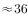

# 现期平均数差值（人均收入比较，跨图拼接+单位量级换算）

考点：[[20-考点/资料分析/平均数/现期平均数差值（人均收入比较，跨图拼接+单位量级换算）|平均数 / 现期平均数差值（人均收入比较，跨图拼接+单位量级换算）]]
材料：[[15-材料/资料分析/247100 2010-2018年我国海洋主题公园|247100 2010-2018年我国海洋主题公园]]

**问法模型**：题干出现'2016年平均每名游客创造的门票收入比非门票收入多约多少元'→ 现期平均数之差模型：(门票收入−非门票收入)÷游客人次，一次除法完成

## 推理链
1. 第1步：定位图2（堆叠柱分层读数），2016年门票收入38.02亿元、非门票收入15.61亿元（15.61是上层非门票，非柱顶总和）
2. 第2步：定位图1折线（右轴万人次），2016年全年游客规模为6277万人次
3. 第3步：先作差再除：收入差=38.02−15.61=22.41亿元
4. 第4步：公式：人均差=22.41亿元÷6277万人，按X亿元÷Y万人次=(X/Y)×10^4元换算量级
5. 第5步：代入计算：22.41/6277×10^4≈0.00357×10^4≈35.7元
6. 第6步：与选项对照：35.7元≈36元，只有D(36)吻合，A(42)、B(48)、C(30)均偏差超5元，故选D

**最快解法**：⚡ 截位直除+量级口诀：先求差38.02−15.61=22.41亿元，再用'亿元÷万人次=(差/人数)×10^4元'口诀，22.41/6277≈22.41/6300≈0.00356，×10^4≈35.6元，直接锁定D(36)；切忌分别算两个人均再相减（多做一次除法且易错量级）

## 易错点
- ⚠ 量级换算陷阱：亿元÷万人次先得'万元'数值(≈0.00357万元)，须再×10^4化为元(≈35.7元)；漏乘10^4会误判为接近0而无一选项可选，量级错成10^3或10^5则落入其他错误选项区间
- ⚠ 跨图取数与堆叠柱读数：门票/非门票收入在图2且须分层读，误把柱顶总和53.63亿元当门票收入、或把15.61与38.02 Roles颠倒，均会算错；游客规模6277在图1折线（右轴），勿误读柱体家数
- ⚠ 模型选择：题干问'多约多少元'是平均数之差，正确做法是(收入差)÷人次做一次除法；若分别求门票人均≈60.6元、非门票人均≈24.9元再相减，虽结果相同但多一次除法耗时，且两次四舍五入易累积误差

## 母题抽象
> 🧩 当题干出现'平均每名/每家…的A比B多约多少（元/家/人次）'且A、B总量与份数分处不同图时，用'先求总量差、再除以份数'一次除法，并用'亿元÷万人次=(X/Y)×10^4元'量级口诀验算选项

**同类特征**：平均每名游客、门票收入比非门票收入多约多少元、现期年份2016年（无需基期换算）、跨图拼接取数（图1游客规模+图2收入构成）、亿元/万人次单位量级换算、差值平均数模型

## 相关题
（暂无）

---

### 题干
2016年我国海洋主题公园平均每名游客创造的门票收入比非门票收入多约多少元？

### 选项
- A. 42
- B. 48
- C. 30
- D. 36　✅

### 官方解析

根据题干“2016年······平均······多约多少元”，判定本题为现期平均数问题。定位图1可知，2016年我国海洋主题公园游客规模为6277万人次，定位图2可知，2016年我国海洋主题公园门票收入和非门票收入分别为38.02亿元、15.61亿元。则题干所求为元。

故正确答案为D。

### 给定材料

> [!warning] 疑点（官方解析可能有误，待人工复核）
> 官方解析正文算式显示不完整（'则题干所求为元'中间缺具体计算过程），按材料数据复算(38.02−15.61)亿元÷6277万人次≈35.7元≈36元，与答案D一致，无实质矛盾
