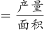

# 现期平均数计算——单位面积产量阈值筛选计数

考点：[[20-考点/资料分析/平均数/现期平均数计算——单位面积产量阈值筛选计数|平均数 / 现期平均数计算——单位面积产量阈值筛选计数]]
材料：[[15-材料/资料分析/247104 茶叶生产统计：2007～2018年全|247104 茶叶生产统计：2007～2018年全]]

**问法模型**：'有几个省份的单位面积产量高于1吨/公顷' → 现期平均数阈值筛选模型：单产=产量÷面积，利用万吨÷万公顷=吨/公顷量级自然抵消，把'高于1'转化为产量数值与面积数值的直接比大小，逐省扫描计数。

## 推理链
1. 第1步：从表1提取2018年18个产茶省份的面积（万公顷）与产量（万吨）成对数据，如福建20.72/40.16、湖北29.93/31.45、广东6.20/9.65、山东2.20/2.88、湖南16.89/21.36。
2. 第2步：公式：单位面积产量=茶叶产量÷茶园面积；因万吨÷万公顷=吨/公顷，'单产高于1吨/公顷'等价于'产量数值＞面积数值'，无需任何系数换算。
3. 第3步：逐省比较分子分母：福建40.16＞20.72✓、山东2.88＞2.20✓、湖南21.36＞16.89✓、广东9.65＞6.20✓、湖北31.45＞29.93✓，共5省满足。
4. 第4步：核查其余13省及边界省：浙江18.60＜19.92、广西7.30＜7.71、云南39.81＜44.45、四川29.50＜36.34、贵州19.93＜45.62、河南7.40＜11.63、陕西7.35＜13.80、重庆3.96＜4.49、安徽13.49＜16.97、江西7.09＜11.42、江苏1.46＜3.37、海南0.06＜0.24、甘肃0.14＜1.15，均不满足。
5. 第5步：计数为5个省份（福建、山东、湖北、湖南、广东），对照选项选A。

**最快解法**：⚡ 数值直接比较法（回避除法）：因万吨/万公顷=吨/公顷，'单产＞1'即'产量数字＞面积数字'，对表1逐行比大小即可，不必真做18次除法；重点核验接近1的边界省——湖北31.45＞29.93✓、浙江18.60＜19.92✗、广西7.30＜7.71✗、云南39.81＜44.45✗，数出福建、山东、湖北、湖南、广东共5个，锁定A。

## 易错点
- ⚠ 单位量级陷阱：若丢掉'万'字按千吨/千公顷等口径额外换算，会整体错一个数量级；本题万吨÷万公顷恰好等于吨/公顷，直接比数值即可。
- ⚠ 直觉筛选陷阱：面积最大的贵州（45.62）、云南（44.45）、四川（36.34）单产反而低于1吨/公顷，小数值省（海南0.06/0.24、甘肃0.14/1.15、江苏1.46/3.37）单产也极低，不能凭面积或产量单一指标直觉筛选，必须逐省比大小。
- ⚠ 边界与漏看陷阱：湖北31.45/29.93≈1.05仅略高于1，浙江≈0.93、广西≈0.95、云南≈0.90略低于1，接近1易数错；表1左右分栏，右栏的广东（9.65＞6.20）若漏看则误选B（4个）。

## 母题抽象
> 🧩 当题干出现'单位面积产量（均产值）高于某阈值、有几个/几省'的计数设问，且分子分母单位带同级别'万'字时，先把阈值比较化为'分子数值＞分母数值×阈值'的直接比大小（回避除法），再对表格逐行扫描、重点核验接近阈值的边界行后计数。

**同类特征**：单位面积产量、高于1吨/公顷、有几个省份、现期截面数据、产量÷面积、阈值筛选计数

## 相关题
- [[10-真题/资料分析/平均数/2188149 现期平均数（单位面积产量）计算+万吨-万亩与斤-亩单位换算|2188149]]（陕西 2018，相关度1）
- [[10-真题/资料分析/平均数/4658508 平均数（单产）增长率——两期平均数比较|4658508]]（四川 2021，相关度1）
- [[10-真题/资料分析/平均数/1746800 平均数倍率阈值比较（全国平均单产×80%逐行计数）|1746800]]（国考 2016，相关度1）
- [[10-真题/资料分析/平均数/2049382 现期平均数（公顷单产）计算|2049382]]（河南 2017，相关度1）
- [[10-真题/资料分析/平均数/2047656 单位面积产量（单产）计算，跨图表拼接+面积基期倒推|2047656]]（福建 2019，相关度1）

---

### 题干
2018年全国产茶省份中，有几个省份的茶园单位面积茶叶产量高于1吨/公顷？

### 选项
- A. 5　✅
- B. 4
- C. 7
- D. 6

### 官方解析

根据题干“······有几个省份的单位面积茶叶产量高于1吨/公顷”，可判定本题为现期平均数的计算问题。定位表格材料，可知2018年全国产茶省份的产量和面积。根据公式：单位面积产量，若单位面积茶叶产量高于1吨/公顷，即产量数值（吨数）大于面积数值（公顷数）的省份，查找表中数据，共有5个省份符合要求，分别为福建、山东、湖北、湖南、广东。

故正确答案为A。

### 给定材料

 

