# 现期平均数计算与多省比较（利润÷企业数求最大值）

考点：[[20-考点/资料分析/平均数/现期平均数计算与多省比较（利润÷企业数求最大值）|平均数 / 现期平均数计算与多省比较（利润÷企业数求最大值）]]
材料：[[15-材料/资料分析/247411 2019年上半年我国东部地区10个省|247411 2019年上半年我国东部地区10个省]]

**问法模型**：题干问'各省（市）……平均利润的最大值'→ 对每省套用平均数模型：平均利润=软件业务利润÷企业数，先粗筛后精算，取最大者对照选项

## 推理链
1. 第1步：从表格跨列提取两组数据——'软件业务利润金额(万元)'列与首列'企业数(个)'，如北京4853028/3200、上海3894683/1679、江苏5515597/7138、浙江7319992/1813、广东10421759/4426
2. 第2步：明确模型：平均利润=利润÷企业数（单位：万元/个），2019年上半年为现期，直接相除，无需基期换算
3. 第3步：粗筛排除——江苏利润虽大(5515597)但企业数7138个更大，5515597/7138≈773；山东1971420/4277≈461；同理排除天津(701589/623≈1126)、河北、福建、海南等小值省
4. 第4步：对四个候选省截位直除：北京4853028/3200≈1517，上海3894683/1679≈2320，广东10421759/4426≈2355，浙江7319992/1813≈732÷1.81≈4038
5. 第5步：比较得浙江4038万元/个为最大值，其余各省均低于2400万元/个
6. 第6步：与选项对照：C项4038万元与浙江计算值一致；A项2320万元=上海值、B项2355万元=广东值均为干扰项，故选C

**最快解法**：⚡ 粗筛+截位直除：利润绝对值最大的广东(10421759)除以4426个企业仅≈2355万元/个，说明'利润最大≠平均最大'；只需精算北京、上海、广东、浙江四省，浙江7319992/1813→截位732÷1.81≈404，即4038万元/个，直接锁定C

## 易错点
- ⚠ 最大利润≠最大平均利润：广东利润10421759万元为10省最大，但企业数4426个也多，平均后仅约2355万元/个（正是B选项陷阱）；同理'利润大'的江苏(≈773)远小于浙江
- ⚠ 分母选错列：平均利润的分母是首列'企业数(个)'，须跨列拼接'软件业务利润'列，勿误用软件业务收入或信息技术服务收入做分母（会算成收入均值或利润率口径）
- ⚠ 8位数硬算易错位：金额为8位数字（如7319992），直接竖除耗时长且易抄错位，应先截位（732÷1.81）再估算量级

## 母题抽象
> 🧩 当题干出现'平均+最大值/最大地区'特征时，用'总量÷份数'模型逐项相除，先排除分子分母同量级偏大的干扰项，再对3~4个候选取截位直除比较，验证最大者是否与某选项吻合

**同类特征**：平均利润、最大值、各省（市）逐一比较、利润÷企业数、现期平均数、跨列取数

## 相关题
- [[10-真题/资料分析/平均数/13319360 现期平均数（总量÷份数）|13319360]]（江苏 2025，相关度1）
- [[10-真题/资料分析/平均数/13504650 现期平均数计算与多期排序比较|13504650]]（辽宁 2025，相关度1）
- [[10-真题/资料分析/平均数/18385424 现期平均数计算与比较（单价-均价=总额÷数量，跨双轴图取数）|18385424]]（浙江 2024，相关度1）
- [[10-真题/资料分析/平均数/18643712 现期平均数计算（累计值求月均）|18643712]]（天津 2026，相关度1）
- [[10-真题/资料分析/平均数/18643737 现期平均数比较（平均每船次进口量与固定值8万吨比较计数）|18643737]]（天津 2026，相关度1）

---

### 题干
2019年上半年，东部地区各省（市）软件企业的软件业务平均利润的最大值是

### 选项
- A. 2320万元
- B. 2355万元
- C. 4038万元　✅
- D. 4969万元

### 官方解析

根据题干“2019年上半年······平均利润······”，可判定本题为现期平均数问题。定位表格资料可知2019年上半年我国东部地区各省（市）软件业务利润及企业数，根据公式：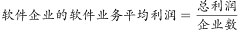，可得2019年上半年我国东部地区各省（市）软件企业平均利润：北京，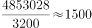万元；天津，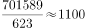万元；河北，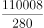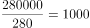万元；上海，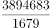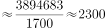万元；江苏，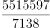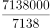=1000万元；浙江，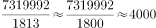万元；福建，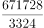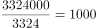万元；山东，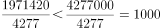万元；广东，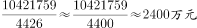；海南，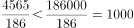万元。可得浙江的最大，且与C项最接近。

故正确答案为C。

### 给定材料

根据以下资料，回答116～120题

 

