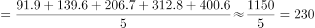

# 现期平均数（多年区间算术平均：总和÷年数）

考点：[[20-考点/资料分析/平均数/现期平均数（多年区间算术平均：总和÷年数）|平均数 / 现期平均数（多年区间算术平均：总和÷年数）]]
材料：[[15-材料/资料分析/247416 2013-2017年全国快递业务量（|247416 2013-2017年全国快递业务量（]]

**问法模型**：题干出现'2013-2017年…平均每年约收发'→ 采用现期平均数模型：五年业务量之和÷5。

## 推理链
1. 第1步：题干要求2013-2017年五年平均每年收发的快递业务量，判定为现期平均数问题
2. 第2步：从柱状图读取五年数据：2013年91.9、2014年139.6、2015年206.7、2016年312.8、2017年400.6亿件
3. 第3步：五年求和：91.9+139.6+206.7+312.8+400.6=1151.6亿件
4. 第4步：平均数=1151.6÷5≈230.3亿件
5. 第5步：与选项对照，230.3最接近B项230亿件，A(206)、C(226)、D(246)均偏差明显，故选B

**最快解法**：⚡ 尾数法+直除：五年和的尾数为9+6+7+8+6=36（进位后总和1151.6），1151.6÷5，先看首两位得230，尾数0.32≈0.3，即≈230.3，直接锁定B项230亿件；无需精算全和。

## 易错点
- ⚠ 首尾平均陷阱：误用(400.6+91.9)÷2≈246亿件，恰好落在D项，五年平均必须÷5而非÷2
- ⚠ 时间范围错误：2013-2017共5个年度，漏加某一年或按4年除会得≈288或≈218等错误值
- ⚠ 双轴复合图干扰：折线为同比增速（右轴%），与本题计算无关，误把折线按左轴刻度读数或纳入求和会严重出错

## 母题抽象
> 🧩 当题干出现'某N年区间…平均每年约多少'特征时，直接把区间内各期值求和÷N（现期平均数），用尾数法或首两位直除速算，并警惕命题人设置的'首尾两值平均'干扰选项。

**同类特征**：平均每年约收发、2013-2017年、五年求和÷5、现期平均数、复合图仅用柱状数据、亿件

## 相关题
- [[10-真题/资料分析/平均数/13319360 现期平均数（总量÷份数）|13319360]]（江苏 2025，相关度1）
- [[10-真题/资料分析/平均数/13504650 现期平均数计算与多期排序比较|13504650]]（辽宁 2025，相关度1）
- [[10-真题/资料分析/平均数/18385424 现期平均数计算与比较（单价-均价=总额÷数量，跨双轴图取数）|18385424]]（浙江 2024，相关度1）
- [[10-真题/资料分析/平均数/18643712 现期平均数计算（累计值求月均）|18643712]]（天津 2026，相关度1）
- [[10-真题/资料分析/平均数/18643737 现期平均数比较（平均每船次进口量与固定值8万吨比较计数）|18643737]]（天津 2026，相关度1）

---

### 题干
2013-2017年，快递业务量平均每年约收发：

### 选项
- A. 206亿件
- B. 230亿件　✅
- C. 226亿件
- D. 246亿件

### 官方解析

由题干“2013-2017年，…平均每年约收发”，结合材料时间，可判定本题为现期平均数问题。定位柱状图，2013-2017年快递业务量分别为91.9亿件、139.6亿件、206.7亿件、312.8亿件、400.6亿件。则2013-2017年，平均每年收发快递量亿件。

故正确答案为B。

### 给定材料

