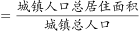
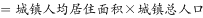
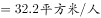
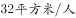
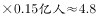

# 现期平均数逆推总量（总量=人均量×人口数）+ 量级单位换算（万平方米→亿平方米）

考点：[[20-考点/资料分析/平均数/现期平均数逆推总量（总量=人均量×人口数）+ 量级单位换算（万平方米→亿平方米）|平均数 / 现期平均数逆推总量（总量=人均量×人口数）+ 量级单位换算（万平方米→亿平方米）]]
材料：[[15-材料/资料分析/247457 A自治区2012~2016年末城镇与|247457 A自治区2012~2016年末城镇与]]

**问法模型**：题干问'2016年末城镇人口总居住面积约为多少亿平方米'→ 现期总量模型：总居住面积=城镇人均居住面积×城镇人口数，再作万→亿的单位换算

## 推理链
1. 第1步：题干限定对象为'城镇人口总居住面积'，时间2016年末；从文字段取城镇人口1542.1万人，城镇人均居住面积32.20平方米/人（与表格2016年末城镇列32.20互验一致）
2. 第2步：现期总量公式：总居住面积=人均居住面积×人口数=1542.1万人×32.20平方米/人
3. 第3步：代入计算：1542.1×32.20≈1542×32+1542×0.2≈49344+308≈49656万平方米（精确约49655.6万平方米）
4. 第4步：单位换算：万人×平方米/人=万平方米，1亿平方米=10000万平方米，故49655.6万÷10000≈4.97亿平方米
5. 第5步：与选项对照：4.97亿平方米与B项5最接近，其余选项3、7、9均偏离，故选B

**最快解法**：⚡ 截位估算法+量级锁定：1542.1×32.20≈1500×32=48000万平方米=4.8亿，量级锁定'个位数亿平方米'且略高于5，直接选B；核心动作是先乘后÷10000换亿，切勿跳过换算直接对照选项

## 易错点
- ⚠ 单位换算错级：1542.1万×32.20≈49656万平方米，若忘记÷10000换算成亿平方米，会误判选项（4.97≠5的判断出错或误入其他量级）；牢记万人×平方米/人=万平方米，再÷10000得亿平方米
- ⚠ 对象口径：必须用城镇人口1542.1万×城镇人均32.20；若误用农牧民人均27.40或试图求总人口（城镇化率在原文留空缺失，无法求），即入坑
- ⚠ 干扰信息：文字段'比1978年末增长5.5倍'与本题无关，本题是现期总量，不涉及基期换算，勿被远期基期信息带偏

## 母题抽象
> 🧩 当题干出现'总居住面积/总量≈多少亿（大单位）'且现期人均量与人口数均给全时，直接用总量=人均×人口，关键验证量级换算（万→亿÷10000；每百户→户均÷100）后再对照选项

**同类特征**：2016年末、城镇人口总居住面积、约多少亿平方米、人均居住面积×城镇人口、现期总量计算、万平方米换算亿平方米

## 相关题
- [[10-真题/资料分析/其他/5833649 区间求和（五年加总）+单位量级换算|5833649]]（选调 2020，相关度1）
- [[10-真题/资料分析/比重/12019692 间接求部分量（整体−其余子项）+面积单位换算|12019692]]（广东 2026，相关度1）
- [[10-真题/资料分析/增长/2376888 基期量计算（基期=现期-增量）|2376888]]（选调 2019，相关度1）
- [[10-真题/资料分析/增长/2453096 增长量比较（同比增量=现期存量−基期存量）|2453096]]（上海 2020，相关度1）

---

### 题干
2016年末A自治区城镇人口总居住面积约为多少亿平方米？

### 选项
- A. 3
- B. 5　✅
- C. 7
- D. 9

### 官方解析

根据题干所求“2016年末······人口总居住面积约为······”，结合材料可判定此题为现期平均数问题。定位文字材料第一段“2016年末，A自治区城镇人口为1542.1万人”，定位文字材料第二段“2016年末A自治区城镇人均居住面积达32.20平方米”。由城镇人均居住面积得，城镇人口总居住面积亿平方米，与B项最接近。

故正确答案为B。

### 给定材料

        2016年末，A自治区城镇人口为1542.1万人，城镇化率(城镇人口占总人口比重)为。

        2016年末A自治区城镇人均居住面积达32.20平方米，比1978年末增长了5.5倍；农村牧区人均居住面积达27.40平方米，比1985年末增长。2016年末A自治区城镇居民家庭每百户拥有家用汽车38.48辆、家用电脑62台、移动电话222.21部；农牧民家庭每百户拥有家用汽车27.29辆、家用电脑23台、移动电话231.53部。

