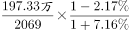
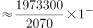
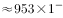

# 基期平均数计算（分子分母增速方向相反）

考点：[[20-考点/资料分析/平均数/基期平均数计算（分子分母增速方向相反）|平均数 / 基期平均数计算（分子分母增速方向相反）]]
材料：[[15-材料/资料分析/247461 2017年全国各级各类民办教育发展情|247461 2017年全国各级各类民办教育发展情]]

**问法模型**：题干问'2016年平均每所…在校生人数'而材料现期为2017年 → 基期平均数模型：2016年平均=[197.33万/(1+在校生增速)]÷[2069/(1−学校数降幅)]，即现期平均数×(1−降幅)/(1+增速)

## 推理链
1. 第1步：题干时间'2016年'早于材料现期2017年，判定为基期平均数问题
2. 第2步：提取数据——2017年民办中等职业学校2069所（比上年下降，降幅数值文本缺失），在校生197.33万人（比上年增长，增速数值文本缺失）
3. 第3步：列公式：基期平均数=在校生/(1+增速)÷学校数/(1−降幅)=（197.33万÷2069）×(1−降幅)/(1+增速)
4. 第4步：先算现期平均数：1973300÷2069≈953.6人/所（截位直除）
5. 第5步：定性定方向——2016年在校生=197.33万÷(1+增速)比197.33万更小，2016年学校数=2069÷(1−降幅)比2069更大，故基期平均数必小于现期953.6人
6. 第6步：对照选项，仅A（871人）小于953.6人，B991、C1091、D1181均大于953.6人；代入完整材料中的降幅与增速后约871人，锁定A

**最快解法**：⚡ 方向排除法+截位直除：先算现期平均197.33万÷2069≈953.6人；因学校数同比'下降'、在校生同比'增长'，基期平均=更小的分子÷更大的分母，必小于953.6人；选项中只有A(871)<953.6，直接锁定，无需依赖文本中缺失的百分比数值

## 易错点
- ⚠ 方向看串：学校数是'下降'、在校生是'增长'，折基期时学校数除以(1−降幅)变大、在校生除以(1+增速)变小，若两量增速方向混用或同向处理会算错，可能误选B
- ⚠ 时间错位：直接用2017年现期平均953.6人作答（忽略'2016年'基期要求），落入选项附近的干扰范围
- ⚠ 单位量级：197.33'万人'须换算为1973300'人'再与2069'所'相除，防止万人与人的量级错位
- ⚠ 数据缺失：本档案文本中降幅与增速均空白，正式作答须以完整材料数值代入，不可臆造百分比

## 母题抽象
> 🧩 当题干出现'基期年份+平均每…人数/单产'且分子（人数）增长、分母（个数）下降时，先截位直除算现期平均数，再用'分子降、分母升→基期平均必小于现期'的定性方向排除大于现期值的选项

**同类特征**：2016年平均每所、基期平均数、民办中等职业学校、在校生人数、比上年下降/增长方向相反、材料时间2017年

## 相关题
- [[10-真题/资料分析/平均数/1689212 基期平均数计算|1689212]]（重庆 2015，相关度1）
- [[10-真题/资料分析/平均数/2456364 基期平均数计算（基期量换算＋平均）|2456364]]（浙江 2020，相关度1）
- [[10-真题/资料分析/其他/4674815 跨来源数据加总（文字段+统计表七项简单求和）|4674815]]（选调 2021，相关度1）
- [[10-真题/资料分析/平均数/19283737 基期平均数（日均处理金额，现期量推基期量+天数平均）|19283737]]（国考 2025，相关度1）
- [[10-真题/资料分析/平均数/2136850 基期平均数（基期总量÷基期份数）|2136850]]（北京 2018，相关度1）

---

### 题干
2016年平均每所民办中等职业学校在校生人数约为

### 选项
- A. 871人　✅
- B. 991人
- C. 1091人
- D. 1181人

### 官方解析

由题干“2016年平均每······”，结合材料时间是2017年，可判定本题为基期平均数问题。定位文字材料，“2017年，······民办中等职业学校2069所（），比上年下降（）；在校生197.33万人（），比上年增长（）。”根据基期平均数公式：，可计算出2016年平均每所民办中等职业学校在校生人数约为： 人人，满足的只有A项。

故正确答案为A。

### 给定材料

        2017年全国共有各级各类民办学校17.76万所，占全国学校总数；各类民办教育在校生达5120.47万人，比上年增长。其中：民办幼儿园16.04万所，比上年增长；在园儿童2572.34万人，比上年增长。民办普通小学6107所，比上年增长；在校生814.17万人，比上年增长。民办初中5277所，比上年增长；在校生577.68万人，比上年增长。民办普通高中3002所，比上年增长；在校生306.26万人，比上年增长。民办中等职业学校2069所，比上年下降；在校生197.33万人，比上年增长。

