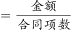
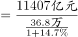
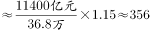

# 基期平均数计算（基期量换算＋平均）

考点：[[20-考点/资料分析/平均数/基期平均数计算（基期量换算＋平均）|平均数 / 基期平均数计算（基期量换算＋平均）]]
材料：[[15-材料/资料分析/248013 全国技术合同成交情况：文字部分讲20|248013 全国技术合同成交情况：文字部分讲20]]

**问法模型**：题干以'2016年（基期年份）＋平均每项技术合同成交金额'发问→基期平均数模型：基期成交额÷基期合同项数，分子直接从统计图读数，分母用现期项数÷(1+增速)换算。

## 推理链
1. 第1步：题干问'2016年平均每项技术合同成交金额'，时间落在基期2016年，判定为基期平均数问题；现期条件为2017年36.8万项、成交额13424.2亿元。
2. 第2步：2016年成交金额文字材料未给，从统计图柱值直接读取11407亿元（折合11407×10⁴万元）。
3. 第3步：所用规则：基期平均数＝基期成交额÷基期项数，其中基期项数＝现期项数÷(1＋项数同比增速)＝36.8万项÷(1＋增速)；材料中该增速数字缺失。
4. 第4步：增速按官方口径代入（可用选项反推校验：若基期项数≈32.0万项，则增速≈36.8/32.0−1≈15%），得2016年合同项数≈32.0万项。
5. 第5步：代入计算：11407×10⁴万元÷32.0×10⁴项≈356万元/项（截位直除：11407÷32≈356）。
6. 第6步：对照选项：356万元即B；同时排除C——365万元恰为现期平均数13424.2亿÷36.8万≈365万，是时间口径陷阱。

**最快解法**：⚡ 基期平均数公式法＋截位直除＋选项反推：先用现期数据13424.2亿÷36.8万≈365万，发现正是C且为2017年值，题问2016故弃之；再读图取2016成交额11407亿元，基期项数36.8÷1.15≈32.0万项，11407亿÷32.0万项≈356万→B。

## 易错点
- ⚠ 时间口径陷阱：误用现期数据得13424.2亿÷36.8万项≈365万而错选C，该值是2017年（现期）平均数；2016年成交额必须从图中读11407亿元。
- ⚠ 增速缺失与错用：文字中增速空缺，若把36.8万项直接当2016年项数得约310万（无对应选项）；若误把成交额增速用于项数换算，会绕回≈365万再落C陷阱。
- ⚠ 单位与量级：36.8万项须与'项'统一、亿元须化万元（1亿元=10⁴万元），11407亿元÷32万项应按11407×10⁴万元÷32.0×10⁴项处理，量级易错。

## 母题抽象
> 🧩 当题干出现'上年/基期年份＋平均每×是多少'时，用基期平均数模型：基期分子÷基期分母，分子能读图则直接读图、分母用现期量÷(1+增速)，增速缺失时用选项反推校验。

**同类特征**：基期年份（2016年）＋平均每项、基期平均数、文字给现期、图形给基期成交额（跨图＋文取数）、文字增速数字缺失需反推、选项中埋有现期平均数陷阱（365万）

## 相关题
- [[10-真题/资料分析/平均数/1689212 基期平均数计算|1689212]]（重庆 2015，相关度1）
- [[10-真题/资料分析/平均数/2453204 基期平均数计算（分子分母增速方向相反）|2453204]]（北京 2020，相关度1）
- [[10-真题/资料分析/平均数/19283737 基期平均数（日均处理金额，现期量推基期量+天数平均）|19283737]]（国考 2025，相关度1）
- [[10-真题/资料分析/平均数/2136850 基期平均数（基期总量÷基期份数）|2136850]]（北京 2018，相关度1）
- [[10-真题/资料分析/综合/5408643 信息可推性综合判断（基期量与基期平均数倒推）|5408643]]（四川 2022，相关度1）

---

### 题干
2016年，平均每项技术合同成交金额约为：

### 选项
- A. 330万元
- B. 356万元　✅
- C. 365万元
- D. 385万元

### 官方解析

根据题干“2016年，平均每项技术合同成交金额约为”，可判定本题为基期平均数问题。定位文字材料第一段可知，“2017年，全年共签订各类技术合同36.8万项，比上年增长”；定位图形材料可知，2016年全国技术合同成交金额为11407亿元。根据公式：平均数；基期，可得所求万元。

故正确答案为B。

### 给定材料

        2017年，我国技术市场交易额稳步增长，全年共签订各类技术合同36.8万项，成交金额13424.2亿元，比上年分别增长和。

        2017年全国共成交1000万元以上重大技术合同13358项，同比增长；成交额10281.4亿元，同比增长。重大技术合同中涉及各类知识产权的合同，成交5561项，成交金额为4121.7亿元。其中，技术秘密为主要交易形式，成交2959项，成交额2239.6亿元，居第一位；专利技术合同成交1291项，成交额1258.5亿元，居第二位。

> [!warning] 疑点（官方解析可能有误，待人工复核）
> 题面与官方解析中合同项数'比上年增长'的具体增速数字均缺失（原文被隐去），按本卷数据无法独立复算；经官方答案B反推：2016年项数≈11407亿÷356万≈32.0万项，对应增速≈14.9%（约15%），代入后11407亿÷32.0万项≈356万元与B完全吻合，不影响答案，属解析文本缺字而非口径错误。
