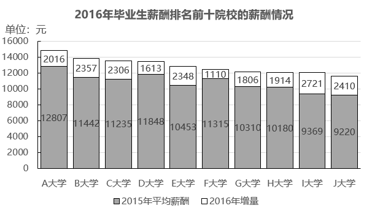
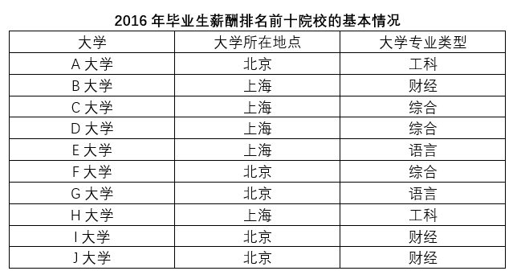

# 现期平均数计算与分类排序（分组算术平均）

考点：[[20-考点/资料分析/平均数/现期平均数计算与分类排序（分组算术平均）|平均数 / 现期平均数计算与分类排序（分组算术平均）]]
材料：[[15-材料/资料分析/257877 2016年毕业生薪酬排名前十的十所院|257877 2016年毕业生薪酬排名前十的十所院]]

**问法模型**：题干'假设各院校毕业生人数相同，求各专业类型2016年平均薪酬从高到低排序' → 先由'基期+增量'算出各校2016年薪酬，再按专业类型分组取算术平均后排序

## 推理链
1. 第1步：由表1定位专业类型分组：工科=A、H（2所），财经=B、I、J（3所），综合=C、D、F（3所），语言=E、G（2所）
2. 第2步：由图1求各校2016年薪酬=2015年薪酬+白框增量：A=12807+2016=14823、B=13799、C=13541、D=13461、E=12801、F=12425、G=12116、H=10180+1914=12094、I=12090、J=11630（元）
3. 第3步：由'各院校毕业生人数相同'，设每校人数为1，各类型平均薪酬=组内各校2016年薪酬的算术平均（无需加权）
4. 第4步：工科=(14823+12094)/2=13458.5元；综合=(13541+13461+12425)/3=39427/3≈13142.3元，前两位锁定工科＞综合
5. 第5步：财经=(13799+12090+11630)/3=37519/3≈12506.3元；语言=(12801+12116)/2=12458.5元，两者仅差约48元，交叉相乘精判：2×37519=75038＞3×24917=74751，故财经＞语言
6. 第6步：排序为工科13458.5＞综合13142.3＞财经12506.3＞语言12458.5，对照选项仅C（工科＞综合＞财经＞语言）符合

**最快解法**：⚡ 截位直除+交叉相乘比较：白框是增量，先加和得2016年薪酬；工科≈13459、综合≈13142可粗算锁定前两位；财经与语言接近，免算除法直接交叉相乘——(13799+12090+11630)×2=75038 与 (12801+12116)×3=74751，75038较大故财经＞语言，得工科＞综合＞财经＞语言，选C

## 易错点
- ⚠ 白框数字是'2016年增量'而非2016年薪酬，直接拿白框数分组平均必错；A大学白框恰为'2016'，极易与年份混淆
- ⚠ 财经(≈12506.3)与语言(≈12458.5)仅差约48元，粗估易判反；若误用2015年基期薪酬分组平均，会得出语言(10381.5)＞财经(10010.3)的相反结论
- ⚠ 类型分组须图1（数据）与表1（地点/类型）跨图表联用，H（上海/工科）等易归错组；'人数相同'是算术平均的前提条件，若人数不同则需加权

## 母题抽象
> 🧩 当题干出现'假设各个体数量相同＋按某分类求平均并排序'时，先统一将每项现期值=基期值+增长量算出，再按类别取算术平均，数值接近的两组用交叉相乘（通分）精判

**同类特征**：假设各院校毕业生人数相同、各专业类型毕业生平均薪酬、从高到低排序、现期平均数问题、跨图表联用（图给数值、表给分类）、基期+增量求现期

## 相关题
- [[10-真题/资料分析/平均数/2184619 现期平均数比较（收入÷企业数排序）|2184619]]（选调 2018，相关度1）
- [[10-真题/资料分析/增长/1758944 年均增长率比较与排序|1758944]]（上海 2016，相关度1）
- [[10-真题/资料分析/平均数/2136494 现期平均数比较（平均每个法人单位从业人员数从高到低排序）|2136494]]（河南 2017，相关度1）
- [[10-真题/资料分析/平均数/2604298 基期平均数（基期量）大小比较——四大区域月均收入2018年排序|2604298]]（广东 2020，相关度1）
- [[10-真题/资料分析/增长/1797916 基期量计算与排序（环比基期比较）|1797916]]（黑龙江 2016，相关度1）

---

### 题干
假设资料中的各个院校毕业生人数相同，2016年各专业类型毕业生平均薪酬，从高到低排序为：

### 选项
- A. 
工科语言财经综合

- B. 
财经工科综合语言

- C. 
工科综合财经语言
　✅
- D. 
综合工科财经语言

### 官方解析
根据题干“2016年各专业类型毕业生平均薪酬······”，可判定本题为现期平均数问题。定位表格可知，工科类院校有A、H共2所、财经类院校有B、I、J共3所、综合类院校有C、D、F共3所、语言类院校有E、G共2所，各专业类型毕业生平均薪酬。
定位柱状图数据可得2016年各院校类型平均薪酬，由题干条件“设资料中的各个院校毕业生人数相同”，设各个毕业院校毕业生人数为1，则工科类（A、H）的平均薪酬为元，财经类（B、I、J）平均薪酬为元，综合类（C、D、F）平均薪酬为元，语言类（E、G）平均薪酬为元。
所以平均薪酬从高到低依次为工科综合财经语言。
故正确答案为C。

### 给定材料

        据调查，全国各院校毕业五年的大学生（以下统称为毕业生）薪酬排名前十的情况如下：

> [!warning] 疑点（官方解析可能有误，待人工复核）
> 官方解析中各类平均薪酬的具体数值缺失（'平均薪酬为元'处排版空缺），但不影响答案；经补算工科13458.5＞综合13142.3＞财经12506.3＞语言12458.5，与官方答案C一致
