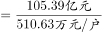

# 平均数逆向求份数（总量÷户均求户数）

考点：[[20-考点/资料分析/平均数/平均数逆向求份数（总量÷户均求户数）|平均数 / 平均数逆向求份数（总量÷户均求户数）]]
材料：[[15-材料/资料分析/257879 S市服务业小微样本企业2017年经营|257879 S市服务业小微样本企业2017年经营]]

**问法模型**：题干问'共有多少户'且材料同时给出总量与户均水平 → 用'份数=总量÷平均数'，即户数=营业收入总量÷户均营业收入，先统一亿元与万元的单位再直除

## 推理链
1. 第1步：题干要求2017年样本企业总户数，定位材料第1段：总体实现营业收入105.39亿元、户均实现营业收入510.63万元
2. 第2步：平均数逆向公式：户数=营业收入总量÷户均营业收入
3. 第3步：统一单位，105.39亿元=105.39×10000万元=1053900万元
4. 第4步：截位直除，1053900÷510.63≈1053900÷510≈2066，精确值约2064户
5. 第5步：倍数反证更快：若为3000户，总营收=3000×510.63万元≈153.2亿元>105.39亿元，故户数必不到3000户
6. 第6步：用第2段互验：938.58亿元÷4547.40万元=9385800÷4547.40≈2064户，两条路径一致，对照选项选A（不到3000户）

**最快解法**：⚡ 倍数反证+截位直除：先判区间——3000×510.63万≈153亿>105.39亿，必不到3000户，秒选A；如需精算，105.39亿=1053900万，1053900÷510.63≈2064户

## 易错点
- ⚠ 单位换算陷阱：总量为'亿元'、户均为'万元'，若直接105.39÷510.63≈0.21而漏乘10000，结果会差一万倍（1亿元=10000万元）
- ⚠ 口径混淆陷阱：第4段93.50万元是'户均薪酬'、6.64万元是'人均年薪酬'，本题只能用第1段'户均营业收入510.63万元'，勿张冠李戴
- ⚠ 干扰信息陷阱：材料各处同比增速留空且提及'回落15.7个百分点'，但本题只涉及2017年现期总量与户均，与增速完全无关，勿被带偏

## 母题抽象
> 🧩 当题干出现'总量+户均/人均水平求总份数（户数/家数/人数）'特征时，用'份数=总量÷平均数'，先统一亿与万单位（1亿=10000万）再截位直除；区间型选项可用'份数×平均数反推总量'的倍数反证快速锁定区间

**同类特征**：共有多少户、总量（亿元）÷户均（万元）、区间型选项（不到/之间/超过）、现期数据直接计算、纯文字材料定位单一段落

## 相关题
- [[10-真题/资料分析/平均数/19283750 现期平均数计算（总数需先做'减上市企业'修正再除以城市数）|19283750]]（国考 2025，相关度1）
- [[10-真题/资料分析/比重/19283962 现期比重计算（部分÷整体，跨图表取数）|19283962]]（国考 2025，相关度1）
- [[10-真题/资料分析/其他/19283968 多期数据求和（五年零售量加总）+单位量级换算（万台→亿台）|19283968]]（国考 2025，相关度1）
- [[10-真题/资料分析/比重/2030142 现期比重（客座率定义逆向求空位数，需乘当月天数）|2030142]]（四川 2016，相关度1）
- [[10-真题/资料分析/比重/2453200 现期比重·部分÷比重反推整体（整体计算）|2453200]]（北京 2020，相关度1）

---

### 题干
2017年，S市服务业小微样本企业共有多少户?

### 选项
- A. 不到3000户　✅
- B. 3000~4000户之间
- C. 4001~5000户之间
- D. 超过5000户

### 官方解析

根据题干“2017年，S市服务业小微样本企业······户”，结合材料给出2017年总体营业收入及户均营业收入，可判定本题为现期平均数计算问题。定位文字材料第一段，“2017年，S市服务业小微样本企业总体实现营业收入105.39亿元······户均实现营业收入510.63万元”。根据平均数计算公式：户数，故2017年S市服务业小微样本企业户数户，不到3000户。

故正确答案为A。

### 给定材料

        2017年，S市服务业小微样本企业总体实现营业收入105.39亿元，同比增长 ，比2016年回落了15.7个百分点，户均实现营业收入510.63万元。

        2017年，S市服务业小微样本企业总体资产938.58亿元，同比增长 ，增速比2016年下降0.9个百分点，户均资产4547.40万元。分门类看，除房地产业，交通运输、仓储和邮政业，教育业资产总计比2016年分别下降、和外，其他行业资产总计同比均有不同程度的增长。

        2017年，S市服务业小微样本企业总体营业税金及附加为1.09亿元，同比下降；缴纳增值税2.30亿元，同比增长，户均缴纳增值税11.16万元。

        2017年，S市服务业小微样本企业总体应付职工薪酬19.28亿元，比2016年增长。户均应付职工薪酬93.50万元。从业人员人数29028人，人均年薪酬6.64万元，比2016年增加0.60万元。

