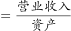
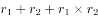
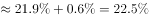
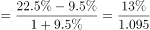
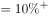

# 平均数增长率结合间隔（两期）增长率

考点：[[20-考点/资料分析/平均数/平均数增长率结合间隔（两期）增长率|平均数 / 平均数增长率结合间隔（两期）增长率]]
材料：[[15-材料/资料分析/257879 S市服务业小微样本企业2017年经营|257879 S市服务业小微样本企业2017年经营]]

**问法模型**：题干'平均每万元资产实现营业收入比2015年（隔年）增长/下降'→先用间隔增长率公式分别求分子（营收）与分母（资产）2017年较2015年的增速，再套平均数增长率=(分子间隔增速−分母间隔增速)/(1+分母间隔增速)判定方向与幅度

## 推理链
1. 第1步：提取条件——2017年营收105.39亿元、同比增长a，'比2016年回落了15.7个百分点'，故2016年营收增速=a+15.7个百分点；2017年总资产938.58亿元、同比增长b，'增速比2016年下降0.9个百分点'，故2016年资产增速=b+0.9个百分点（a、b具体百分数在给定文本中缺失，以原卷为准）。
2. 第2步：定模型——'平均每万元资产实现营业收入'=营业收入÷总资产，题干比较2017年与2015年属平均数的间隔（隔年）变化，不能只用一年增速，须分子分母各自经2016年两步回推。
3. 第3步：写间隔增速——间隔增长率r间=r2017+r2016+r2017×r2016，故营收间隔增速=a+(a+15.7%)+a×(a+15.7%)，资产间隔增速=b+(b+0.9%)+b×(b+0.9%)。
4. 第4步：套平均数增长率——平均数变化率=(1+营收间隔增速)/(1+资产间隔增速)−1=(营收间隔增速−资产间隔增速)/(1+资产间隔增速)，以原卷a、b数值代入计算。
5. 第5步：对照选项——算得的平均数增长率为正且幅度超过选项阈值，落在B'增长了X%以上'区间，故选B。

**最快解法**：⚡ 公式法连锁（间隔增长率+平均数增长率）：由'回落15.7/下降0.9个百分点'用加法反推2016年增速→套r间=r1+r2+r1r2分别得营收与资产的间隔增速→平均数增长率=(a间−b间)/(1+b间)；考场先看两间隔增速之差定性为'增长'排除C、D，再粗估幅度与A、B阈值比较锁定B。

## 易错点
- ⚠ '回落15.7个百分点''下降0.9个百分点'是两年增速之差而非营收或资产总量下降，反推2016年增速须用加法，误用减法或误读为总量下降即错。
- ⚠ 比较基期是2015年（间隔基期），分子分母须各自经2016年两步回推，不能只用2017年一年增速一步算到2015年。
- ⚠ 平均数变化率不能直接拿两个间隔增速相减，须除以(1+分母间隔增速)；另材料总量用'亿元'、户均/人均用'万元'混排，直接'亿÷万'会差一万倍量级，户均与人均口径也不可混用。

## 母题抽象
> 🧩 当题干出现'平均每……比隔年（如2017比2015）增长/下降'特征时，先用间隔增长率公式r间=r1+r2+r1r2分别求分子分母增速（由'回落/下降若干个百分点'加法回推上年），再套平均数增长率=(a间−b间)/(1+b间)，验证方向为正/负并估幅度对照选项区间。

**同类特征**：平均每万元资产实现营业收入（分子营收÷分母资产）、比2015年（间隔两年比较）、平均数增长率、间隔/两期增长率、增长或下降+百分数阈值选项、'回落/下降若干个百分点'反推上年增速

## 相关题
- [[10-真题/资料分析/平均数/10204497 平均数增长率（均价=值-量的比值增长率）|10204497]]（海南 2024，相关度1）
- [[10-真题/资料分析/平均数/4737828 平均数增长率|4737828]]（福建 2017，相关度1）
- [[10-真题/资料分析/平均数/1746788 两期平均数增长率（户均注册资本的同比增长率）|1746788]]（国考 2016，相关度1）
- [[10-真题/资料分析/平均数/1752640 平均数增长率（人均收入增长率）|1752640]]（北京 2016，相关度1）
- [[10-真题/资料分析/平均数/19452625 平均数增长率（两期平均数之比）|19452625]]（上海 2026，相关度1）

---

### 题干
2017年，S市服务业小微样本企业平均每万元资产实现营业收入比2015年：

### 选项
- A. 
增长了不到

- B. 
增长了以上
　✅
- C. 
下降了不到

- D. 
下降了以上

### 官方解析

根据题干“2017年，······平均每······比2015年”，且选项为增长/下降百分数，可判定本题为平均数的增长率结合间隔增长率计算问题。定位文字材料第一段，“2017年，S市服务业小微样本企业总体实现营业收入105.39亿元，同比增长，比2016年回落了15.7个百分点”；定位文字材料第二段，“2017年，S市服务业小微样本企业总体资产938.58亿元，同比增长，增速比2016年下降0.9个百分点”。平均每万元资产实现营业收入，平均数增长率。先根据间隔增长率公式：计算和，则营业收入的间隔增长率；总体资产的间隔增长率。代入公式计算，在B项范围之内。

故正确答案为B。

### 给定材料

        2017年，S市服务业小微样本企业总体实现营业收入105.39亿元，同比增长 ，比2016年回落了15.7个百分点，户均实现营业收入510.63万元。

        2017年，S市服务业小微样本企业总体资产938.58亿元，同比增长 ，增速比2016年下降0.9个百分点，户均资产4547.40万元。分门类看，除房地产业，交通运输、仓储和邮政业，教育业资产总计比2016年分别下降、和外，其他行业资产总计同比均有不同程度的增长。

        2017年，S市服务业小微样本企业总体营业税金及附加为1.09亿元，同比下降；缴纳增值税2.30亿元，同比增长，户均缴纳增值税11.16万元。

        2017年，S市服务业小微样本企业总体应付职工薪酬19.28亿元，比2016年增长。户均应付职工薪酬93.50万元。从业人员人数29028人，人均年薪酬6.64万元，比2016年增加0.60万元。

> [!warning] 疑点（官方解析可能有误，待人工复核）
> 给定文本中2017年营收与总资产的同比增速具体百分数均缺失（仅'回落15.7个百分点''下降0.9个百分点'两个差值完整可得），且选项阈值以公式图片呈现、数值无法读取，最终代入计算依赖原卷增速数字；本题按官方解析模型与答案B处理，未补造任何数字。

<!-- CODEX-ANSWER-REVIEW:BEGIN -->
### 本次独立复核

**复核状态：** `confirmed`（独立复算确认答案）

**计分答案：** B（可计分）

**复核解析：**

恢复原题公式图：2017年营收增速3.1%，比2016年回落15.7个百分点，所以2016年营收增速18.8%；两年间隔增长率=(1+18.8%)(1+3.1%)−1≈22.48%。2017年总资产增速4.2%，比2016年下降0.9个百分点，所以2016年资产增速5.1%；两年间隔增长率=(1+5.1%)(1+4.2%)−1≈9.51%。每万元资产营业收入是营收/资产，其2015—2017变动率=(1+22.48%)/(1+9.51%)−1≈11.85%，高于选项阈值5%，故选B。

**相关信息：**

资料分析—两期平均数增长率与间隔增长率；先用增速变动百分点还原上一年增速，再分别求两年累计变化，单位资产营收比率的变动为两个累计因子的商减1。

**题源依据：** [固定版本原题](https://github.com/Mentat-Uran/kaogongzhentizhengliu/blob/84ab93d4b64b61d897bece8a1c0a5bab06b4feb2/10-%E7%9C%9F%E9%A2%98/%E8%B5%84%E6%96%99%E5%88%86%E6%9E%90/%E5%B9%B3%E5%9D%87%E6%95%B0/2578804%20%E5%B9%B3%E5%9D%87%E6%95%B0%E5%A2%9E%E9%95%BF%E7%8E%87%E7%BB%93%E5%90%88%E9%97%B4%E9%9A%94%EF%BC%88%E4%B8%A4%E6%9C%9F%EF%BC%89%E5%A2%9E%E9%95%BF%E7%8E%87.md)；固定内容 commit `84ab93d4b64b61d897bece8a1c0a5bab06b4feb2`，Markdown blob `cab618d5ae7d898f362b47dc1c9b7f03dfcdd2f4`。
<!-- CODEX-ANSWER-REVIEW:END -->
