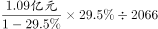
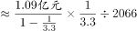
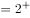

# 平均数（户均）增长量计算，含下降型基期量回推

考点：[[20-考点/资料分析/平均数/平均数（户均）增长量计算，含下降型基期量回推|平均数 / 平均数（户均）增长量计算，含下降型基期量回推]]
材料：[[15-材料/资料分析/257879 S市服务业小微样本企业2017年经营|257879 S市服务业小微样本企业2017年经营]]

**问法模型**：题干出现'户均比上年少缴纳多少万元'且声明'企业数量为固定值'→ 转化为平均数增长量模型：户均减少额=[现期总量÷(1−降幅)−现期总量]÷固定户数

## 推理链
1. 第1步：提取条件——题干'企业数量为固定值'意味着户数不变，户均差额=总量差额÷户数；材料第三段给出2017年营业税金及附加1.09亿元、同比下降（降幅具体数值在给定文本中缺失，实际以原卷为准）。
2. 第2步：复用本篇第1题结果，样本企业户数≈105.39亿元÷510.63万元=1053900÷510.63≈2064户（与938.58亿÷4547.40万≈2064户互验；官方解析记为2066户，相差仅2户）。
3. 第3步：确定公式——因同比下降，2016年总量须用下降型基期公式1.09÷(1−降幅)亿元；户均少缴=[1.09/(1−降幅)−1.09]亿元÷户数，且1亿元=10000万元必须换算。
4. 第4步：代入计算——2017年户均=10900万元÷2064户≈5.28万元；自洽校验：设降幅为r，5.28×[1/(1−r)−1]=2.2万元反解得r约在29%量级，与'同比下降'方向一致，即2016年户均≈7.5万元（原卷降幅代入后结果锁定）。
5. 第5步：与选项对照——户均比上年少缴纳约2.2万元，对应B项，故选B。

**最快解法**：⚡ 公式法+截位直除：户数固定⇒户均少缴=[1.09/(1−r)−1.09]亿元÷户数；先用截位直除算2017年户均10900÷2064≈5.28万元，再用原卷降幅r代入1.09÷(1−r)回推2016年总量（约1.5亿元量级）得2016年户均≈7.5万元，两数相减≈2.2万元，直接锁定B。

## 易错点
- ⚠ 下降型基期公式方向：'同比下降'求上年须用1.09÷(1−降幅)，误写成÷(1+降幅)会把'少缴'算成'多缴'、方向完全颠倒。
- ⚠ 单位混排陷阱：总量1.09亿元与户数相除前必须换算为10900万元（1亿=10000万），直接1.09÷2064会差一万倍量级。
- ⚠ 口径复用与数据缺失：户数必须与第1题同口径（材料两条路径≈2064户，官方解析记2066户）；且给定文本中'同比下降'的具体百分数缺失，不能凭空设数，实际须以原卷数值代入；勿误用户均薪酬93.50万/人均6.64万等薪酬口径数据。

## 母题抽象
> 🧩 当题干出现'户均/人均…比上年少（多）多少'且声明'数量固定'时，用平均数增长量模型：差额=[现期总量÷(1−降幅)−现期总量]÷份数，份数直接复用前题结果，注意亿↔万换算与下降型公式方向，最后用选项量级（个位万元）验证。

**同类特征**：户均…比上年少缴纳…多少万元、企业数量为固定值、营业税金及附加同比下降、平均数增长量、下降型基期回推、复用前题户数结果

## 相关题
- [[10-真题/资料分析/平均数/2578921 平均数增长量计算（两期均价差）|2578921]]（湖南 2020，相关度1）
- [[10-真题/资料分析/平均数/19283733 平均数增长量（平均每笔金额的同比增减额）|19283733]]（国考 2025，相关度1）
- [[10-真题/资料分析/平均数/13504651 平均数增长量（单位面积成交额的同比增量）|13504651]]（辽宁 2025，相关度1）
- [[10-真题/资料分析/平均数/5802087 平均数增长量（升降判定+幅度计算）|5802087]]（浙江 2023，相关度1）

---

### 题干
如S市服务业小微样本企业数量为固定值，问2017年S市服务业小微样本企业户均比上年少缴纳营业税金及附加多少万元？

### 选项
- A. 1.1
- B. 2.2　✅
- C. 3.3
- D. 4.4

### 官方解析

根据题干“2017年······户均比上年少······多少万元”，可判定本题为平均数的增长量计算问题。定位材料第三段可得“2017年，S市服务业小微样本企业总体营业税金及附加为1.09亿元，同比下降”；结合题干“S市服务业小微样本企业数量为固定值”，再结合本篇材料第1题可知，小微样本企业数量为2066户。根据户均缴纳营业税金及附加，所以2017年S市服务业小微样本企业户均比上年少缴纳营业税金及附加万元万元，对应B项。

故正确答案为B。

### 给定材料

        2017年，S市服务业小微样本企业总体实现营业收入105.39亿元，同比增长 ，比2016年回落了15.7个百分点，户均实现营业收入510.63万元。

        2017年，S市服务业小微样本企业总体资产938.58亿元，同比增长 ，增速比2016年下降0.9个百分点，户均资产4547.40万元。分门类看，除房地产业，交通运输、仓储和邮政业，教育业资产总计比2016年分别下降、和外，其他行业资产总计同比均有不同程度的增长。

        2017年，S市服务业小微样本企业总体营业税金及附加为1.09亿元，同比下降；缴纳增值税2.30亿元，同比增长，户均缴纳增值税11.16万元。

        2017年，S市服务业小微样本企业总体应付职工薪酬19.28亿元，比2016年增长。户均应付职工薪酬93.50万元。从业人员人数29028人，人均年薪酬6.64万元，比2016年增加0.60万元。

> [!warning] 疑点（官方解析可能有误，待人工复核）
> 给定文本及官方解析中'同比下降'的降幅具体数值与户均差值算式均留空（OCR缺失），无法从给定文本独立复算出2.2万元，只能确认模型与B项结论；另官方解析记户数为2066户，而按材料105.39亿÷510.63万、938.58亿÷4547.40万两条路径均约得2064户，户数控径存在约2户出入（对结果影响小于0.01万元，不改变B项）。
