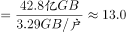

# 现期平均数逆用（户均流量反推接入户数：份数=总量÷平均数）

考点：[[20-考点/资料分析/平均数/现期平均数逆用（户均流量反推接入户数：份数=总量÷平均数）|平均数 / 现期平均数逆用（户均流量反推接入户数：份数=总量÷平均数）]]
材料：[[15-材料/资料分析/257880 全国移动互联网接入流量：2017年6|257880 全国移动互联网接入流量：2017年6]]

**问法模型**：题干问'某月接入户数约为多少亿户'→ 由图中该月接入流量（柱）÷该月户均流量（线）反推户数，即总量=平均数×份数的逆用

## 推理链
1. 第1步：题干锁定2018年3月，需从柱线复合双轴图中取该月'同月配对'数据：柱（左轴）接入流量42.8亿GB，线（右轴）户均流量3.29GB/户
2. 第2步：由'户均流量=接入流量÷接入户数'变形得公式：接入户数=接入流量÷户均流量
3. 第3步：代入计算：42.8÷3.29≈13.0（验证：3.29×13=42.77≈42.8，量级为亿户）
4. 第4步：与选项对照：A12.4、B12.7、C13.0、D13.3，计算值13.0精确对应C，故选C

**最快解法**：⚡ 乘法反验（胜过直除）：拿选项C的13去乘户均3.29，3.29×13=42.77≈柱值42.8，秒锁C；若直除则截位 42.8÷3.29≈428÷33≈13.0

## 易错点
- ⚠ 双轴量级陷阱：42.8读左轴（0-100）、3.29读右轴（0-5），两套刻度差约20倍，逐月配对读数不可串轴
- ⚠ 分子分母颠倒：户数=流量÷户均流量，若误算3.29÷42.8≈0.08会得到荒谬量级而误选
- ⚠ 时间定位：2018年3月位于横轴'2018年'区段（第10个柱），勿误取2017年同月（图中2017年仅6-12月，且数值明显更小）；另单位上亿GB÷GB/户=亿户，无需额外换算

## 母题抽象
> 🧩 当题干出现'某期户数/份数约为多少'且材料同时给出该期总量（柱值）与平均数（户均线值）时，用 总量÷平均数 反推份数，并用 平均数×选项 做乘法快速验证锁定答案

**同类特征**：接入户数约为多少亿户、指定单一月份（2018年3月）、柱线复合双轴图同月配对取数、户均流量（GB/户）作除数、总量÷平均数反推份数、选项为一位小数的近似值

## 相关题
（暂无）

---

### 题干
2018年3月，全国移动互联网接入户数约为多少亿户?

### 选项
- A. 12.4
- B. 12.7
- C. 13.0　✅
- D. 13.3

### 官方解析

根据题干“2018年3月，全国移动互联网接入户数约为······”，结合材料中给出2018年3月全国移动互联网接入流量和户均全国移动互联网接入流量可知：全国移动互联网接入户数，可判定本题为现期平均数问题。定位图形材料可得：2018年3月，全国移动互联网接入流量为42.8亿GB，户均全国移动互联网接入流量为3.29GB/户。则全国移动互联网接入户数亿户。

故正确答案为C。

### 给定材料

        2018年上半年，全国移动互联网累计流量达266亿GB，同比增长；其中通过手机上网的流量达到262亿GB，同比增长。

