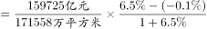
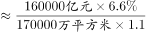
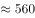

# 平均数增长量计算（两期均价差）

考点：[[20-考点/资料分析/平均数/平均数增长量计算（两期均价差）|平均数 / 平均数增长量计算（两期均价差）]]
材料：[[15-材料/资料分析/257856 2019年全国及东部、中部、西部、东|257856 2019年全国及东部、中部、西部、东]]

**问法模型**：题干为'与2018年相比，2019年……均价约'+选项为'增长/下降+具体元数' → 平均数增长量模型：先定方向，再算两期均价差额

## 推理链
1. 第1步：从文字段/表二提取：2019年商品房销售额159725亿元（同比+6.5%），销售面积171558万平方米（同比-0.1%）
2. 第2步：定方向——分子（销售额）增速a=+6.5%＞分母（销售面积）增速b=-0.1%，均价必上升，排除C、D
3. 第3步：现期均价=159725亿元÷171558万平方米，量级换算×10⁴，159725÷171558≈0.931，即约9311元/平方米
4. 第4步：基期换算：2018年销售额=159725÷(1+6.5%)≈150024亿元，2018年销售面积=171558÷(1-0.1%)≈171730万平方米
5. 第5步：2018年均价=150024÷171730×10⁴≈8737元/平方米
6. 第6步：增长量=9311-8737≈574元（或用公式9311×(6.5%+0.1%)÷1.065≈577元），为正且最接近580元，选A

**最快解法**：⚡ 平均数增长量公式法：先比增速定方向（a=6.5%＞b=-0.1%，必增长，秒排C/D），再套 增长量=现期均价×(a-b)/(1+a)=9311×6.6%÷1.065≈9311×6.2%≈577元→选A；若直除，注意亿元÷万平方米结果须×10⁴换算

## 易错点
- ⚠ 量级陷阱：159725÷171558≈0.93只是万元级结果，必须×10⁴才是元/平方米（约9311元/平方米），漏换算会得出0.93或930的错误量级
- ⚠ 方向误判：销售面积增速为-0.1%（下降），但分子增速6.5%高于分母，均价应上升；被面积负增长带偏会错选C/D
- ⚠ 基期换算符号：面积增速为负，2018年面积=171558÷(1-0.1%)，误写成÷(1+0.1%)或分子分母增速混用会算错基期均价

## 母题抽象
> 🧩 当题干出现'与上年相比，今年平均/均价/单位量增长或下降多少（带具体单位）'时，先比较分子分母增速定升降方向排除两项，再用'增长量=现期平均数×(a-b)/(1+a)'估算差额，验证最接近选项

**同类特征**：与2018年相比、销售均价、增长/下降+具体元数、平均数增长量、跨指标相除（亿元÷万平方米）、量级换算×10⁴

## 相关题
- [[10-真题/资料分析/增长/2606259 增长量计算（无整体增速，分项用同比变化率求增长量后求和）|2606259]]（广东 2020，相关度1）
- [[10-真题/资料分析/平均数/19283733 平均数增长量（平均每笔金额的同比增减额）|19283733]]（国考 2025，相关度1）
- [[10-真题/资料分析/平均数/13504651 平均数增长量（单位面积成交额的同比增量）|13504651]]（辽宁 2025，相关度1）
- [[10-真题/资料分析/平均数/2578805 平均数（户均）增长量计算，含下降型基期量回推|2578805]]（四川 2020，相关度1）
- [[10-真题/资料分析/平均数/5802087 平均数增长量（升降判定+幅度计算）|5802087]]（浙江 2023，相关度1）

---

### 题干
与2018年相比，2019年全国商品房销售均价约：

### 选项
- A. 增长580元　✅
- B. 增长710元
- C. 下降580元
- D. 下降710元

### 官方解析

根据题干“与2018年相比，2019年······均价约”，结合选项为，可判定本题为平均数的增长量计算问题。定位文字材料第一段“2019年，全国商品房销售面积171558万平方米，比上年下降······商品房销售额159725亿元，增长”，商品房销售均价，代入平均数的增长量公式：元，最接近A项。

故正确答案为A。

### 给定材料

        2019年全国房地产开发投资132194亿元，比上年增长，增速比上年加快0.4个百分点。其中，住宅投资97071亿元，增长，增速比上年加快0.5个百分点。2019年，全国商品房销售面积171558万平方米，比上年下降。其中，住宅销售面积增长，办公楼销售面积下降，商业营业用房销售面积下降。商品房销售额159725亿元，增长，增速比上年回落5.7个百分点。其中，住宅销售额增长，办公楼销售额下降，商业营业用房销售额下降。

