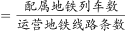

# 现期平均数计算与大小比较（列-条）

考点：[[20-考点/资料分析/平均数/现期平均数计算与大小比较（列-条）|平均数 / 现期平均数计算与大小比较（列/条）]]
材料：[[15-材料/资料分析/269188 2019年全国地铁（城轨交通）运营规|269188 2019年全国地铁（城轨交通）运营规]]

**问法模型**：题干问'2019年末平均每条运营的地铁线路配属地铁列车数最多'→ 现期平均数模型：配属地铁列车数÷运营线路条数，四个选项城市逐一计算取最大

## 推理链
1. 第1步：题干时间'2019年末'与表1口径一致（表注：除客运量为全年值外，其余指标均为年末时点值），判定为现期平均数，无需基期换算
2. 第2步：定位表1提取四城两项数据——广州：13条、510列；武汉：9条、435列；成都：7条、410列；南京：5条、203列
3. 第3步：套用'平均每条线路配属列车数=配属列车数÷运营线路条数'：广州510÷13≈39.2列/条，武汉435÷9≈48.3列/条，成都410÷7≈58.6列/条，南京203÷5=40.6列/条
4. 第4步：比较四个商值：58.6＞48.3＞40.6＞39.2，成都最大，对应选项C

**最快解法**：⚡ 首位/截位直除：四个除式只看商的首位即可分出高下——成都410÷7首位'5'（约58.6），武汉435÷9首位'4'（约48.3），南京203÷5首位'4'（40.6），广州510÷13首位'3'（约39.2），成都明显领先，直接锁定C，无需精算到小数位

## 易错点
- ⚠ 分子分母混淆：本题分子是'配属列车数'（列），与同材料'平均每条线路长度'模型（分子为线路长度公里）同分母不同分子，切勿拿489.4÷13等长度数据代入
- ⚠ 条数多≠平均值高：广州13条、南京仅5条，但广州510÷13≈39.2反而是四个选项中最小，南京40.6高于广州，必须逐项做除法而非凭条数/列车总数直觉排序
- ⚠ 时间口径：列车数与线路条数均为2019年末时点值，与题干一致属现期问题，勿误作基期或跨期计算

## 母题抽象
> 🧩 当题干出现'平均每条/每个/每家…的…最多（或最高）'且材料时间与题干一致时，用现期平均数模型（分子指标÷分母单位数），对选项逐一截位直除、先比商的首位即可锁定最大者

**同类特征**：平均每条……配属地铁列车数、最多、2019年末、现期平均数、表格四个选项城市逐一计算、列/条

## 相关题
- [[10-真题/资料分析/平均数/4674812 现期平均数计算（每所学校平均在校生数＝人数÷学校数）|4674812]]（选调 2021，相关度2）
- [[10-真题/资料分析/平均数/13319360 现期平均数（总量÷份数）|13319360]]（江苏 2025，相关度1）
- [[10-真题/资料分析/平均数/13504650 现期平均数计算与多期排序比较|13504650]]（辽宁 2025，相关度1）
- [[10-真题/资料分析/平均数/18385424 现期平均数计算与比较（单价-均价=总额÷数量，跨双轴图取数）|18385424]]（浙江 2024，相关度1）
- [[10-真题/资料分析/平均数/18643712 现期平均数计算（累计值求月均）|18643712]]（天津 2026，相关度1）

---

### 题干
以下城市中，2019年末平均每条运营的地铁线路配属地铁列车数最多的是：

### 选项
- A. 广州
- B. 武汉
- C. 成都　✅
- D. 南京

### 官方解析

根据题干“2019年末平均每条运营的地铁线路配属地铁列车数······”，结合材料时间为2019年，可判定本题为现期平均数问题。定位表格可知，广州运营地铁线路条数为13条，配属地铁列车510列；武汉运营地铁线路条数为9条，配属地铁列车435列；成都运营地铁线路条数为7条，配属地铁列车410列；南京运营地铁线路条数为5条，配属地铁列车203列。

根据“平均每条运营的地铁线路配属地铁列车数”，则A项：广州为列；B项：武汉为列；C项：成都为列；D项：南京为列。故选项中2019年末平均每条运营的地铁线路配属地铁列车数最多的城市是成都。

故正确答案为C。

### 给定材料

        2019年全国地铁运营线路长度达5181公里，占城轨交通运营线路总里程的。

        2019年末，我国城轨交通配属地铁列车6178列，全年实现地铁客运量227.76亿人次。

