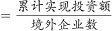
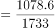

# 现期平均数计算（总量÷份数）

考点：[[20-考点/资料分析/平均数/现期平均数计算（总量÷份数）|平均数 / 现期平均数计算（总量÷份数）]]
材料：[[15-材料/资料分析/269200 2020年1-2月我国对外投资合作情|269200 2020年1-2月我国对外投资合作情]]

**问法模型**：题干问'对每个当期内产生非金融类直接投资的境外企业的投资额均值约为多少'→ 时间与材料一致，用现期平均数模型：投资总额÷境外企业数，直接除法估算

## 推理链
1. 第1步：题干时间'2020年1-2月'与材料现期一致，问'每个……境外企业……均值'，判定为现期平均数，无需基期还原
2. 第2步：定位材料第一段，提取分子与分母：累计投资额1078.6亿元人民币；当期内产生直接投资的境外企业数为1733家（147个'国家和地区'是国家/地区数，非企业数）
3. 第3步：代入公式：均值=1078.6÷1733，截位估算1080÷1730≈0.62（验证：1733×0.6≈1040，与1078.6同量级）
4. 第4步：与选项对照：0.62最接近D项0.6；若误用147国做分母得约7.3、误用其他分母对应A/B/C均不吻合，排除A、B、C，选D

**最快解法**：⚡ 截位直除：1078.6÷1733≈1080÷1730，首位商0、次位商6，即约0.62，直接锁定D=0.6；再用1733×0.6≈1040≈1078.6做量级验证

## 易错点
- ⚠ 分母主体错位：题干强调'每个当期内产生非金融类直接投资的境外企业'，分母是1733家境外企业，误用147个国家/地区做分母会得约7.3，远离所有选项
- ⚠ 时间口径陷阱：文中出现'同比增长'（且增速数值缺失）易诱导做基期换算，但题干求现期2020年1-2月的均值，直接用现期总额除以现期企业数即可
- ⚠ 量级/小数点校验：结果约0.62不足1，可先粗判1733家均摊1078.6亿元必小于1亿元/家，快速排除A(1.6)、B(1.3)、C(0.8)

## 母题抽象
> 🧩 当题干出现'每个/平均每家（企业）……均值约为多少'且时间与材料现期一致时，用现期平均数=现期总量÷对应份数，截位直除估算，并核对分母是与分子直接对应的主体数（企业数而非国家数）

**同类特征**：每个当期内产生……投资的境外企业、均值约为多少亿元人民币、现期平均数问法、时间与材料现期一致（2020年1-2月）、分子为累计投资总额、分母为境外企业数而非国家数

## 相关题
（暂无）

---

### 题干
2020年1-2月，我国境内投资者对每个当期内产生非金融类直接投资的境外企业的非金融类直接投资额均值约为多少亿元人民币？

### 选项
- A. 1.6
- B. 1.3
- C. 0.8
- D. 0.6　✅

### 官方解析

根据题干“2020年1-2月，······每个······均值约为多少亿元人民币”，可判定本题为现期平均数问题。定位文字资料第一段“2020年1-2月，我国境内投资者共对全球147个国家和地区的1733家境外企业进行了非金融类直接投资，累计实现投资1078.6亿元人民币，同比增长”，可得，累计实现投资额1078.6亿元人民币，境外企业数为1733家，故题干所求亿元人民币。

故正确答案为D。

### 给定材料

        2020年1-2月，我国境内投资者共对全球147个国家和地区的1733家境外企业进行了非金融类直接投资，累计实现投资1078.6亿元人民币，同比增长。对外承包工程完成营业额1080亿元人民币，同比下降，新签合同额2150.3亿元人民币，同比增长。对外劳务合作派出各类劳务人员3.9万人，同比减少2.9万人，2月末在外各类劳务人员77.8万人。

        2020年1-2月，我国对外投资合作主要呈现以下特点：

        一是对“一带一路”投资合作增幅较大。2020年1-2月，我国企业对“一带一路”沿线的48个国家有新增投资，合计27.2亿美元，同比增长。在“一带一路”沿线的59个国家新签对外承包工程合同额153.6亿美元，同比增长，完成营业额91.4亿美元。

        二是对外投资结构持续多元。2020年1-2月，对外投资主要流向租赁和商务服务业、批发和零售业、制造业和采矿业等传统投资领域，占对境外企业非金融类直接投资的比重分别为、、和。其中流向租赁和商务服务业的投资额同比增长，成为增速最高的领域。

        三是对外承包工程新签大项目增多。2020年1-2月，对外承包工程新签合同额在5000万美元以上的项目有115个，较去年同期增加29个，占新签合同总额的。

