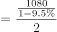
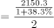
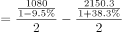

# 基期平均数（月均）作差比较

考点：[[20-考点/资料分析/平均数/基期平均数（月均）作差比较|平均数 / 基期平均数（月均）作差比较]]
材料：[[15-材料/资料分析/269200 2020年1-2月我国对外投资合作情|269200 2020年1-2月我国对外投资合作情]]

**问法模型**：题干以基期时间（2019年1-2月）+'月均'+两指标高低及幅度档位提问 → 基期平均数模型：先用基期公式还原2019年两量，各除以2得月均，作差后判断方向（高/低）与幅度（是否超过300亿元）

## 推理链
1. 第1步：题干时间为2019年1-2月（基期），材料数据为2020年1-2月（现期），定位第一段提取现期数据：对外承包工程完成营业额1080亿元人民币（同比下降）、新签合同额2150.3亿元人民币（同比增长），1-2月共2个月
2. 第2步：规则——基期量=现期量/(1+同比增速)，月均=基期量÷2，所求=月均完成营业额−月均新签合同额
3. 第3步：代入方向判断——营业额同比下降则基期值1080/(1−降幅)>1080亿元，新签合同额同比增长则基期值2150.3/(1+增幅)<2150.3亿元
4. 第4步：月均差=（1080/(1−降幅)−2150.3/(1+增幅)）÷2，按官方解析代入卷面增速计算，差值为负且绝对值不足300亿元
5. 第5步：差值为负→2019年1-2月月均完成营业额低于月均新签合同额→排除A、B（'高'方向）；绝对值不足300亿元→排除D（'低300亿元以上'）
6. 第6步：与选项对照锁定C'低不到300亿元人民币'，与官方答案一致

**最快解法**：⚡ 基期公式法+定性定档：先看'一降一升'定方向——营业额同比下降→基期营业额>1080亿元，新签合同额同比增长→基期新签<2150.3亿元，故月均营业额必低于月均新签（排除A、B）；再按1080/(1−降幅)、2150.3/(1+增幅)截位直除还原基期值，各除以2作差，差值绝对值不足300亿元（排除D），直接锁定C，无需精确计算

## 易错点
- ⚠ 基期与现期混淆：若直接用现期值作差(1080−2150.3)÷2≈−535亿元，会误选D'低300亿元以上'；必须先用基期公式还原2019年数值（降幅使营业额基期变大、增幅使新签基期变小，差值缩小至300亿元以内）
- ⚠ 漏除月数：'月均'要求除以2个月，若只算基期两月总量之差（约400亿元级）会跨越'300亿元'档位误判为D；除以2后差值才落入'不到300亿元'区间
- ⚠ 方向误判：'同比下降'意味着基期值比现期大，'同比增长'意味着基期值比现期小，两个增速方向相反，看反任一个都会在'高/低'之间选错；另注意'不到300'与'300以上'的临界档位划分

## 母题抽象
> 🧩 当题干出现'基期时间+月均/平均+两指标比较高或低及幅度档位'特征时，用基期公式（现期/(1+r)）还原两量、除以时段数后作差，先依据同比升降定性定'高/低'方向，再对照阈值判'不到/以上'档位

**同类特征**：基期时间2019年1-2月（早于材料时间）、月均（需除以月数2）、完成营业额与新签合同额两指标作差、同比一降一增、方向相反、高低+幅度档位式选项（不到/以上300亿元）、基期平均数差值比较

## 相关题
（暂无）

---

### 题干
2019年1-2月，我国对外承包工程月均完成营业额比月均新签合同额：

### 选项
- A. 高不到300亿元人民币
- B. 高300亿元人民币以上
- C. 低不到300亿元人民币　✅
- D. 低300亿元人民币以上

### 官方解析

根据题干“2019年1-2月，······月均······”，结合材料时间为2020年1-2月，可判定本题为基期平均数问题。定位文字材料第一段，可知2020年1-2月，对外承包工程完成营业额1080亿元人民币，同比下降，新签合同额2150.3亿元人民币，同比增长。根据公式，可得2019年1-2月，我国对外承包工程月均完成营业额，月均新签合同额，则题干所求亿元人民币，即2019年1-2月，我国对外承包工程月均完成营业额比月均新签合同额低不到300亿元人民币。

故正确答案为C。

### 给定材料

        2020年1-2月，我国境内投资者共对全球147个国家和地区的1733家境外企业进行了非金融类直接投资，累计实现投资1078.6亿元人民币，同比增长。对外承包工程完成营业额1080亿元人民币，同比下降，新签合同额2150.3亿元人民币，同比增长。对外劳务合作派出各类劳务人员3.9万人，同比减少2.9万人，2月末在外各类劳务人员77.8万人。

        2020年1-2月，我国对外投资合作主要呈现以下特点：

        一是对“一带一路”投资合作增幅较大。2020年1-2月，我国企业对“一带一路”沿线的48个国家有新增投资，合计27.2亿美元，同比增长。在“一带一路”沿线的59个国家新签对外承包工程合同额153.6亿美元，同比增长，完成营业额91.4亿美元。

        二是对外投资结构持续多元。2020年1-2月，对外投资主要流向租赁和商务服务业、批发和零售业、制造业和采矿业等传统投资领域，占对境外企业非金融类直接投资的比重分别为、、和。其中流向租赁和商务服务业的投资额同比增长，成为增速最高的领域。

        三是对外承包工程新签大项目增多。2020年1-2月，对外承包工程新签合同额在5000万美元以上的项目有115个，较去年同期增加29个，占新签合同总额的。

