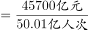
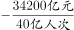

# 两期平均数增长量比较（人均收入差值）

考点：[[20-考点/资料分析/平均数/两期平均数增长量比较（人均收入差值）|平均数 / 两期平均数增长量比较（人均收入差值）]]
材料：[[15-材料/资料分析/269905 2015-2017年我国旅游业核心指|269905 2015-2017年我国旅游业核心指]]

**问法模型**：题干问'平均每人次创造收入比2015年增长/减少多少'→ 用'国内旅游收入÷国内旅游人数'分别求两期平均数再作差，与100元阈值比较

## 推理链
1. 第1步：定位表格，2017年国内旅游收入4.57万亿元、国内旅游人数50.01亿人次；2015年国内旅游收入3.42万亿元、国内旅游人数40亿人次
2. 第2步：平均每人次创造收入=国内旅游收入÷国内旅游人数；单位换算：万亿元÷亿人次=万元/人次，需×10^4折算为元/人次
3. 第3步：2017年人均=4.57÷50.01≈0.0914万元/人次=914元/人次
4. 第4步：2015年人均=3.42÷40=0.0855万元/人次=855元/人次
5. 第5步：差值=914-855≈59元，为正且小于100元，即'增长小于100元'
6. 第6步：对照选项，只有A'增长小于100元'符合，选A

**最快解法**：⚡ 截位直除+反证排除：若增长≥100元，则2017年收入应≥50.01亿人次×(855+100)元≈4.78万亿元>实际4.57万亿元，故增长必小于100元；或直接算4.57/50.01≈914元、3.42/40=855元，差约59元<100元，秒选A

## 易错点
- ⚠ 单位量纲：万亿元÷亿人次=万元/人次，折成元必须×10^4，漏乘会得0.0059误判远小于100而侥幸对、但量级理解错误，若反向乘错会得5900元误选B
- ⚠ 看串行/串列：'国内旅游收入'(4.57万亿元)不能误取相邻的'国际旅游收入'(1234亿美元)或'旅游业总收入'(5.4万亿元)，2017与2015两栏数据易横向看混
- ⚠ 时间口径：两期数据分属2017栏与2015栏，且均用当年总量直除，无需基期反推（本题不涉及2014年），勿套用增速公式多此一举

## 母题抽象
> 🧩 当题干出现'平均每人次/人均XX比某年增长(减少)且选项以固定金额阈值为界'时，用'总量÷总人数'分别求两期平均数（注意万亿元÷亿人次=万元/人次需×10^4折元）作差，与阈值比较即可，无需列增长量公式

**同类特征**：平均每人次创造收入、两期比较（比2015年）、选项为'增长/减少+大于/小于+固定数值'、收入÷人次结构、万亿元与亿人次单位换算、同一张表跨行跨列取数

## 相关题
（暂无）

---

### 题干
2017年，国内旅游平均每人次创造收入比2015年：

### 选项
- A. 增长小于100元　✅
- B. 增长大于100元
- C. 减少小于100元
- D. 减少大于100元

### 官方解析

根据题干“2017年，国内旅游平均每人次创造收入比2015年”，结合选项：增长/减少单位，可判定本题为平均数的增长量问题。定位表格材料可知：2017年国内旅游收入为4.57万亿元，国内旅游人数为50.01亿人次；2015年国内旅游收入为3.42万亿元，国内旅游人数为40亿人次。代入公式：平均数的增长量元，即增长小于100元。

故正确答案为A。

### 给定材料

