# 两期平均数比较（含基期平均数反推）

考点：[[20-考点/资料分析/平均数/两期平均数比较（含基期平均数反推）|平均数 / 两期平均数比较（含基期平均数反推）]]
材料：[[15-材料/资料分析/269905 2015-2017年我国旅游业核心指|269905 2015-2017年我国旅游业核心指]]

**问法模型**：题干问'2014-2017年出境旅游平均人次花费最多的年份'→用'出境旅游花费÷出境旅游人数'逐年求平均并比大小，2014年需由2015年总量及增速反推，或直接用'分子增速vs分母增速'的两期平均数结论判断升降。

## 推理链
1. 第1步：从表格提取数据——出境旅游花费：2015年1045亿美元(增速16.6%)、2016年1098亿美元(增速5.1%)、2017年1152.9亿美元(增速5.0%)；出境旅游人数：2015年1.17亿人次(增速9.3%)、2016年1.22亿人次(增速4.3%)、2017年1.31亿人次(增速7.4%)。
2. 第2步：平均人次花费=花费÷人数；表中无2014年数据，需用2015年总量÷(1+2015年增速)分别反推：人数=1.17/1.093≈1.07亿人次，花费=1045/1.166≈896亿美元。
3. 第3步：逐年计算平均数——2014年≈896/1.07≈837美元/人次；2015年=1045/1.17≈893美元/人次；2016年=1098/1.22≈900美元/人次；2017年=1152.9/1.31≈880美元/人次。
4. 第4步：也可用两期平均数结论验证——2015年分子增速16.6%>分母增速9.3%，平均数较2014年上升；2016年5.1%>4.3%，较2015年上升；2017年5.0%<7.4%，较2016年下降。
5. 第5步：比较得900>893>880>837，平均人次花费最高的年份为2016年，对应C选项。

**最快解法**：⚡ 两期平均数比较法（分子增速vs分母增速）：只需逐年比较'出境旅游花费增速'与'出境旅游人数增速'——2015年16.6%>9.3%、2016年5.1%>4.3%说明平均数连续两年上升，2017年5.0%<7.4%说明下降，故峰值在2016年；全程无需反推2014年基期值，也无需算出具体平均数。

## 易错点
- ⚠ 2014年数据表中未给，须用'2015年总量÷(1+增速)'对花费(1045/1.166)与人数(1.17/1.093)两行分别反推，若直接拿2015年值冒充2014年或只反推一行即出错
- ⚠ 看串行列：'出境旅游花费'(亿美元)与相邻的'实现国际旅游收入'(亿美元)、'出境旅游人数'(亿人次)与'入境旅游人数'位置相邻，且每栏分'总量''增速'两个子列，横向易取错增速
- ⚠ 2017年花费增速5.0%与2016年5.1%、人数增速4.3%数字极为接近，若看错增速子列会误判2017年平均数仍在上升，从而误选D(2017)

## 母题抽象
> 🧩 当题干问'某多年区间内总量÷总量的平均数最大/最小的年份'且首年基期数据未直接给出时，用两期平均数结论逐年比较分子增速与分母增速：分子增速>分母增速则平均数上升，反之下降，峰值即增速差由正转负的前一年，可完全绕开基期反推与具体计算。

**同类特征**：跨多年份区间且包含表中未直接给出的首年基期、平均人次花费/人均花费类问法、求最大/最多的年份、分子分母均为总量且各有同比增速、出境旅游花费÷出境旅游人数、选项为年份

## 相关题
（暂无）

---

### 题干
2014-2017年，出境旅游平均人次花费最多的年份是：

### 选项
- A. 2014
- B. 2015
- C. 2016　✅
- D. 2017

### 官方解析

根据题干“2014-2017年，出境旅游平均人次花费最多的年份是”，可判定本题为现期平均数问题。

方法一：定位表格数据，出境旅游平均人次花费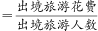，根据基期平均数公式：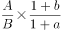，则2014年出境旅游平均人次花费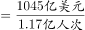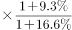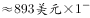；

2015年出境旅游平均人次花费：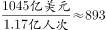美元；

2016年出境旅游平均人次花费：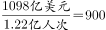美元；

2017年出境旅游平均人次花费：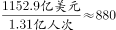美元。

因此2016年出境旅游平均人次花费最多。

方法二：根据出境旅游平均人次花费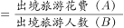，定位表格数据，可查找到对应分子A（旅游花费）和分母B（旅游人次）的具体量与增长率，可判定本题为两期平均数比较问题。根据两期平均数结论：分子（旅游花费）的增长率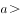分母（人次）的增长率，平均数上升；反之，下降。

则：2015年旅游花费增长率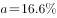；旅游人次增长率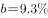，，因此2015年平均数2014年平均数；

2016年旅游花费增长率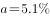；旅游人次增长率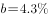，，因此2016年平均数2015年平均数；

2017年旅游花费增长率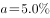；旅游人次增长率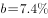，，因此2017年平均数2016年平均数；

综上可得，2016年出境旅游平均人次花费最多。

故正确答案为C。

### 给定材料

