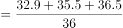
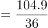
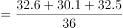
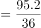
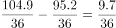
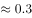

# 月均量计算与两区间平均数作差

考点：[[20-考点/资料分析/平均数/月均量计算与两区间平均数作差|平均数 / 月均量计算与两区间平均数作差]]
材料：[[15-材料/资料分析/270540 以2018年中国茶叶产销概况（产量、|270540 以2018年中国茶叶产销概况（产量、]]

**问法模型**：'某三年区间月均出口量比另一三年区间高多少'→先分别求两区间出口量总和，各除以36个月得月均，再作差；因两区间月数相同，可合并为'总量差÷36'一步求解

## 推理链
1. 第1步：从统计图柱状（出口数量）读取2016—2018年出口量为32.9、35.5、36.5万吨，2013—2015年为32.6、30.1、32.5万吨
2. 第2步：月均出口量=三年总量÷36个月；'2016—2018'与'2013—2015'各为完整3年（各含36个月），月数相同
3. 第3步：2016—2018总量=32.9+35.5+36.5=104.9万吨，2013—2015总量=32.6+30.1+32.5=95.2万吨，总量差=104.9−95.2=9.7万吨
4. 第4步：月均差=9.7÷36≈0.27万吨
5. 第5步：与选项对照，0.27最接近0.3，故选D

**最快解法**：⚡ 同月数作差法+截位直除：两区间均为36个月，直接算总量差104.9−95.2=9.7，再9.7÷36，口算36×0.27≈9.7，得约0.27≈0.3，秒选D；切勿除以3（得3.2误选A）

## 易错点
- ⚠ '月均'必须除以36个月（3年×12），若误按年均除以3得9.7÷3≈3.2，正好落入选项A的陷阱
- ⚠ 区间端点年份易漏：'2016—2018'与'2013—2015'各含3个完整年份，勿漏算端点年或误当2年（除以24）
- ⚠ 读图取数须取柱状出口量（万吨），勿误读折线出口均价（千美元/吨），尤其2016与2017年均价同为4.5易干扰对位

## 母题抽象
> 🧩 当题干出现'某时间段月均/季均量比另一时间段高多少'特征时，先确认两时间段单位时段数相同，则只需(两段总量之差)÷每段时段数，用截位直除估算后对照最近选项

**同类特征**：月均出口量、2016-2018年与2013-2015年两区间对比、高多少万吨、数据全部来自双轴图柱状、完整三年区间含端点

## 相关题
（暂无）

---

### 题干
2016-2018年我国茶叶月均出口量约比2013-2015年间高多少万吨？

### 选项
- A. 3.2
- B. 1.5
- C. 0.8
- D. 0.3　✅

### 官方解析

由题干“······月均出口量约比······高多少”，结合材料时间，可判定本题为现期平均数问题。定位图形材料，2016-2018年我国茶叶出口量分别是32.9万吨、35.5万吨、36.5万吨，则2016-2018年月均出口量万吨；2013-2015年我国茶叶出口量分别是32.6万吨、30.1万吨、32.5万吨，则2013-2015年月均出口量万吨。故2016-2018年我国茶叶月均出口量约比2013-2015年间高万吨。

故正确答案为D。

### 给定材料

        2018年全球茶叶产量585.6万吨，同比增长约，中国茶叶产量261.6万吨，同比增长0.7万吨。2018年，中国茶叶国内销售量为191万吨，同比增长，国内销售总额为2661亿元，出口量为36.5万吨，同比增长，出口总额为17.89亿美元（合人民币120亿元），同比增长（？）。

