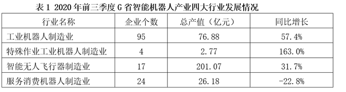

# 现期平均数比较（平均每企业产值=总产值÷企业个数）

考点：[[20-考点/资料分析/平均数/现期平均数比较（平均每企业产值=总产值÷企业个数）|平均数 / 现期平均数比较（平均每企业产值=总产值÷企业个数）]]
材料：[[15-材料/资料分析/277849 2020年前三季度G省智能机器人产业|277849 2020年前三季度G省智能机器人产业]]

**问法模型**：题干问'平均每个企业产值最高的是'→采用现期平均数模型：各行业总产值÷企业个数，逐一相除后比较大小

## 推理链
1. 第1步：题干时间为2020年前三季度且无基期要求，判定为现期平均数比较；定位表1，提取四大行业的企业个数与总产值：工业机器人95家/76.88亿元、特殊作业4家/2.77亿元、智能无人飞行器17家/201.07亿元、服务消费24家/26.18亿元
2. 第2步：所用公式为平均每个企业产值=该行业总产值÷该行业企业个数（均为现期值，无需换算基期）
3. 第3步：代入计算：工业机器人76.88÷95≈0.81亿元/家；特殊作业2.77÷4≈0.69亿元/家；智能无人飞行器201.07÷17≈11.8亿元/家；服务消费26.18÷24≈1.09亿元/家
4. 第4步：比较四个商值，11.8亿元/家远大于其余三项（0.69~1.09），对应智能无人飞行器制造业，与选项C对照一致，故选C

**最快解法**：⚡ 分数比较法（分子大分母小者大）：智能无人飞行器分子201.07为四行业最大、分母17又小于95和24，先排除A、D；特殊作业虽分母最小（4家）但分子2.77极小，2.77/4≈0.69，而201.07/17≈11.8，二者差十几倍，锁定C，全程只需两次粗算

## 易错点
- ⚠ 跨表口径混用：分子必须取表1'总产值'（智能无人飞行器201.07），误用表2'营业收入'（233.07）虽本题仍选C但口径错误，其他题可能改变结果
- ⚠ 被增速误导：特殊作业同比增速163.0%为四行业最高，但平均产值仅约0.69亿元/家，比较的是现期平均水平而非增长速度
- ⚠ 单一维度误判：不能只看总产值最大就直接选（工业机器人95家分母大），也不能只看企业个数最少就选（特殊作业4家分子太小），分子分母必须配对相除比较

## 母题抽象
> 🧩 当题干出现'平均每个（家）企业××最高/最低'特征时，用'平均数=对应总量÷单位个数'对各选项逐一相除比较，注意分子取与题干同口径的指标、勿被增速高低或总量/个数的单一维度误导

**同类特征**：平均每个企业产值最高、2020年前三季度、四大行业逐一比较、现期平均数、总产值÷企业个数、定位表1

## 相关题
- [[10-真题/资料分析/平均数/13319360 现期平均数（总量÷份数）|13319360]]（江苏 2025，相关度1）
- [[10-真题/资料分析/平均数/13504650 现期平均数计算与多期排序比较|13504650]]（辽宁 2025，相关度1）
- [[10-真题/资料分析/平均数/18385424 现期平均数计算与比较（单价-均价=总额÷数量，跨双轴图取数）|18385424]]（浙江 2024，相关度1）
- [[10-真题/资料分析/平均数/18643712 现期平均数计算（累计值求月均）|18643712]]（天津 2026，相关度1）
- [[10-真题/资料分析/平均数/18643737 现期平均数比较（平均每船次进口量与固定值8万吨比较计数）|18643737]]（天津 2026，相关度1）

---

### 题干
2020年前三季度，G省下列行业中，平均每个企业产值最高的是（    ）。

### 选项
- A. 工业机器人制造业
- B. 特殊作业工业机器人制造业
- C. 智能无人飞行器制造业　✅
- D. 服务消费机器人制造业

### 官方解析
根据题干“2020年前三季度······平均每个企业产值最高的是”，结合材料时间为2020年前三季度，可判断本题为现期平均数比较问题。定位表1可得，2020年前三季度G省工业机器人制造业企业95个，总产值76.88亿元，平均产值为亿元；特殊作业工业机器人制造业企业4个，总产值2.77亿元，平均产值为亿元；智能无人飞行器制造业企业17个，总产值201.07亿元，平均产值为亿元；服务消费机器人制造业企业24个，总产值26.18亿元，平均产值为亿元。比较可知，智能无人飞行器制造业企业平均产值最高。
故正确答案为C。

### 给定材料

        智能机器人产业是G省战略性新兴产业之一。2020年前三季度，G省智能机器人产业纳入规模以上工业统计的法人单位共140家，完成总产值306.90亿元，占全部规模以上工业产值的，同比增长，增速高于全部规模以上工业产值32.8个百分点；前三季度平均用工人数3.12万人，同比增长。

        2020年前三季度，G省智能机器人产业实现营业收入326.62亿元，同比增长超，四大行业营业收入均实现正增长，经济效益好于全部规模以上工业企业。

