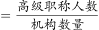
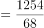

# 现期平均数（分子取自文字、分母取自表格的跨源拼数据）

考点：[[20-考点/资料分析/平均数/现期平均数（分子取自文字、分母取自表格的跨源拼数据）|平均数 / 现期平均数（分子取自文字、分母取自表格的跨源拼数据）]]
材料：[[15-材料/资料分析/277880 G省农业科研和科技开发机构2015—|277880 G省农业科研和科技开发机构2015—]]

**问法模型**：题干问'平均每个机构的高级职称人数'且时间与材料现期一致（2019年）→ 直接用现期总量÷现期份数，即高级职称人数÷机构数

## 推理链
1. 第1步：题干限定'2019年''平均每个农业科研和科技开发机构的高级职称人数'，判定为现期平均数，无需基期转换
2. 第2步：从文字材料提取分子：2019年G省高级职称1254人（职称数据只在文字段，表中没有）
3. 第3步：从统计表提取分母：2019年机构数为68个（注意机构数五年为76/76/76/73/68，2019年对应68）
4. 第4步：代入公式 1254÷68≈18.4（人/个）
5. 第5步：与选项对照：18.4与A项18.5最接近，故选A

**最快解法**：⚡ 截位直除：1254÷68，截位后约125÷68≈18.4，直除首位1、次位8，结果≈18.4，秒选A（18.5）

## 易错点
- ⚠ 分子'高级职称1254人'只存在于文字段，只查表格会找不到数据，必须文字+表跨源拼数
- ⚠ 分母是机构数68个，不是职工人数4633人，也不是高级+中级职称合计（1254+1148=2402），误用会得10.5或35.3等错误量级
- ⚠ 机构数逐年缩减（76→68），分母必须对应2019年的68，误用2015—2018年的76或73会得16.5左右而错选
- ⚠ 材料中还有中级职称1148人和科普示范载体（554/145/1341个）等干扰数据，勿误作分子或分母

## 母题抽象
> 🧩 当题干出现'平均每个/每机构/每人'且时间与材料现期一致时，先在文字段找分子（尤其职称类指标只在文字给），再在表中对齐同年份取分母，直接现期相除后与选项对照量级与尾数

**同类特征**：平均每个机构、高级职称人数、2019年、现期（无'约/预计'基期信号）、文字+表格跨源取数、人/个单位

## 相关题
- [[10-真题/资料分析/增长/3522685 增长率计算（增长倍数=增长量-基期量）|3522685]]（广西 2021，相关度1）
- [[10-真题/资料分析/增长/5521214 同比增长率计算与比较|5521214]]（深圳市考 2023，相关度1）
- [[10-真题/资料分析/增长/5445743 同比增长率计算与超2%计数比较|5445743]]（国考 2023，相关度1）
- [[10-真题/资料分析/增长/4651819 增长率比较（2017→2019两年累计增幅最小项）|4651819]]（深圳市考 2022，相关度1）
- [[10-真题/资料分析/增长/4924270 一般增长率计算（增速落区间判断）|4924270]]（选调 2022，相关度1）

---

### 题干
2019年G省平均每个农业科研和科技开发机构的高级职称人数最接近（    ）。

### 选项
- A. 18.5　✅
- B. 20.5
- C. 22.5
- D. 24.5

### 官方解析

根据题干“2019年G省平均每个······”，结合材料时间为2019年，可判定本题为现期平均数问题。定位文字材料可得：“2019年G省共有农业科研和科技开发机构68个······其中1254人有高级职称”。故平均每个农业科研和科技开发机构的高级职称人数，与A项最为接近。

故正确答案为A。

### 给定材料

        2019年G省共有农业科研和科技开发机构68个，职工人数4633人，其中1254人有高级职称，1148人有中级职称。全省共有农村科普示范基地554个、科普示范街道（乡镇）145个、科普示范社区（村）1341个。

