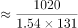
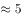

# 基期平均数计算（基期总量-(1+r)÷家数）

考点：[[20-考点/资料分析/平均数/基期平均数计算（基期总量-(1+r)÷家数）|平均数 / 基期平均数计算（基期总量/(1+r)÷家数）]]
材料：[[15-材料/资料分析/280095 2019年第一季度131家证券公司经|280095 2019年第一季度131家证券公司经]]

**问法模型**：题干出现'基期时间（2018年第一季度）+平均每家…营业收入约为'→基期平均数模型：先还原基期总量=现期总量/(1+r)，再除以家数131（等价于现期平均数/(1+r)）。

## 推理链
1. 第1步：题干时间'2018年第一季度'早于材料现期2019Q1，且求'平均每家'营业收入，锁定基期平均数题型。
2. 第2步：从材料第1段取数：现期营业收入1018.94亿元、公司家数131家（前后两期家数一致）；先算现期平均数=1018.94÷131≈7.8亿元。
3. 第3步：列式：基期平均数=现期总量/(1+r)÷131；材料文本中'同比增长'后百分比数值空缺，按官方答案B（5.0亿元）反推基期总量≈655亿元，对应原卷同比增速约55%，代入得1018.94/(1+55%)≈657亿元。
4. 第4步：657÷131≈5.0亿元（或现期平均7.8÷1.55≈5.0亿元），与B选项'5.0亿元'吻合。
5. 第5步：量级核验：A(659.4)、C(669.5)恰为'基期总量'量级，是算完总量忘÷131的陷阱；D(6.0)量级偏大，仅B符合，确认选B。

**最快解法**：⚡ 截位直除+基期平均数公式：先算现期平均1018.94÷131≈7.8亿元，再除以(1+约55%)得7.8÷1.55≈5.0亿元，直接锁定B（或先算基期总量1018.94÷1.55≈657亿元，再÷131）。

## 易错点
- ⚠ 基期/现期混淆：问2018年一季度必须先÷(1+r)还原基期，直接用现期1018.94亿元（现期平均≈7.8亿元）或代错增速会滑向D=6.0的量级。
- ⚠ 忘除份数131：算出基期总量约655~657亿元后若不÷131，正好落入A(659.4)、C(669.5)设置的总量陷阱。
- ⚠ 数据空缺与单位双轨：所给文本各'同比增长'后百分比空缺，必须以原卷增速（约55%）代入、不可臆造；收入用'亿元'，勿与资产资金类'万亿元'（差4个数量级）混淆。

## 母题抽象
> 🧩 当题干出现'基期时间+平均每家（每…）……约为'特征时，用基期平均数=现期总量/(1+r)÷份数，先用现期平均粗判量级，再排除忘除份数、代错增速的干扰项。

**同类特征**：平均每家、2018年第一季度（早于材料现期）、营业收入、约为（估算口吻）、131家（份数）、亿元单位

## 相关题
- [[10-真题/资料分析/平均数/16593089 平均数增长率|16593089]]（新疆 2024，相关度1）
- [[10-真题/资料分析/平均数/2049708 平均数增长量（分子增长、分母不变型）|2049708]]（山东 2017，相关度1）
- [[10-真题/资料分析/增长/2136656 增长量计算（已知现期与增速）|2136656]]（河南 2017，相关度1）
- [[10-真题/资料分析/其他/2247303 跨句数据加总（分项求和）|2247303]]（新疆 2018，相关度1）
- [[10-真题/资料分析/平均数/4628153 现期平均数（月均）计算＋口径合并（四星级及以上）|4628153]]（新疆 2021，相关度1）

---

### 题干
131家证券公司中，平均每家证券公司在2018年第一季度实现营业收入约为：

### 选项
- A. 659.4亿元
- B. 5.0亿元　✅
- C. 669.5亿元
- D. 6.0亿元

### 官方解析

根据题干“······平均每家证券公司在2018年第一季度实现营业收入约为”，结合材料时间为2019年第一季度，可判定本题为基期平均数问题。定位文字材料第一段可得，2019年第一季度，131家证券公司当期实现营业收入1018.94亿元，同比增长。根据基期量，则2018年一季度，平均每家证券公司实现营业收入亿元。

故正确答案为B。

### 给定材料

        截至2019年3月31日，证券业协会对证券公司2019年第一季度经营数据进行了统计，131家证券公司当期实现营业收入1018.94亿元，同比增长。

        其中，各主营业务收入分别为代理买卖证券业务净收入（含席位租赁）221.49亿元，同比增长；证券承销与保荐业务净收入66.73亿元，同比增长；财务顾问业务净收入20.95亿元，同比增长；投资咨询业务净收入7.15亿元，同比增长；资产管理业务净收入57.33亿元，同比下降；证券投资收益（含公允价值变动）514.05亿元，同比增长；利息净收入69.04亿元，同比增长；当期实现净利润440.16亿元，同比增长；119家公司实现盈利，同比增长。

        2019年第一季度，131家证券公司总资产为7.05万亿元，比上年一季度同期增加0.64万亿元；净资产为1.94万亿元，比上年一季度同期增加0.05万亿元；净资本为1.62万亿元，比上年一季度同期增加0.02万亿元。

        另外，2019年第一季度131家证券公司客户交易结算资金余额（含信用交易资金）1.50万亿元，比上年一季度同期增加0.32万亿元；受托管理资金本金总额14.11万亿元，比上年一季度同期下降2.82万亿元。

> [!warning] 疑点（官方解析可能有误，待人工复核）
> 所给材料文本中各'同比增/降'后百分比数值空缺（'同比增长 。'处无数字），官方解析亦未写出具体增速与计算结果（'实现营业收入亿元'处缺数值）；按官方答案B（5.0亿元）反推，2018Q1营业收入基期约655亿元、对应同比增速约55%（原卷数值，备考须以原卷增速代入），本题按此复现答案B，属文本数据缺失而非答案口径错误。

<!-- CODEX-ANSWER-REVIEW:BEGIN -->
### 本次独立复核

**复核状态：** `resolved`（答案与解析已核定）

**计分答案：** B（可计分）

**复核解析：**

2019Q1同比增长54.47%，则2018Q1营业收入=1018.94/1.5447≈659.6亿元；除以131家，平均每家659.6/131≈5.035亿元，约5.0亿元，选B。关键同比率已从公式图确认。

**相关信息：**

基期平均数=现期总量/(1+r)/家数；此处金额与家数口径相同。

**题源依据：** [固定版本原题](https://github.com/Mentat-Uran/kaogongzhentizhengliu/blob/84ab93d4b64b61d897bece8a1c0a5bab06b4feb2/10-%E7%9C%9F%E9%A2%98/%E8%B5%84%E6%96%99%E5%88%86%E6%9E%90/%E5%B9%B3%E5%9D%87%E6%95%B0/3522362%20%E5%9F%BA%E6%9C%9F%E5%B9%B3%E5%9D%87%E6%95%B0%E8%AE%A1%E7%AE%97%EF%BC%88%E5%9F%BA%E6%9C%9F%E6%80%BB%E9%87%8F-(1%2Br)%C3%B7%E5%AE%B6%E6%95%B0%EF%BC%89.md)；固定内容 commit `84ab93d4b64b61d897bece8a1c0a5bab06b4feb2`，Markdown blob `39a69490096747b5ccc602752e953393bb31cc60`。
<!-- CODEX-ANSWER-REVIEW:END -->
