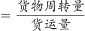
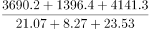
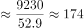
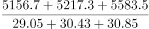
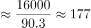
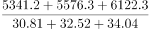
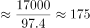
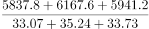
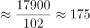

# 复合比率（平均运输距离=周转量÷货运量）的季度加总比较

考点：[[20-考点/资料分析/平均数/复合比率（平均运输距离=周转量÷货运量）的季度加总比较|平均数 / 复合比率（平均运输距离=周转量÷货运量）的季度加总比较]]
材料：[[15-材料/资料分析/280257 2020年1-12月全国公路货物运输|280257 2020年1-12月全国公路货物运输]]

**问法模型**：题干问'各季度平均运输距离最高'→ 采用复合平均数模型：季度货物周转量合计÷季度货运量合计，四个比值比大小，不可用各月比率的平均数替代

## 推理链
1. 第1步：从图下注释提取公式'货物平均运输距离=货物周转量/货运量'，并按季度口径拼组月份：Q1=1-3月、Q2=4-6月、Q3=7-9月、Q4=10-12月
2. 第2步：逐月读取数据，Q1周转量3690.2+1396.4+4141.3=9227.9亿吨公里、货运量21.07+8.27+23.53=52.87亿吨；Q2周转量5156.7+5217.3+5583.5=15957.5、货运量29.05+30.43+30.85=90.33
3. 第3步：继续加总Q3周转量5341.2+5576.3+6122.3=17039.8、货运量30.81+32.52+34.04=97.37；Q4周转量5837.8+6167.6+5941.2=17946.6、货运量33.07+35.24+33.73=102.04
4. 第4步：代入'合计÷合计'：Q1≈9227.9/52.87≈174.5公里，Q2≈15957.5/90.33≈176.7公里，Q3≈17039.8/97.37≈175.0公里，Q4≈17946.6/102.04≈175.9公里
5. 第5步：四个比值非常接近（174.5~176.7），用基准值176反乘验证：Q2的15957.5>90.33×176≈15898为唯一超过176者，其余Q1、Q3、Q4均低于176
6. 第6步：与选项对照，第二季度平均运输距离最高，选B

**最快解法**：⚡ 截位直除+基准值反乘验证：四个季度分别'周转量合计÷货运量合计'粗除得约174.5/176.7/175.0/175.9公里；因差距极小，再以176为基准反乘各季度货运量合计（52.87×176≈9305>9228，90.33×176≈15898<15958，97.37×176≈17137>17040，102.04×176≈17959>17947），仅Q2超过176，直接锁定B，避免四个除法精算

## 易错点
- ⚠ 复合比率陷阱：季度平均距离必须用'季度周转量合计÷季度货运量合计'，若把各月距离（如6月约181公里、5月约171.5公里）再算术平均会得错误结论
- ⚠ 季度拼组陷阱：需跨月自行加总（Q1=1-3月等），2月为断崖低谷（8.27亿吨、1396.4亿吨公里）极易漏加或误读，Q1货运量与周转量均被2月拉低
- ⚠ 精度陷阱：四个季度结果仅相差0.4~2.2公里（174.5~176.7），Q2与Q4只差约0.8公里，目测图形或粗略估算无法区分，必须精确加总与除法；另注意双轴单位不同，相除后隐含单位为公里，量级约170~180而非图中右轴7000的量级

## 母题抽象
> 🧩 当题干出现'平均运输距离/平均单价/亩产'等'总量A÷总量B'的复合比率并要求分组（季度/地区/月份区间）比较高低时，先分别加总分子与分母再相除，严禁对比率再平均；若各组比值差距极小，用某一基准值反乘分母合计做大小验证即可免精算除法

**同类特征**：各季度…最高、平均运输距离、货物周转量/货运量（注释派生公式）、季度需按月自行拼组、周转量÷货运量复合比率、四组比值差距极小需精算

## 相关题
（暂无）

---

### 题干
2020年各季度公路货物平均运输距离最高的季度是：

### 选项
- A. 第一季度
- B. 第二季度　✅
- C. 第三季度
- D. 第四季度

### 官方解析

根据题干“2020年各季度公路货物平均运输距离最高的季度是”，根据备注可知，货物平均运输距离，可判定本题为现期平均数比较问题。定位统计图可得，2020年各月份公路货物周转量与货运量，分别计算各季度货物平均运输距离进行比较即可。

第一季度：公里；第二季度：公里；第三季度：公里；第四季度：公里。

比较可知，第二季度公路货物平均运输距离最高。

故正确答案为B。

### 给定材料

