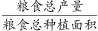
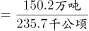
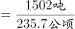
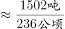
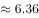

# 现期平均数计算（单产）与千公顷-万吨单位换算

考点：[[20-考点/资料分析/平均数/现期平均数计算（单产）与千公顷-万吨单位换算|平均数 / 现期平均数计算（单产）与千公顷/万吨单位换算]]
材料：[[15-材料/资料分析/294539 2018年H市国民经济与社会统计公报|294539 2018年H市国民经济与社会统计公报]]

**问法模型**：题干问'平均每公顷的粮食产量'→ 现期平均数模型：粮食总产量÷粮食总面积，核心是千公顷、万吨统一化为公顷、吨后作商

## 推理链
1. 第1步：定位第一段：2018年粮食种植面积235.7千公顷，全年粮食产量150.2万吨；题干时间与材料时间同为2018年，属现期平均数计算
2. 第2步：确认对应关系：玉米199.3千公顷、小麦4.7千公顷是面积构成，夏粮2.4万吨、秋粮147.9万吨是产量构成，单产只能用粮食总面积235.7千公顷对粮食总产量150.2万吨
3. 第3步：单位换算：235.7千公顷=235.7×10³公顷，150.2万吨=150.2×10⁴吨，两套单位各差10³量级
4. 第4步：代入公式 单产=150.2×10⁴吨÷235.7×10³公顷=(150.2/235.7)×10 吨/公顷
5. 第5步：截位直除：150.2/235.7≈0.637，乘10得≈6.37吨/公顷
6. 第6步：与选项对照：6.37吨/公顷与D项6.37吨一致，选D

**最快解法**：⚡ 截位直除+换算口诀'千公顷配万吨，商×10'：150.2/235.7≈0.637，直接×10得6.37，秒锁D

## 易错点
- ⚠ 漏做单位换算：直接150.2÷235.7≈0.637，忽略千公顷→公顷、万吨→吨各差1000倍，量级出错
- ⚠ 结构错配：误用玉米面积对夏粮产量，或只以秋粮147.9万吨计算，混淆面积构成与产量构成两套结构
- ⚠ 分母错选：误把油料3.0、棉花0.02千公顷并入总面积，或将产量只取夏粮/秋粮单项，导致结果偏离6.37

## 母题抽象
> 🧩 当题干出现'平均每公顷/每亩产量、人均'等平均数特征时，用'总量÷份数'模型，先统一单位（千公顷×1000、万吨×10000），再截位直除并核对选项量级

**同类特征**：平均每公顷、粮食产量、单产、千公顷对万吨、单位换算、现期平均数

## 相关题
- [[10-真题/资料分析/平均数/4673140 现期平均数（单位蓄积量：总量÷面积）|4673140]]（广东 2022，相关度2）
- [[10-真题/资料分析/平均数/13319360 现期平均数（总量÷份数）|13319360]]（江苏 2025，相关度1）
- [[10-真题/资料分析/平均数/13504650 现期平均数计算与多期排序比较|13504650]]（辽宁 2025，相关度1）
- [[10-真题/资料分析/平均数/18385424 现期平均数计算与比较（单价-均价=总额÷数量，跨双轴图取数）|18385424]]（浙江 2024，相关度1）
- [[10-真题/资料分析/平均数/18643712 现期平均数计算（累计值求月均）|18643712]]（天津 2026，相关度1）

---

### 题干
2018年H市平均每公顷的粮食产量约是：

### 选项
- A. 5.34吨
- B. 5.87吨
- C. 6.12吨
- D. 6.37吨　✅

### 官方解析

根据题干“2018年H市平均每公顷的粮食产量约是”，结合材料时间也是2018年，可判定本题为现期平均数计算问题。定位文字材料第一段可得：2018年H市粮食种植面积235.7千公顷······全年粮食产量150.2万吨。则2018年H市粮食的平均产量为吨/公顷，因此2018年H市平均每公顷的粮食产量约是6.36公顷，与D项最接近。

故正确答案为D。

### 给定材料

        2018年H市粮食种植面积235.7千公顷，油料种植面积3.0千公顷，棉花种植面积0.02千公顷。在粮食种植面积中，玉米种植面积199.3千公顷，小麦种植面积4.7千公顷。全年粮食产量150.2万吨。其中，夏粮2.4万吨，秋粮147.9万吨。

        2018年H市完成邮电业务总量108.2亿元。其中，邮政业务总量40.8亿元，同比增长26.5%；电信业务总量67.4亿元，同比增长56.7%。年末移动电话用户达到341万户，其中，3G移动电话用户达到25.7万户，4G移动电话用户达到241.4万户。全市互联网接入用户89.9万户，其中，新增互联网用户23.8万户。

        2018年全年全市保费收入65.4亿元，增长0.7%。其中，寿险业务保费收入39.5亿元，下降5.1%；健康和意外险业务保费收入9.1亿元，增长21.6%，增速同比增加5个百分点；财产险业务保费收入3.4亿元，增长25.2%；车险业务保费收入13.3亿元，增长1.8%。全年支付各类赔款及给付21.2亿元，增长5.3%。其中，寿险业务保费赔付11.0亿元，增长1.4%；健康和意外险业务保费赔付3.0亿元，增长68.7%；财产险业务保费赔付0.9亿元，增长5.7%；车险业务保费赔付6.4亿元，下降5.0%。

> [!warning] 疑点（官方解析可能有误，待人工复核）
> 官方解析末句'约是6.36公顷'存在笔误：单位应为'吨/公顷'，精确值150.2×10⁴÷235.7×10³≈6.372吨/公顷，四舍五入为6.37吨，解析数值6.36与6.37略有出入但不影响正确答案D的判定
