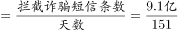
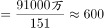

# 现期平均数（总量÷天数，含单位换算与天数枚举）

考点：[[20-考点/资料分析/平均数/现期平均数（总量÷天数，含单位换算与天数枚举）|平均数 / 现期平均数（总量÷天数，含单位换算与天数枚举）]]
材料：[[15-材料/资料分析/307043 2021年1-5月全国打击治理电信网|307043 2021年1-5月全国打击治理电信网]]

**问法模型**：'2021年1-5月平均每天拦截短信约多少万条'→ 现期平均数=总量÷真实天数，先做亿→万单位换算再直除

## 推理链
1. 第1步：定位第二段，2021年1-5月全国拦截诈骗短信9.1亿条；题干时间口径同为2021年1-5月，无基期字样，判定为现期平均数
2. 第2步：单位换算，9.1亿条=91000万条（亿→万需乘10000）
3. 第3步：枚举天数，2021年为平年（2月28天），1-5月天数=31+28+31+30+31=151天
4. 第4步：代入公式，平均每天=91000÷151≈602.6万条/天
5. 第5步：与选项对照，602.6≈603，对应选项C

**最快解法**：⚡ 截位直除：91000/151，先商600（151×600=90600），余400，400/151≈2.6，合计约602.6≈603，锁定C

## 易错点
- ⚠ 单位量级陷阱：材料给'亿条'而选项为'万条'，若不做亿→万换算，9.1÷151≈0.06，与选项量级完全对不上
- ⚠ 天数枚举错误：2021年是平年，2月为28天；若按闰年29天（152天）或按每月30天粗算（150天），结果分别为约599和607，易误选
- ⚠ 口径混淆：材料中另有'拦截电话6.1亿次''日均下发预警指令5.2万条'等相近指标，取数须锁定'拦截诈骗短信9.1亿条'，且不能用现成的'日均5.2万条'

## 母题抽象
> 🧩 当题干出现'平均每天/每月……多少（单位）'时，用平均数=总量÷期数：先把总量统一到选项单位（亿↔万），再按平闰年枚举真实天数（1-5月=31+28/29+31+30+31），截位直除验证最接近选项

**同类特征**：平均每天、2021年1-5月、拦截诈骗短信、单位问'万条'、现期平均数、需自行枚举天数

## 相关题
- [[10-真题/资料分析/平均数/13319360 现期平均数（总量÷份数）|13319360]]（江苏 2025，相关度1）
- [[10-真题/资料分析/平均数/13504650 现期平均数计算与多期排序比较|13504650]]（辽宁 2025，相关度1）
- [[10-真题/资料分析/平均数/18385424 现期平均数计算与比较（单价-均价=总额÷数量，跨双轴图取数）|18385424]]（浙江 2024，相关度1）
- [[10-真题/资料分析/平均数/18643712 现期平均数计算（累计值求月均）|18643712]]（天津 2026，相关度1）
- [[10-真题/资料分析/平均数/18643737 现期平均数比较（平均每船次进口量与固定值8万吨比较计数）|18643737]]（天津 2026，相关度1）

---

### 题干
2021年1-5月，全国平均每天拦截诈骗短信约多少万条？

### 选项
- A. 545
- B. 571
- C. 603　✅
- D. 659

### 官方解析

根据题干“2021年1-5月······平均每天······”，结合材料时间为2021年1-5月，可判定本题为现期平均数问题。定位文字材料第二段可得：2021年1-5月，全国拦截诈骗短信9.1亿条。2021年1-5月共计31+28+31+30+31=151天，则平均每天拦截诈骗短信万条。

故正确答案为C。

### 给定材料

        2021年1-5月，全国共破获电信网络诈骗案件11.4万起，打掉犯罪团伙1.4万个，抓获犯罪嫌疑人15.4万名，同比分别上升60.4%、80.6%和146.5%。2021年5月，全国共立电信网络诈骗案件8.46万起，与4月相比下降14.3%。

        2021年1-5月，全国拦截诈骗电话6.1亿次，拦截诈骗短信9.1亿条，封堵诈骗网址82.1万个。1-5月公安部日均下发预警指令5.2万条。

        2021年1-5月，全国共成功劝阻771万名群众免于受骗，紧急止付涉案资金2654亿元，为群众挽回经济损失991亿元。

        2021年1-5月，全国公安机关捣毁境内诈骗窝点6500余个，共破获被骗百万元以上案件881起，同比上升160.5%，先后组织20余次集中收网行动，抓获犯罪嫌疑人2421名，打掉技术开发平台、网络引流推广、虚拟货币洗钱等团伙380余个。

        2020年10月至2021年5月，全国公安机关会同检察、法院、通讯、金融等部门，共打掉“两卡”违法犯罪团伙1.5万个，缴获涉诈电话卡373.3万张，银行卡56.6万张，惩戒“两卡”失信人员17.3万名，整治违规行业网点，机构1.8万家。

