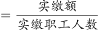
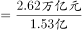
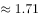
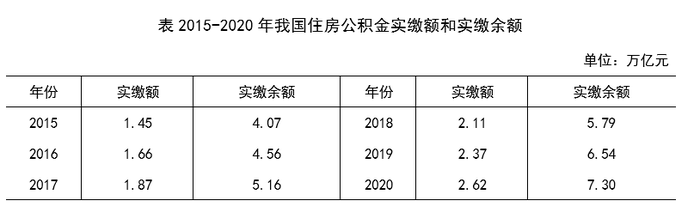

# 现期平均数计算（跨表图取数+单位量纲换算）

考点：[[20-考点/资料分析/平均数/现期平均数计算（跨表图取数+单位量纲换算）|平均数 / 现期平均数计算（跨表图取数+单位量纲换算）]]
材料：[[15-材料/资料分析/307973 2015—2020年我国住房公积金的|307973 2015—2020年我国住房公积金的]]

**问法模型**：题干'2020年……人均……为'→现期平均数模型：人均实缴=实缴额÷实缴职工人数，核心在'万亿元÷亿人=万元'的量纲换算

## 推理链
1. 第1步：由题干'2020年人均'判定现期平均数；定位统计表取2020年实缴额2.62万亿元（注意不是实缴余额7.30万亿元），定位统计图取2020年实缴职工人数1.53亿人（柱，左轴）
2. 第2步：公式：人均实缴=实缴额÷职工人数；量纲规则：万亿元÷亿人=万元/人（2.62万亿元=26200亿元）
3. 第3步：代入：2.62÷1.53≈1.712（万元/人），或26200亿÷1.53亿≈17124元≈1.71万元
4. 第4步：与选项对照：1.71万元即C；可反向验证1.71×1.53=2.616≈2.62成立，而1.61×1.53=2.463、1.87×1.53=2.861均偏差过大，故选C

**最快解法**：⚡ 直除+选项反乘验证：2.62÷1.53，首位商1、次位商7（1.53×1.7=2.601，余0.019），约1.71万元；考场更稳的是拿选项反乘1.53看谁最接近2.62——1.71×1.53=2.616≈2.62，秒选C

## 易错点
- ⚠ 量纲换算：2.62万亿元÷1.53亿人=1.71万元/人，若忘换算量级（如误按亿元÷亿人得2.62元或按万亿÷万得错误量级）极易错选
- ⚠ 分子取错指标：'实缴额'是当年流量2.62万亿元，'实缴余额'是期末存量7.30万亿元，误用余额得7.30÷1.53≈4.77万元，口径混淆即错
- ⚠ 跨表图取数+双轴陷阱：钱在表、人在图；图中柱（职工人数，亿人）须按左轴和标注读1.53，勿与点线（单位数，万个）的量纲量级混淆或误读右轴刻度

## 母题抽象
> 🧩 当题干出现'某年人均/户均/单位均……为多少金额'特征时，用现期平均数公式'总量÷份数'，先确认分子分母单位量纲（万亿元÷亿人=万元），再截位直除或用选项反乘验证最接近值

**同类特征**：现期人均计算、跨表图取数（表给钱、图给人）、万亿元÷亿人=万元量级换算、实缴额为流量非余额、选项为万元量级、2020年当期数值

## 相关题
（暂无）

---

### 题干
2020年我国实缴职工的人均实缴住房公积金为：

### 选项
- A. 1.50万元
- B. 1.61万元
- C. 1.71万元　✅
- D. 1.87万元

### 官方解析

根据题干“2020年······人均······为”，结合材料时间为2020年，可判定本题为现期平均数问题。定位统计表可得：2020年我国住房公积金实缴额为2.62万亿元；定位统计图可得：2020年我国住房公积金实缴职工人数为1.53亿人。则2020年我国实缴职工的人均实缴住房公积金万元。

故正确答案为C。

### 给定材料

