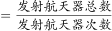
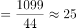
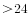

# 现期平均数求最大值（单次发射航天器数量=数量÷次数）

考点：[[20-考点/资料分析/平均数/现期平均数求最大值（单次发射航天器数量=数量÷次数）|平均数 / 现期平均数求最大值（单次发射航天器数量=数量÷次数）]]
材料：[[15-材料/资料分析/307974 2016—2020年（十三五期）全球|307974 2016—2020年（十三五期）全球]]

**问法模型**：题干问'单次发射航天器的最大数量'→用平均数模型'航天器发射数量(枚)÷发射次数(次)'逐年逐主体做除法，取最大值后与区间选项对照

## 推理链
1. 第1步：从表格提取'数量(枚)'与'次数(次)'两列，题干要求单次发射航天器数量=数量÷次数，需遍历2016—2020年中国、美国、俄罗斯、欧洲各年组合找最大
2. 第2步：公式：单次发射航天器数量=航天器发射数量÷发射次数（现期平均数，无需基期换算）
3. 第3步：粗筛候选：美国逐年72/22≈3.3、152/30≈5.1、212/31≈6.8、252/27≈9.3，俄罗斯2017年116/21≈5.5，欧洲2020年36/5=7.2，其余组合均更低
4. 第4步：锁定2020年美国（一箭多星致枚数突增至1099、次数44）代入：1099÷44≈24.98枚，用44×25=1100校验可知略小于25但大于24
5. 第5步：24.98枚>24枚，落入'大于24枚'区间，对照选项得A

**最快解法**：⚡ 极端值定位+截位直除：先扫分子找突增点——2020年美国1099枚远超其余年份且分母仅44次，直接1099÷44：44×25=1100≈1099，商约24.98>24，秒选A；其余主体最大比值不超过10，无需精算

## 易错点
- ⚠ 列口径切换：必须用'数量(枚)'列÷'次数(次)'列，两列同名相邻极易拿错，误用次数列则全错
- ⚠ 最大值定位遗漏：若只算美国2019年252/27≈9.3或只看个别年份，会漏掉2020年美国1099/44这个一箭多星造成的极端值
- ⚠ 区间端点误判：1099÷44≈24.98非常接近25，判断分界是24，若估算过粗或四舍五入丢精度会误选B，需用44×25=1100精确校验大于24

## 母题抽象
> 🧩 当题干出现'单次/平均每次…的最大数量'特征时，用'总量÷次数'的平均数模型逐主体逐年做除法，优先锁定分子突增的极端年份先算，再用区间端点精确验证

**同类特征**：单次发射航天器、最大数量、2016—2020年、数量÷次数、枚、区间式选项

## 相关题
- [[10-真题/资料分析/其他/15419185 月度时间序列区间求和（简单加和计算）|15419185]]（湖北 2025，相关度1）
- [[10-真题/资料分析/平均数/4737717 现期平均数计算（单件平均收入=总收入÷总业务量）|4737717]]（福建 2017，相关度1）

---

### 题干
2016—2020年全球主要国家或地区单次发射航天器的最大数量：

### 选项
- A. 大于24枚　✅
- B. 大于16枚且不大于24枚
- C. 小于11枚
- D. 不小于11枚且不大于16枚

### 官方解析

根据题干“2016—2020年······单次发射航天器······”，可判定本题为现期平均数问题。定位表格材料，可知2016—2020年中国、美国、俄罗斯、欧洲航天发射次数和航天器发射数量。根据公式：单次发射航天器数量，可知2020年美国单次发射航天器的数量最大。代入计算可得：2020年美国单次发射航天器数量枚枚。

故正确答案为A。

### 给定材料

> [!warning] 疑点（官方解析可能有误，待人工复核）
> 官方解析文字存在缺失（'根据公式：单次发射航天器数量'后公式未显示、'枚枚'处数值截断），但按1099÷44≈24.98>24可完全复现A选项，结论无误
