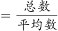
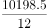
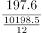
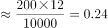

# 现期平均数之两步拼接（单位企业利润=利润总额÷企业数，企业数由营业收入÷单位企业营业收入间接求出）

考点：[[20-考点/资料分析/平均数/现期平均数之两步拼接（单位企业利润=利润总额÷企业数，企业数由营业收入÷单位企业营业收入间接求出）|平均数 / 现期平均数之两步拼接（单位企业利润=利润总额÷企业数，企业数由营业收入÷单位企业营业收入间接求出）]]
材料：[[15-材料/资料分析/308027 2019年A市专利密集型产业的增加值|308027 2019年A市专利密集型产业的增加值]]

**问法模型**：题干问'单位企业实现利润额约为多少亿元'→ 现期平均数模型：单位企业利润=利润总额÷企业数，其中企业数=营业收入总额÷单位企业营业收入，即 197.6÷(10198.5÷12)

## 推理链
1. 第1步：定位材料第三段，提取三个数据：2019年A市信息通信技术服务业营业收入10198.5亿元、利润197.6亿元、单位企业营业收入12亿元
2. 第2步：明确目标公式：单位企业利润=利润总额÷企业数，而材料未直接给企业数，须由'企业数=营业收入总额÷单位企业营业收入'间接推出
3. 第3步：代入求企业数：10198.5÷12≈850家
4. 第4步：代入求单位企业利润：197.6÷(10198.5÷12)=197.6×12÷10198.5≈2371.2÷10198.5≈0.233亿元
5. 第5步：与选项对照：0.233与B项0.23最接近（A项0.18、C项0.35均偏离明显），故选B

**最快解法**：⚡ 乘法交换避开大数除法：不必真算企业数，直接 197.6×12÷10198.5≈2371÷10200，截位直除首位商2得≈0.23，锁定B；亦可粗估企业数约850家后心算 197.6÷850≈0.23

## 易错点
- ⚠ 绕不开'企业数'这一隐含中介量：直接拿利润197.6÷12（把单位企业营业收入当分母）得约16.5，量级全错；正确路径是先由10198.5÷12求企业数
- ⚠ 跨句拼接漏数据：所需三个数据分散在第三段两句中（利润与单位企业营业收入相隔两句），扫读时漏掉'单位企业营业收入12亿元'即无法列式
- ⚠ 口径混淆：'单位企业营业收入12亿元'是平均数而非企业数，也不能误当'单位企业利润'；本题不涉及万/件换算，但同材料其他小题混排单位，勿串题错用5.2万件等数据

## 母题抽象
> 🧩 当题干出现'单位企业（平均每家）实现A'而材料只给'A的总量+B的总量+单位企业的B'时，用两步平均数拼接：单位企业A=A总量×单位企业B÷B总量（即A总量÷企业数，企业数=B总量÷单位企业B），乘法交换后截位直除验证选项

**同类特征**：单位企业实现利润额、信息通信技术服务业、2019年A市、约为多少亿元、单位企业营业收入作中介、两步平均数拼接

## 相关题
- [[10-真题/资料分析/增长/2456363 基期量计算|2456363]]（浙江 2020，相关度1）
- [[10-真题/资料分析/平均数/2579778 现期平均数计算（累计值−单月值做差求子时段总量后求月均）|2579778]]（浙江 2020，相关度1）
- [[10-真题/资料分析/增长/2388066 按上年价格计算的现期值折算（名义增速→实际增速）|2388066]]（河北 2019，相关度1）
- [[10-真题/资料分析/其他/2388239 累计值求当月值（相邻累计差值简单计算）|2388239]]（河北 2019，相关度1）
- [[10-真题/资料分析/比重/2423341 现期比重求部分量（多品类占比求和）|2423341]]（甘肃 2019，相关度1）

---

### 题干
在专利密集型产业中，2019年A市信息通信技术服务业单位企业实现利润额约为多少亿元？

### 选项
- A. 0.18
- B. 0.23　✅
- C. 0.35
- D. 0.59

### 官方解析

根据题干“······2019年······单位企业实现利润额约为多少亿元”，结合材料时间为2019年，可判定本题为现期平均数问题。定位文字材料第三段可知，（A市）2019年信息通信技术服务业实现营业收入10198.5亿元，实现利润197.6亿元；单位企业实现营业收入12亿元。根据个数，则2019年A市有信息通信技术服务业企业数家；根据平均数，则2019年A市信息通信技术服务业单位企业实现利润额为亿元，与B项最接近。

故正确答案为B。

### 给定材料

        2019年A市专利密集型产业实现增加值6918.8亿元，比上年增长9.6%，分别高于战略性新兴产业、高技术产业增加值增速2.3个和1.7个百分点；专利密集型产业增加值占GDP的比重为19.5%，比上年提高0.4个百分点。

        2019年专利密集型产业发明专利申请量占专利申请总量的比重为66%，比规模以上重点企业高5.1个百分点。专利密集型产业每亿元R&amp;D经费产生的发明专利申请量为73.1件，比规模以上重点企业高3.6件；企业户均拥有有效发明专利15.6件，是规模以上重点企业的2.2倍。从成果转化看，已被成功实施的发明专利数为5.2万件，占有效发明专利数的58.4%。

        在专利密集型产业中，2019年信息通信技术服务业实现营业收入10198.5亿元，增速达41.3%；实现利润197.6亿元，比上年增长1倍；单位企业实现营业收入12亿元，是专利密集型产业平均水平的3.3倍。

        在专利密集型产业中，2019年医药医疗产业营业收入、利润分别增长13.7%和5%；收入利润率达到17%，高于专利密集型产业平均水平4.1个百分点；单位企业营业收入、利润分别为4.5亿元和0.76亿元。

