# 平均数（单产）增长率——两期平均数比较

考点：[[20-考点/资料分析/平均数/平均数（单产）增长率——两期平均数比较|平均数 / 平均数（单产）增长率——两期平均数比较]]
材料：[[15-材料/资料分析/308284 2016年全国棉花产量、播种面积总体|308284 2016年全国棉花产量、播种面积总体]]

**问法模型**：“单位面积产量比上年约上升/下降百分之几”→ 平均数增长率模型：单产=产量÷面积，先还原2015年基期产量与基期面积，再用(a−b)/(1+b)（a=产量增速，b=面积增速）或两期单产直接对比

## 推理链
1. 第1步：题干问“全国棉花单位面积产量比上年约”如何变化，锁定需用全国总量数据（第1、2段），排除新疆及黄河、长江流域的分区单产变化率
2. 第2步：由第1段提取产量：2016年534.3万吨，比2015年减产26.0万吨，还原2015年产量=534.3+26.0=560.3万吨
3. 第3步：由第2段提取面积：2016年3376.1千公顷，比2015年减少420.5千公顷，还原2015年面积=3376.1+420.5=3796.6千公顷
4. 第4步：求分子分母增速：产量增速a=-26.0/560.3≈-4.6%，面积增速b=-420.5/3796.6≈-11.1%
5. 第5步：代入平均数增长率公式(a−b)/(1+b)=(-4.6%+11.1%)/(1-11.1%)≈6.5%/0.889≈+7.2%
6. 第6步：验证（方法二）：2016年单产=534.3万吨÷3376.1千公顷≈1.583吨/公顷，2015年单产=560.3万吨÷3796.6千公顷≈1.476吨/公顷，增速≈1.583/1.476-1≈+7.2%，两法一致
7. 第7步：与选项对照：+7.2%对应D项“上升7.2%”，故选D

**最快解法**：⚡ 公式法+方向预判：产量降约4.6%、面积降约11.1%，面积降得更多→单产必升，直接排除A、B；再粗算(a−b)≈6.5%，除以(1-11.1%)≈0.89，6.5%/0.89≈7.3%>2.6%，锁定D（截位直除，两步内出答案）

## 易错点
- ⚠ 基期量需自行还原：用534.3+26.0=560.3万吨、3376.1+420.5=3796.6千公顷；若偷懒用现期作分母（如-26.0/534.3）会算偏增速
- ⚠ 误用分区数据：C项“+2.6%”是新疆产量增速的陷阱；黄河流域单产+6.0%、长江流域-5.9%也不能代表全国，须用全国产量与全国面积两套数据
- ⚠ 方向误判：产量与面积双降，直觉易选“下降”（A/B）；实际面积降幅(约11.1%)远大于产量降幅(约4.6%)，单产应上升
- ⚠ 单位量级：万吨÷千公顷=吨/公顷，若换算公斤/公顷需×10⁴（≈1582公斤/公顷），直接相除时注意量级一致即可比出增速

## 母题抽象
> 🧩 当题干出现“单位面积产量（亩产/人均/平均数）比上年上升/下降约百分之几”特征时，先由“现期±变化量”还原分子分母基期量，求出分子增速a与分母增速b，代入(a−b)/(1+b)（分子分母同向变化时先比|a|与|b|定升降方向），与选项对照验证

**同类特征**：单位面积产量、比上年约、上升/下降+百分数选项、全国（总量口径，非分区）、产量÷面积跨段拼合、两期平均数比较

## 相关题
- [[10-真题/资料分析/平均数/13319353 两期平均数比较（平均价格同比升降）|13319353]]（江苏 2025，相关度1）
- [[10-真题/资料分析/平均数/2188149 现期平均数（单位面积产量）计算+万吨-万亩与斤-亩单位换算|2188149]]（陕西 2018，相关度1）
- [[10-真题/资料分析/平均数/2448544 现期平均数计算——单位面积产量阈值筛选计数|2448544]]（国考 2020，相关度1）
- [[10-真题/资料分析/平均数/5919129 两期平均数变化比较（人均垫付环比升降判断）|5919129]]（江苏 2024，相关度1）
- [[10-真题/资料分析/平均数/13504305 两期平均数比较（均价升降判断，分子a与分母b增速比较）|13504305]]（云南 2025，相关度1）

---

### 题干
2016年，全国棉花单位面积产量比上年约：

### 选项
- A. 下降6.8%
- B. 下降3.9%
- C. 上升2.6%
- D. 上升7.2%　✅

### 官方解析

根据题干“2016年······单位面积产量比上年约”，结合选项为“上升/下降+百分数”，可判定本题为平均数的增长率问题。定位文字材料第一、二段可得：2016年，全国棉花产量534.3万吨，比2015年减产26.0万吨；2016年全国棉花播种面积为3376.1千公顷，比2015年减少420.5千公顷。

方法一：根据公式：增长率，2016年全国棉花产量的同比增速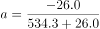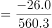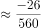，2016年全国棉花播种面积的同比增速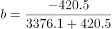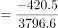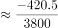。代入平均数的增长率计算公式：，2016年全国棉花单位面积产量的同比增速为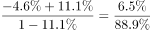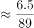，与D项最接近。

方法二：根据公式：单位面积产量，2016年全国棉花单位面积产量为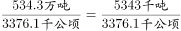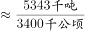吨/公顷，2015年全国棉花单位面积产量为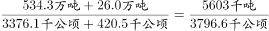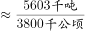吨/公顷。根据公式：增长率，2016年全国棉花单位面积产量同比增速为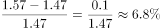，与D项最接近。

故正确答案为D。

### 给定材料

        2016年，全国棉花产量534.3万吨，比2015年减产26.0万吨。

        播种面积减少是2016年我国棉花产量减少的主要原因。继2014、2015年后，2016年棉花播种面积继续减少。2016年全国棉花播种面积为3376.1千公顷，比2015年减少420.5千公顷。分地区看，新疆棉花播种面积比2015年减少99.1千公顷，下降约5.2%；其他省棉花播种面积减少321.3千公顷，下降约17%。

        从棉区看，黄河、长江流域棉区延续2015年减产较多的趋势。其中，黄河流域棉花播种面积减少147.8千公顷，下降约14.3%；单产每公顷增加63.3公斤，提高约6.0%；产量减少10.0万吨，下降约9.2%。长江流域棉花播种面积减少160.7千公顷，下降约19.8%；单产每公顷减少68.3公斤，下降约5.9%；产量减少23.0万吨，下降约24.6%。

        尽管我国最大的产棉区新疆棉花播种面积减少，但由于每公顷单产增加151.5公斤，棉花产量仍达到359.4万吨，比上年增加9.1万吨，增长约2.6%。新疆棉花产量占全国的比重进一步扩大到约67.3%，比上年提高约4.8个百分点。

