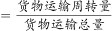
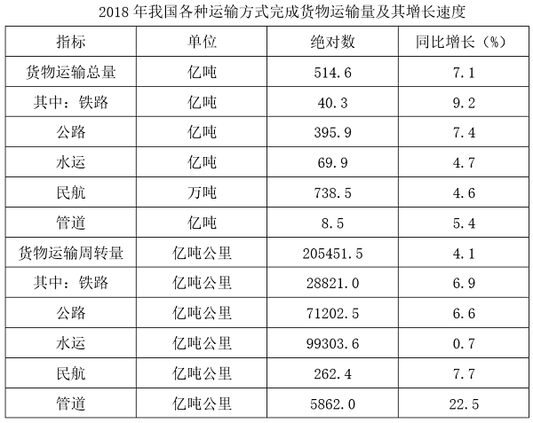

# 两期平均数比较（平均数升降判断）

考点：[[20-考点/资料分析/平均数/两期平均数比较（平均数升降判断）|平均数 / 两期平均数比较（平均数升降判断）]]
材料：[[15-材料/资料分析/308416 2018年我国各种运输方式（铁路-公|308416 2018年我国各种运输方式（铁路-公]]

**问法模型**：题干问'2018年平均运输距离高于2017年水平的是哪几种' → 两期平均数比较模型：平均数=分子(周转量)÷分母(总量)，分子增速＞分母增速则2018年高于2017年，逐项比增速即可，无需算具体数值

## 推理链
1. 第1步：题干给出定义'平均运输距离=货物运输周转量÷货物运输总量'，分子为周转量、分母为总量，是典型的两期平均数结构
2. 第2步：从表格两个数据块按同行配对提取增速——铁路：周转量+6.9%、总量+9.2%；公路：周转量+6.6%、总量+7.4%；水运：周转量+0.7%、总量+4.7%；民航：周转量+7.7%、总量+4.6%
3. 第3步：应用两期平均结论'分子增速＞分母增速→平均数上升'，逐一比较：铁路6.9%＜9.2%下降，公路6.6%＜7.4%下降，水运0.7%＜4.7%下降，民航7.7%＞4.6%上升
4. 第4步：四种方式中仅④民航的平均运输距离2018年高于2017年，对照选项'仅④'为D，与官方答案一致

**最快解法**：⚡ 结论法（分子增速＞分母增速→平均数上升）：完全不计算，直接在表格中给每种方式的周转量增速与总量增速画'>或<'号，四个配对中只有民航7.7%＞4.6%，秒选D；全程不超过30秒

## 易错点
- ⚠ 跨行串数据：周转量与总量分属表格两个数据块，必须同方式同行配对，若把铁路周转量6.9%错配公路总量7.4%等会得出错误结论
- ⚠ 死算陷阱：试图先还原2017年基期再算两年平均距离（如民航需262.4÷(1+7.7%)与738.5万吨÷(1+4.6%)，且万吨须换算成亿吨÷10000才能与周转量口径匹配），既慢又易踩'民航单位是万吨'的单位陷阱
- ⚠ 方向搞反：记反结论误认为'分母增速大→平均数上升'，会把铁路/公路/水运误判为上升而错选A或C

## 母题抽象
> 🧩 当题干出现'A=B÷C的平均数，判断现期高于/低于基期'的特征时，用两期平均结论'分子增速＞分母增速→平均数上升'，只逐项比较分子分母增速大小即可定向，绝不动手算平均数

**同类特征**：平均运输距离=周转量÷总量、2018年……高于2017年水平、在①②③④几种方式中、仅……、表格中已给出各项同比增速

## 相关题
（暂无）

---

### 题干
已知货物平均运输距离（公里）=货物运输周转量÷货物运输总量。在①铁路、②公路、③水运和④民航四种运输方式中，2018年我国货物平均运输距离高于2017年水平的是：

### 选项
- A. 仅①和②
- B. 仅③和④
- C. 仅①、②和③
- D. 仅④　✅

### 官方解析

由题干“2018年······平均运输距离高于2017年水平的是”，可判定本题为两期平均数的比较问题。货物平均运输距离（公里）。根据两期平均数结论：分子增速大于分母增速，则平均数相比去年上升。定位表格，四种运输方式中，只有民航货物运输周转量增速（7.7%）＞民航货物运输总量增速（4.6%），2018年我国货物平均运输距离高于2017年水平的只有民航。

故正确答案为D。

### 给定材料

        2018年我国全年规模以上港口完成货物吞吐量133亿吨，同比增长2.7%，其中外贸货物吞吐量42亿吨，同比增长2.0%。规模以上港口集装箱吞吐量24955万标准箱，同比增长5.2%。

