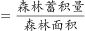

# 现期平均数（单位蓄积量：总量÷面积）

考点：[[20-考点/资料分析/平均数/现期平均数（单位蓄积量：总量÷面积）|平均数 / 现期平均数（单位蓄积量：总量÷面积）]]
材料：[[15-材料/资料分析/308752 以'双碳'为背景介绍我国森林资源状况|308752 以'双碳'为背景介绍我国森林资源状况]]

**问法模型**：题干出现'平均每公顷森林蓄积量……立方米'→ 现期平均数模型：平均数=森林蓄积量（总量）÷森林面积（份数），直接取'十三五'期末现期值相除，单位'亿'约掉后即得立方米/公顷

## 推理链
1. 第1步：题干关键词'平均每公顷森林蓄积量'且无基期字样，判定为现期平均数，所求单位为立方米/公顷
2. 第2步：从文字段提取两个'十三五'期末现期值：森林蓄积量175.6亿立方米、森林面积2.2亿公顷（材料已注明1公顷=15亩，但此处面积已以公顷计，无需换算）
3. 第3步：代入公式：平均每公顷蓄积量=175.6亿立方米÷2.2亿公顷，分子分母'亿'同时约掉，等价于175.6÷2.2
4. 第4步：计算175.6÷2.2=79.818…≈79.8立方米/公顷
5. 第5步：与选项对照：A.5.3（误用图1第9次清查的33.07亿亩不换算所得）、B.32.2（误用累计造林5.45亿亩）、C.79.8、D.98.6，仅C与计算结果吻合，故选C

**最快解法**：⚡ 截位直除+口算验证：175.6÷2.2 即 1756÷22，因22×80=1760略大于1756，故商略小于80、约79.8，直接锁定C；全程只需一次除法，量级'亿'相互约掉，无需任何单位换算

## 易错点
- ⚠ 量纲陷阱：误用图1第9次清查的森林面积33.07亿亩且不做'÷15'换算，得175.6÷33.07≈5.3，恰好落入选项A（33.07亿亩÷15≈2.2亿公顷才是同一指标）
- ⚠ 指标混淆：'十三五'累计造林5.45亿亩是五年累计值而非期末森林面积，误用其作分母得175.6÷5.45≈32.2，恰好落入选项B
- ⚠ 量级心理障碍：分子分母均为'亿'级，商只有几十，勿因看到'亿'就怀疑量级而错选；且勿把'累计值'与'期末现期值'混算

## 母题抽象
> 🧩 当题干出现'平均每公顷/平均每人/平均每……达到多少'且时间与材料现期一致时，直接用总量÷份数（现期平均数公式），先核对分子分母单位是否需换算（亩↔公顷×/÷15），同量级'亿'自动约掉，再截位直除与选项对照

**同类特征**：平均每公顷、森林蓄积量、'十三五'期间/时期、现期平均数、总量÷面积、立方米/公顷

## 相关题
- [[10-真题/资料分析/平均数/4004822 现期平均数计算（单产）与千公顷-万吨单位换算|4004822]]（新疆 2021，相关度2）
- [[10-真题/资料分析/平均数/13319360 现期平均数（总量÷份数）|13319360]]（江苏 2025，相关度1）
- [[10-真题/资料分析/平均数/13504650 现期平均数计算与多期排序比较|13504650]]（辽宁 2025，相关度1）
- [[10-真题/资料分析/平均数/18385424 现期平均数计算与比较（单价-均价=总额÷数量，跨双轴图取数）|18385424]]（浙江 2024，相关度1）
- [[10-真题/资料分析/平均数/18643712 现期平均数计算（累计值求月均）|18643712]]（天津 2026，相关度1）

---

### 题干
“十三五”期间，我国平均每公顷森林蓄积量达到（    ）立方米。

### 选项
- A. 5.3
- B. 32.2
- C. 79.8　✅
- D. 98.6

### 官方解析

根据题干“‘十三五’期间······平均每公顷森林蓄积量······立方米”，可判定本题为现期平均数问题。定位文字材料可得：“十三五”时期······森林蓄积量为175.6亿立方米，森林面积达到2.2亿公顷（1公顷为15亩）。所求平均数立方米/公顷。

故正确答案为C。

### 给定材料

        增加森林面积、提高森林质量、提升生态系统碳汇增量，将为我国实现碳达峰、碳中和目标、维护全球生态安全做出巨大贡献。1973年，我国开展了第一次森林资源清查。目前已完成第9次森林资源清查，我国森林面积和森林蓄积量连续30年保持“双增长”。“十三五”时期，我国累计造林5.45亿亩，森林覆盖率达到23.04%，森林蓄积量为175.6亿立方米，森林面积达到2.2亿公顷（1公顷为15亩）。湿地保护率达到52%，治理沙化土地1.5亿亩。

