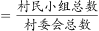
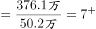

# 现期平均数（平均每个村委会下辖村民小组个数）

考点：[[20-考点/资料分析/平均数/现期平均数（平均每个村委会下辖村民小组个数）|平均数 / 现期平均数（平均每个村委会下辖村民小组个数）]]
材料：[[15-材料/资料分析/308754 2015—2020年全国基层群众性自|308754 2015—2020年全国基层群众性自]]

**问法模型**：题干出现'平均每个A（村委会）下辖/拥有B（村民小组）约多少个' → 现期平均数模型：B的总量÷A的个数

## 推理链
1. 第1步：从题干提取现期时间'2020年'与模型要求'平均每个村委会下辖的村民小组个数'，即村民小组总数÷村委会个数
2. 第2步：定位文字第二段提取两个同口径（万个）数据：村委会50.2万个、村民小组376.1万个
3. 第3步：排除干扰数据——'村委会成员207.3万人'是人数（万人）而非个数（万个），'居民小组123.6万个'属居委会口径，均不进入计算
4. 第4步：代入公式 376.1÷50.2，因50.2×7.5=376.5≈376.1，得商≈7.49
5. 第5步：与选项对照：3.5/5.5/7.5/9.5中仅7.5匹配，选C

**最快解法**：⚡ 放缩验证（公式法变体）：376.1÷50.2，先口算50.2×7.5=376.5与376.1几乎相等，直接锁定7.5，无需完整直除；亦可截位直除376÷50.2≈7.5

## 易错点
- ⚠ 口径陷阱：把'村委会成员207.3万人'当个数代入，得207.3÷50.2≈4.1，接近A(3.5)而误选；成员是'人'，村民小组是'个'，万个/万人量级并存必须分清
- ⚠ 分子分母放反：误算50.2÷376.1≈0.13个，量级不符即可自我纠错
- ⚠ 口径串位：误将居委会'居民小组123.6万个'或'居委会11.3万个'混入计算，材料导读已提示第4题平均数模型必须锁定村委会与村民小组这对指标

## 母题抽象
> 🧩 当题干出现'平均每个（组织）下辖/拥有（成员/单元）多少个'时，用'单元总量÷组织个数'的现期平均数模型，分子取目标单元总数、分母取组织个数，用分母×选项做放缩反推验证量级与数值

**同类特征**：平均每个村委会、下辖村民小组、现期平均数、约（　）个、文字段第二段取数、万个÷万个

## 相关题
- [[10-真题/资料分析/平均数/13319360 现期平均数（总量÷份数）|13319360]]（江苏 2025，相关度1）
- [[10-真题/资料分析/平均数/13504650 现期平均数计算与多期排序比较|13504650]]（辽宁 2025，相关度1）
- [[10-真题/资料分析/平均数/18385424 现期平均数计算与比较（单价-均价=总额÷数量，跨双轴图取数）|18385424]]（浙江 2024，相关度1）
- [[10-真题/资料分析/平均数/18643712 现期平均数计算（累计值求月均）|18643712]]（天津 2026，相关度1）
- [[10-真题/资料分析/平均数/18643737 现期平均数比较（平均每船次进口量与固定值8万吨比较计数）|18643737]]（天津 2026，相关度1）

---

### 题干
2020年，平均每个村委会下辖的村民小组约（    ）个。

### 选项
- A. 3.5
- B. 5.5
- C. 7.5　✅
- D. 9.5

### 官方解析

根据题干“2020年，平均每个······约······”，可判定本题为现期平均数问题。定位文字材料第二段可得：截止2020年底，全国村委会50.2万个；村民小组376.1万个。则2020年平均每个村委会下辖的村民小组数量个。

故正确答案为C。

### 给定材料

        基层群众性自治组织是我国在城市和农村按居民的居住地区建立起来的居民委员会或村民委员会，是城市居民或农村村民自我管理、自我教育、自我服务的组织。

        截止2020年底，全国基层群众性自治组织共计61.5万个，同比减少4.35%。其中，村委会50.2万个，占基层群众性自治组织的81.63%，村民小组376.1万个，村委会成员207.3万人；居委会11.3万个，占基层群众性自治组织的18.37%，居民小组123.6万个，居委会成员61.6万人。2016-2020年，我国村（居）委会完成选举数分别为9.7万个、18.2万个、27.6万个、8.8万个、6.1万个，其中，2020年村（居）委会登记选民数为1.1亿人，参与投票人数为0.65亿人。

