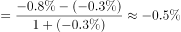

# 平均数增长率（单位面积产量=总产量÷播种面积的同比增速）

考点：[[20-考点/资料分析/平均数/平均数增长率（单位面积产量=总产量÷播种面积的同比增速）|平均数 / 平均数增长率（单位面积产量=总产量÷播种面积的同比增速）]]
材料：[[15-材料/资料分析/310208 国家统计局发布的2016年全国粮食产|310208 国家统计局发布的2016年全国粮食产]]

**问法模型**：题干问'单位面积产量约同比'+选项给增长/减少+% → 识别为平均数（比值）增长率，套用(a-b)/(1+b)，a为总量（产量）增速，b为份数（面积）增速

## 推理链
1. 第1步：单位面积产量=粮食总产量÷粮食播种面积，属平均数；从第1段取2016年总产量比2015年减少0.8%（a=-0.8%），从第2段取播种面积比2015年减少0.3%（b=-0.3%）
2. 第2步：套用平均数增长率公式 r=(a-b)/(1+b)，两者均减少故a、b均取负号
3. 第3步：代入 r=(-0.8%-(-0.3%))/(1-0.3%)=-0.5%/0.997≈-0.5%；若用原始数据（产量减520.1/62144≈-0.84%，面积减314.7/113342.9≈-0.28%）代入得约-0.56%
4. 第4步：结果为负即'减少'，排除A、B；数值约0.5%~0.56%，与C的减少0.56%最接近（D的1.12%约为其两倍），故选C

**最快解法**：⚡ 公式法（平均数增长率）：分子a-b=(-0.8%)-(-0.3%)=-0.5%，符号为负直接锁定'减少'排除A、B；分母1+b≈1，|r|≈0.5%，与0.56%同量级而1.12%明显偏大，选C

## 易错点
- ⚠ 符号陷阱：产量与面积都是'减少'，a、b均为负，分子a-b=(-0.8%)-(-0.3%)=-0.5%仍为负；误算成0.8%-0.3%=+0.5%会错选A（增长）
- ⚠ 分母陷阱：公式是1+b且b=-0.3%，分母为1-0.3%=0.997，粗心写成1+0.3%会使结果略偏但方向判断关键在符号
- ⚠ 口径干扰：玉米/大豆亩产、1-10月受灾面积等是背景信息且为不同口径（1-10月累计、亩/公斤），本题问'粮食'只需总量与总面积两个增速，勿误用谷物数据或灾情数据

## 母题抽象
> 🧩 当题干出现'单位面积产量/人均/平均每…约同比（增长或减少%）'时，判定为平均数增长率，用(a-b)/(1+b)：a、b分别为分子总量与分母份数的同比增速（减少取负、增加取正），结果符号定增减、数值定选项

**同类特征**：单位面积产量、同比、选项为增长/减少+百分数、平均数（比值）增长率、总量与份数增速材料已直接给出、问'约'

## 相关题
- [[10-真题/资料分析/增长/10718183 名义增速与实际增速之差（百分点计算）|10718183]]（深圳市考 2024，相关度1）
- [[10-真题/资料分析/平均数/2188149 现期平均数（单位面积产量）计算+万吨-万亩与斤-亩单位换算|2188149]]（陕西 2018，相关度1）
- [[10-真题/资料分析/平均数/2448544 现期平均数计算——单位面积产量阈值筛选计数|2448544]]（国考 2020，相关度1）
- [[10-真题/资料分析/平均数/4658508 平均数（单产）增长率——两期平均数比较|4658508]]（四川 2021，相关度1）
- [[10-真题/资料分析/平均数/1746800 平均数倍率阈值比较（全国平均单产×80%逐行计数）|1746800]]（国考 2016，相关度1）

---

### 题干
2016年我国粮食单位面积产量约同比：

### 选项
- A. 增长0.56%
- B. 增长1.12%
- C. 减少0.56%　✅
- D. 减少1.12%

### 官方解析

根据题干“2016年······单位面积产量约同比”，结合选项给出增长/减少+%，可判定本题为平均数的增长率问题。定位文字材料第二段可知，2016年全国粮食总产量比2015年减少0.8%（a）；定位文字材料第三段可知，2016年全国粮食播种面积比2015年减少0.3%（b）。根据平均数的增长率公式：，可得：2016年我国粮食单位面积产量同比增长率，即约同比减少0.5%，与C项最接近。

故正确答案为C。

### 给定材料

        2016年全国粮食情况如下：

        全国粮食总产量61623.9万吨（12324.8亿斤），比2015年减少520.1万吨（104.0亿斤），减少0.8%。其中谷物产量56516.5万吨（11303.3亿斤），比2015年减少711.5万吨（142.3亿斤），减少1.2%。

        全国粮食播种面积113028.2千公顷（169542.3万亩），比2015年减少314.7千公顷（472.1万亩），减少0.3%。其中谷物播种面积94370.8千公顷（141556.2万亩），比2015年减少1265.1千公顷（1897.7万亩），减少1.3%。

        对此，国家统计局解读称，2016年粮食产量下降同时受到播种面积减少和单产下降的影响。2016年，全国粮食播种面积比上年减少了472万亩，因播种面积减少而减产34亿斤，占粮食减产总量的33.2%；全国粮食产量因单产下降而减产70亿斤，占粮食减产总量的66.8%。

        粮食单产下降的主要原因：

        一是高产作物面积减少。按可食用的籽粒玉米统计，玉米播种面积5.51亿亩，比上年减少2039万亩，减少3.6%。低产作物大豆播种面积1.08亿亩，比上年增加1046万亩，增长10.7%。2016年，玉米平均亩产398.2公斤，是大豆的3.3倍，仅玉米改种大豆就可拉低粮食亩产约1.7公斤。

        二是全国农业气象灾害较上年偏重，部分地区受灾较重。夏粮、早稻因灾减产。秋粮生长前期，南方多地遭受强降水，湖北、安徽等地受灾较重，部分农田反复受淹，作物倒伏严重。7月下旬至8月中下旬，南方一些地区又遭受持续高温天气，导致水稻空壳率增加；东北、西北部分地区出现不同程度旱情，对玉米后期生产和灌浆不利。据民政部统计，今年1-10月份，全国农作物受灾面积3.97亿亩，比上年同期增加5410万亩；绝收面积6218万亩，增加1719万亩。

