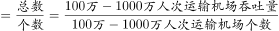
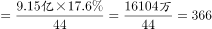

# 现期平均数计算（总量×占比÷个数）

考点：[[20-考点/资料分析/平均数/现期平均数计算（总量×占比÷个数）|平均数 / 现期平均数计算（总量×占比÷个数）]]
材料：[[15-材料/资料分析/310770 2015年全国民航运输机场旅客吞吐量|310770 2015年全国民航运输机场旅客吞吐量]]

**问法模型**：题干问'2015年平均每个100-1000万人次机场吞吐量约多少'→现期平均数模型：全国总量×该类占比÷该类机场个数，再做亿→万单位换算

## 推理链
1. 第1步：从文字材料提取：2015年全国旅客吞吐量9.15亿人次；100-1000万人次运输机场44个，其吞吐量占全国的17.6%（题干时间为2015年，与材料现期一致，为现期平均数）
2. 第2步：所用公式：平均每个机场吞吐量 = 该类机场吞吐量合计 ÷ 机场个数 = 全国总量 × 占比 ÷ 个数
3. 第3步：代入计算分子：9.15亿 × 17.6% = 1.6104亿人次，换算单位为 16104万人次（1亿=10000万）
4. 第4步：除以个数：16104万人次 ÷ 44个 ≈ 366万人次/个
5. 第5步：与选项对照：366万与B项370万最接近（A 470万、C 570万、D 270万偏差均明显更大），故选B

**最快解法**：⚡ 先除后乘+截位直除：9.15÷44≈0.208，0.208×17.6%≈0.0366亿人次=366万人次，首两位'36'直接锁定B（370万）；或百化分 17.6%≈7/40，9.15×7/40÷44≈0.0364亿≈364万，同样选B

## 易错点
- ⚠ 亿与万混用：9.15×17.6%÷44=0.0366是『亿人次』口径，必须×10000换算成366万人次，量级差4位，不换算会在选项数量级上完全错位
- ⚠ 机场个数口径：应使用现期44个，勿被'比上年增加4个'干扰而误用2014年的40个（题干问2015年平均，属现期）
- ⚠ 17.6%是吞吐量占比而非机场个数占比，分子必须是'总量×占比'，不能拿44除以机场总个数或其他比例代替

## 母题抽象
> 🧩 当题干出现'平均每个（某类）主体约多少'且材料给出'总量+该类占比+该类个数'时，用 平均数=总量×占比÷个数，重点核对亿/万单位换算（×10000）后截位直除与选项对照

**同类特征**：平均每个……约多少、100万-1000万人次、运输机场、吞吐量、2015年（与材料现期一致）

## 相关题
- [[10-真题/资料分析/比重/2051444 现期比重计算|2051444]]（新疆 2017，相关度1）

---

### 题干
2015年平均每个吞吐量100万-1000万人次的运输机场吞吐量约多少人次 ？

### 选项
- A. 470 万
- B. 370 万　✅
- C. 570 万
- D. 270 万

### 官方解析

根据题干“2015年平均每个······吞吐量约多少人次”，结合材料时间是2015年，可判定本题为现期平均数问题。定位文字材料可得：“2015年，全国民航运输机场完成旅客吞吐量9.15亿人次······100-1000万人次的运输机场44个，比上年增加4个，吞吐量占全国的17.6%”。根据公式：平均数万人次，与B项最接近。

故正确答案为B。

### 给定材料

        2015年，全国民航运输机场完成旅客吞吐量9.15亿人次，比上年增长10.0%，增速较上年回落了0.4个百分点。西部增长13.5%；中部增长8.5%；东北增长8.2%；东部增长8.8%。全国民航年吞吐量1000万人次以上的运输机场26个，比上年增加2个，吞吐量占全国的77.9%，100-1000万人次的运输机场44个，比上年增加4个，吞吐量占全国的17.6%。2015年，民航基本建设和技术改造投资769.3亿元，比上年增长4.8%。其中：机场系统完成固定资产投资总额656.1亿元，比上年增长17.0%；空管系统完成固定资产投资17.7亿元，比上年减少6.2亿元；民航其他系统完成固定资产投资总额95.5亿元，比上年减少54亿元。

